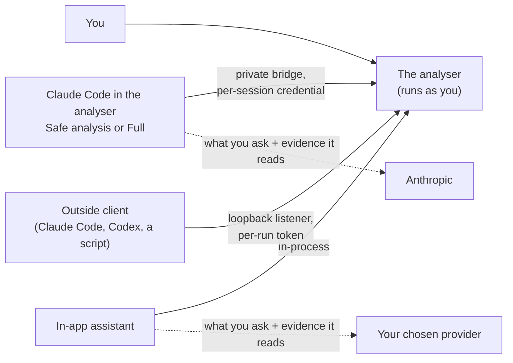

# Security model and limits

!!! warning "Draft for owner review"
    This page gathers the analyser's security model in one place for the first time. Every statement is checked
    against the code, and its central claims are pinned by tests, but the page as a whole has not yet been reviewed
    by the product owner. Treat it as the current best statement, not yet as a signed-off one.

The analyser is a desktop application that runs as you, on your machine. It reads audit logs and shows them. It never
runs your processor or your build, and it never starts or controls a server. Everything below is about the one thing
that can change that picture: an **assistant** that drives the analyser, and what it can reach.

## The parties and the boundaries

| Boundary | What guards it |
|---|---|
| **The loopback listener**, for outside clients and scripts | **Off by default** (*External MCP/REST access*). When on, it is bound to `127.0.0.1` only, so it is not reachable from the network. Every request needs a **per-run** token, minted afresh at each launch and written only to `~/.fluxtion-analyser/rest-endpoint` (mode 600, readable only by you); the console shows its first 8 characters. A request carrying an `Origin` header is rejected, so a web page in your browser cannot drive it. Calls are rate-limited to 10 a second after a burst of 10 ([External access](external-access.md)) |
| **Claude Code's private bridge** | Its own **per-session credential**: a call carrying only the REST token is never treated as Claude Code's. It is served only the verbs on an explicit list, so a verb added in a later release stays refused until it is listed. It has its own rate limit. With external access off, its listener serves only that session, refuses every outside client and publishes no endpoint file |
| **Folder trust**, for Claude Code in the analyser | Each folder is confirmed once on this machine before Start. Full Claude Code confirms the folder separately, because Start runs the folder's hooks and connects its MCP servers ([Approvals and their limits](#approvals-and-their-limits)) |
| **The model provider** | Only the assistant you choose sends anything, and only what you ask and the evidence it reads ([Not local-only](#not-local-only)) |
| **Files you are sent** | An evidence bundle is verified before it is opened, and opens as a disposable working copy; Claude Code is refused in it. A project profile carries pointers, never instructions. No assistant switch is read from a project or a bundle ([one exception](#what-is-stored-where)) |
| **Log-source plugins** | A plugin is a jar you install yourself: **installing a jar is arbitrary code execution**. Nothing is bundled or downloaded, and without plugins this application is byte-identical to a plain build. A plugin can only ever be a log *reader*: it **cannot add verbs** to the action socket, so the verb list below stays complete with or without plugins |

## What each profile can and cannot do

You choose how the assistant works with **Assistant: … ▾** in the assistant panel ([Assistant profiles](profiles.md)).
An outside client is separate: it depends only on *External MCP/REST access*.

| | Runs on this machine | Reads | Changes in the analyser | Writes files through the analyser |
|---|---|---|---|---|
| **Safe analysis** (the default) | your own installed `claude`, with Read, Grep and Glob confined to the folder | the folder, and the evidence through the analyser's verbs | views at once; what is open only after you approve each call | only after you approve each call, and only with file exchange on |
| **Full Claude Code** | your own Claude Code, with **your tools, including Bash**, under your rules and the mode you chose | what your tools can read | the same verbs, asked in the modes that ask | the same, plus whatever your own tools write |
| **In-app assistant** | nothing: it is a chat with your provider | the evidence through the analyser's verbs | views and what is open, without asking, while *Let the in-app assistant change the views as it answers* is on | only with file exchange on |
| **Off** | nothing | nothing | nothing | nothing |
| **An outside client** | what that client runs itself, under its own rules | the evidence through the analyser's verbs | every verb; your client asks first only if its settings say so | only with file exchange on |

## What an assistant can do through the analyser

Every assistant reaches the analyser through the same verbs ([Verbs](../reference/verbs.md)), and nothing more. Out of
the box an agent can compute, filter, graph, flag and read records, and `source` can reread the XML and Java files
**under the source roots you configured** (to show a declaration): no other file reads, and no file writes. Most view
changes can be reversed: a filter widened, a chart closed, a flag cleared. Two cannot. Deleting a saved chart's
definition with `graph {delete}` cannot be undone, and it is not marked destructive for outside clients, so a client
is not prompted to ask you first; Claude Code in the analyser **cannot delete a chart**. And a new `note` or `fix` on a
flag replaces the old text.

These groups go further, and are labelled as such:

- **File exchange is off by default.** *Allow assistant file exchange* (Settings ▸ Assistant) lets `screenshot` and
  `report` write **only inside the exchange directory you choose**, never over an existing file, and lets the `graph`
  verb's external series **read only from that same directory**: one opt-in, one directory, both directions. A file
  you pick in a chooser yourself is readable for that session: the chooser is the grant. `walk {reel}`, which writes a
  walk as an HTML page, and `report {bundle}`, which captures an evidence bundle, are the same kind of write.
- **`open` and `source_root` change which log, event processor or source roots are open**, the same things you change
  through the menus. Still nothing outside the analyser: no shell, no arbitrary file reads, and your API key is never
  reachable.
- **`walk` edits the project's saved spotlight walks**: it can save one, replace one by name, rename one, or move one
  to the recently deleted list, from which it can be restored. Its one file write is `walk {reel}`, as above.
- **`import` borrows an evidence bundle's saved state** into the project you have: its charts and named focuses, its
  reports and walks, and column choices. With only a bundle path it previews and changes nothing; it applies only the
  categories it names. A bundle's source roots and Maven repos are removed at capture, so it can never point your
  analyser somewhere new. Reports carry prose the sender wrote, so they are applied only when named.
- **Creating a project, `open {project, create}`, is off by default for an assistant.** *Allow the assistant to create
  projects* (Settings ▸ Assistant) lets an agent, over MCP/REST or the in-app assistant, create a project in a
  directory it names; you using *Project ▸ New project…* are never gated by it. The switch is this machine's only: it is
  never in a project profile, a shared settings file or an evidence bundle. The preview, `create: true`, writes nothing;
  it reads the chosen directory as *New project…* does: skills to depth 7, GraphML to depth 12, each file at most
  32 MB, all under the chosen directory. An apply writes exactly these, and never over an existing project:
  1. `<dir>/.analyser/` (only if absent) and `<dir>/.analyser/project.fluxtion-settings`, created new;
  2. `<dir>/CLAUDE.md`, only if the reference guide was chosen and offered, never over an existing one;
  3. the outgoing project's pending edits, to its own profile, as any project switch does;
  4. this machine's config: the active project and the recent-projects list, so the created project is the one
     activated at the next start;
  5. the session-recovery journal entry for the new session.

  An assistant is refused inside an evidence bundle's working copy, inside the exchange directory, inside an
  existing project, and through a symbolic-link `.analyser`.
- **`propose` is offered only to Claude Code in the Assistant tab**: never on `/manifest`, never to an outside MCP or
  REST client and never to the in-app assistant. It records an offer of up to ten set-up items and **changes
  nothing**; you answer each item, every answer starts at No, an item outside the chosen folder can never be applied,
  and only *Apply chosen* acts ([Set up a project with Claude](../build/set-up-with-claude.md)).

The six verbs that replace what is loaded or write files, `open`, `source_root`, `screenshot`, `report`, `walk` and
`import`, are marked destructive to MCP clients, so your client can ask you before each call.

## Approvals and their limits

**Claude Code in the Assistant tab is off by default.** **Assistant: … ▾** (it names the profile in force, such as
*Assistant: Safe analysis ▾*) opens the cards that turn it on in one step. *Allow the analyser to start Claude Code*
(Settings ▸ Assistant) lets the tab's **Start** button run **your own installed `claude`**, logged in as you; the
analyser never reads or stores your Claude Code credentials. Start contacts Anthropic (the sign-in check and the
bridge connection) **before your first Send**; no record content is sent until you press Send. Start is always the
explicit button: opening the tab starts nothing, and a bundle's working copy is refused. Claude Code does not need External
MCP/REST access on: with it off, its private listener refuses every external client, even one holding the REST token.

**Safe analysis** gives Claude Code the folder's `CLAUDE.md`, **Read, Grep and Glob confined to the folder**, and the
verbs: **no Bash**, no file edits, no web, none of your skills, hooks, settings or MCP servers. The verbs that change
what is open or write files are visible to it, but **before Claude Code runs any of these verbs the analyser asks you**
([Approvals](../inapp/approvals.md)):

- **Deny is the default.** Enter, Escape and closing the dialog deny; unanswered for 120 s, the call is denied.
- **An approval covers one call.** The analyser itself refuses the call unless your *Allow once* for exactly that call
  (that verb, that input, that turn) is waiting, and uses it at most once within 60 s. There is no "always allow" and no
  "allow for this turn".
- Three refinements keep the questions to the ones that matter: a call that changes nothing stored (playing or ending
  a walk, listing deleted reports or walks) is allowed without a dialog; a file write the settings would refuse is
  refused at once with the reason; a second request waits for the open dialog, and is denied if its turn ends first.

**Full Claude Code is a separate switch with its own warning** (*…with my full Claude Code permissions*, off). It runs
your own Claude Code as in a terminal, with **your settings, skills, hooks and MCP servers**, and **the folder's hooks
and MCP servers run when you press Start**, before you send anything. So the folder is confirmed for full Claude Code
separately, naming the hooks and servers found, and the analyser **asks again if those files change**
(`.claude/settings.json`, `.claude/settings.local.json`, `.mcp.json`, and the instruction files `CLAUDE.md`,
`.claude/CLAUDE.md`, `.claude/commands`, `.claude/skills`, `.claude/agents`). Claude Code can then use **your own
tools, including Bash**, file edits and web access, **as far as your permission rules and the mode you chose allow**
(`default`, `acceptEdits`, `auto` or `plan`; **bypassPermissions is never offered**, nor `dontAsk`), and the analyser
does not confine it to the folder. Only the Start button starts full Claude Code.

The limits the analyser states rather than hides:

- **Not re-checked:** files a `CLAUDE.md` imports with `@path`, `CLAUDE.md` files in the folders above, and the contents
  of the scripts a hook runs. Claude Code reads or runs them, and a change to them does not ask again; the dialog says
  so.
- **A call your own rules or hooks approve is not asked in the analyser**, nor one that the `auto` mode's classifier
  allows. For the analyser's own verbs the analyser still refuses it without your approval in its dialog; for your own
  tools, nothing in the analyser can ask.
- **Full Claude Code can read the analyser's REST token**, which lives in a file in your home folder, as for any outside
  client. With external access on, its own tools could then drive the analyser as an outside client, including the
  destructive verbs. The panel offers **Close external access while this session runs** for that reason
  ([External access](external-access.md#closing-it-for-one-claude-code-session)).
- Record text written to steer an AI reaches an agent that may have your shell. Turn Full Claude Code on only for
  folders and logs you trust.

**The in-app assistant has no approval dialog.** Its actions run at once, within the switches: *Let the in-app
assistant change the views as it answers* (on by default; off, none of its actions run), file exchange, and project
creation. **An outside client** is asked only by its own approval settings: the analyser marks the six destructive
tools, and the client decides.

## Not local-only

**No assistant profile is local-only, Safe analysis included.** What you ask, and the evidence Claude reads through
the analyser, is sent to the model provider (Anthropic, on your Claude plan or API key), as in any Claude Code
session. The in-app assistant sends what you ask, and the evidence it reads, to the model provider you chose, on your
API key. *Safe* describes what Claude Code may do on this machine, not where your words go. With the assistant **Off**,
and External MCP/REST access off, nothing in the analyser sends your evidence anywhere. What else can leave the machine
is on [What is stored where, what leaves](data.md).

## What is stored where

Settings are in your own `~/.fluxtion-analyser/config`, in cleartext, including the in-app assistant's API key; this is
a single-user tool. **Every switch is per user**: *Allow the analyser to start Claude Code*, Full Claude Code,
External MCP/REST access, file exchange and project creation live in each user's own config, and any user can turn
them on for themselves. The switches and the confirmed folders are never in a project profile or an evidence bundle.

One exception: a **shared settings file** exported with its *Assistant* category (ticked by default) carries External
MCP/REST access and the in-app assistant's view switch, and importing it applies them
([Projects, profiles and sharing](../user-guide/projects.md#what-is-kept-where)). [What is stored where, what
leaves](data.md) lists every file.

**There is no central administrator lock yet.** An organisation cannot today forbid Full Claude Code for everyone from
one place. A managed policy that can is planned and not built ([Managed policy](managed-policy.md)).

## The closed-world limit

Every guarantee on this page is about the analyser's own surface: its verbs, its listener, its bridge and the files it
writes. Outside that surface the analyser sees nothing and controls nothing:

- what an assistant's **own tools** do: Full Claude Code's Bash and edits, an outside client's own tools;
- what a **model provider** does with what it is sent;
- what your own Claude Code **permission rules, hooks and settings** allow;
- what a **plugin** jar does once installed;
- anything the **audit log does not record**: the analyser reports what the log says, and a node that wrote nothing is
  never reported as not having run.

A boundary the analyser does not own is stated as such, so that a guarantee is not read as wider than it is.
