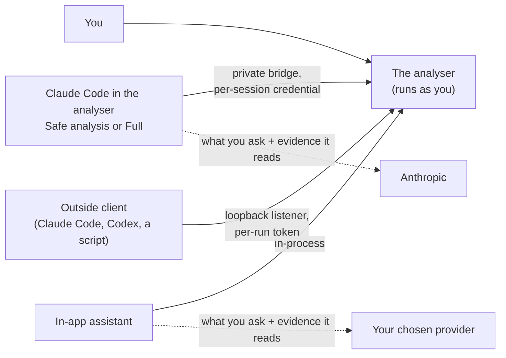

# Security model and limits

!!! warning "Draft for owner review"
    This page gathers the analyser's security model in one place for the first time. Every statement is checked
    against the code, and its central claims are pinned by tests, but the page as a whole has not yet been reviewed
    by the product owner. Treat it as the current best statement, not yet as a signed-off one.

The analyser is a desktop application that runs as you, on your machine. It reads audit logs and shows them. It never
runs your processor or your build, and it never starts or controls a server. Everything below is about the one thing
that can change that picture: an **assistant** that drives the analyser, and what it can reach.

## The parties and the boundaries

| Boundary | What guards it |
|---|---|
| **The loopback listener**, for outside clients and scripts | **Off by default** (*External MCP/REST access*). When on, it is bound to `127.0.0.1` only, so it is not reachable from the network. Every request needs a **per-run** token, minted afresh at each launch and written only to `~/.fluxtion-analyser/rest-endpoint` (mode 600, readable only by you); the console shows its first 8 characters. A request carrying an `Origin` header is rejected, so a web page in your browser cannot drive it. Calls are rate-limited to 10 a second after a burst of 10 ([External access](external-access.md)) |
| **Claude Code's private bridge** | Its own **per-session credential**: a call carrying only the REST token is never treated as Claude Code's, and the per-session file the bridge reads carries only that session's credential, not the REST token. It is served only the verbs on an explicit list, so a verb added in a later release stays refused until it is listed. It has its own rate limit. With external access off, its listener serves only that session, refuses every outside client and publishes no endpoint file |
| **Folder trust**, for Claude Code in the analyser | Each folder is confirmed once on this machine before Start. Full Claude Code confirms the folder separately, because Start runs the folder's hooks and connects its MCP servers ([Approvals and their limits](#approvals-and-their-limits)) |
| **The model provider** | Only the assistant you choose sends anything, and only what you ask and the evidence it reads ([Not local-only](#not-local-only)) |
| **Files you are sent** | An evidence bundle is verified before it is opened, and opens as a disposable working copy. Claude Code is never started in that folder: with a bundle open it works in an empty scratch folder and reads the evidence only through the verbs. A project profile carries pointers, never instructions. No assistant switch is read from a project, a shared settings file or a bundle |
| **Log-source plugins** | A plugin is a jar you install yourself: **installing a jar is arbitrary code execution**. Nothing is bundled or downloaded. With no plugin installed, no plugin code runs; without plugins this application is byte-identical to a plain build. A plugin can only ever be a log *reader*: it **cannot add verbs** to the action socket, so the verb list below stays complete with or without plugins |

## What each profile can and cannot do

You choose how the assistant works with **Set up AI…**, and change it later with the mode chip's quick switch in the
assistant panel (**Safe ▾**, **◆ Full ▾** …; [Assistant profiles](profiles.md)).
An outside client is separate: it depends only on *External MCP/REST access*.

| | Runs on this machine | Reads | Changes in the analyser | Writes files through the analyser |
|---|---|---|---|---|
| **Safe analysis** (the default) | your own installed `claude`, with Read, Grep and Glob confined to the folder | the folder, and the evidence through the analyser's verbs | views at once; what is open, and deleting or replacing a saved chart, only after you approve each call | only after you approve each call, and only with file exchange on |
| **Full Claude Code** | your own Claude Code, with **your tools, including Bash**, under your rules and the mode you chose | what your tools can read | the same verbs: asked in `default` and `acceptEdits`, hidden under `auto` and `plan` | the same, plus whatever your own tools write |
| **In-app assistant** | nothing: it is a chat with your provider | the evidence through the analyser's verbs | views and what is open, without asking, while *Let the in-app assistant change the views as it answers* is on | only with file exchange on |
| **Off** | nothing | nothing | nothing | nothing |
| **An outside client** | what that client runs itself, under its own rules | the evidence through the analyser's verbs | every verb except `propose`; your client asks first only if its settings say so | only with file exchange on |

## What an assistant can do through the analyser

Every assistant reaches the analyser through the same verbs ([Verbs](../reference/verbs.md)), and nothing more. Out of
the box an agent can compute, filter, graph, flag and read records, and `source` can reread the XML and Java files
**under the source roots** (to show a declaration). A source root can be any folder you can read except your home
folder and your credential folders, and `source_root` lets an assistant add one (see below), so this reaches the
`.xml` and `.java` files beneath any such folder. There are no file writes outside file exchange, below. View changes
can be reversed: a filter widened, a chart closed, a flag cleared. **A deleted chart can be restored**: `graph
{delete}`, and a call that replaces a saved chart's definition (re-sent notes, series, guides or bands; `clearNotes`),
keep the previous definition in this machine's chart bin, whoever made the call, and `graph {restore}` or *More →
Restore deleted chart…* brings it back. `graph` is not marked destructive for outside clients, so a client is not
prompted to ask you first; Claude Code in the analyser **asks you before it deletes or replaces a chart**. One change
cannot be undone: a new `note` or `fix` on a flag replaces the old text.

These groups go further, and are labelled as such:

- **File exchange is off by default.** *Allow assistant file exchange* (Settings ▸ Assistant) lets `screenshot` and
  `report` write **only inside the exchange directory you choose**, never over an existing file, and lets the `graph`
  verb's external series **read only from that same directory**: one opt-in, one directory, both directions. A file
  you pick in a chooser yourself is readable for that session: the chooser is the grant. `walk {reel}`, which writes a
  walk as an HTML page, and `report {bundle}`, which captures an evidence bundle, are the same kind of write.
- **`open` and `source_root` change which log, event processor or source roots are open**, the same things you change
  through the menus. `source_root` can add **any folder you can read except your home folder and your credential
  folders** as a source root, and `source` then reads any `.xml` or `.java` file beneath it. **For every caller** — you,
  an outside client, the in-app assistant and Claude Code — a source root is never your home folder or a folder
  containing it, and never a credential folder (`~/.ssh`, `~/.aws`, `~/.config`, `~/.gnupg`), a folder inside one, or
  one containing one; for `~/.m2` only the folder itself is refused, because it holds `settings.xml`, which can hold
  repository credentials, while `~/.m2/repository` and below stay allowed. Links are resolved first, and the refusal
  says why in plain words. A project profile, a shared settings file, a set-up proposal and a bundle's remembered roots
  cannot carry such a root in either, and one that reached the settings some other way is never read. **An assistant is
  also held to the open project**: the in-app assistant is refused a folder outside it (*"add this folder yourself in
  Settings ▸ Sources"*), and Claude Code's approval dialog for `source_root` says *"outside this project"*, the call
  still yours to allow. Once a root is added, `source` reads beneath it without asking. `open` can open any file you can
  read as a log, and an `s3://` address with your own `aws` credentials. The in-app assistant can do this without a
  dialog. Safe analysis asks you before each `source_root` and `open` call. An outside client asks only if its own
  settings say so (both verbs are marked destructive). There is still no shell and no write outside the exchange
  folder, and your API key is never reachable.
- **`walk` edits the project's saved spotlight walks**: it can save one, replace one by name, rename one, or move one
  to the recently deleted list, from which it can be restored. Its one file write is `walk {reel}`, as above.
- **`import` borrows an evidence bundle's saved state** into the project you have: its charts and named focuses, its
  reports and walks, and column choices. With only a bundle path it previews and changes nothing; it applies only the
  categories it names. A bundle's source roots and Maven repos are removed at capture, so it can never point your
  analyser somewhere new. Reports carry prose the sender wrote, so they are applied only when named.
- **Creating a project, `open {project, create}`, is off by default for an assistant.** *Allow the assistant to create
  projects* (Settings ▸ Assistant) lets an agent, over MCP/REST or the in-app assistant, create a project in a
  directory it names; you using *Project ▸ New project…* are never gated by it. The switch is this machine's only: it is
  never in a project profile, a shared settings file or an evidence bundle. The preview, `create: true`, writes nothing;
  it reads the chosen directory as *New project…* does: skills to depth 7, GraphML to depth 12, each file at most
  32 MB, all under the chosen directory. An apply writes exactly these, and never over an existing project:
  1. `<dir>/.analyser/` (only if absent) and `<dir>/.analyser/project.fluxtion-settings`, created new;
  2. `<dir>/CLAUDE.md`, only if the reference guide was chosen and offered, never over an existing one;
  3. the outgoing project's pending edits, to its own profile, as any project switch does;
  4. this machine's config: the active project and the recent-projects list, so the created project is the one
     activated at the next start;
  5. the session-recovery journal entry for the new session.

  An assistant is refused inside an evidence bundle's working copy, inside the exchange directory, inside an
  existing project, and through a symbolic-link `.analyser`.
- **`propose` is offered only to Claude Code in the Assistant tab**: never on `/manifest`, never to an outside MCP or
  REST client and never to the in-app assistant. It records an offer of up to ten set-up items and **changes
  nothing**; you answer each item, every answer starts at No, an item outside the chosen folder can never be applied,
  and only *Apply chosen* acts ([Set up a project with Claude](../build/set-up-with-claude.md)).

The six verbs that replace what is loaded or write files, `open`, `source_root`, `screenshot`, `report`, `walk` and
`import`, are marked destructive to MCP clients, so your client can ask you before each call.

## Approvals and their limits

**Claude Code in the Assistant tab is off by default.** **Set up AI…** (the AI menu, the start page's AI line, the mode
chip's last row) turns it on after checking that Claude Code is installed, and the mode chip's quick switch (**Safe ▾**,
**◆ Full ▾** …) changes it later in one step; both write the same switches. *Allow the analyser to start Claude Code*
(Settings ▸ Assistant) lets the tab's **Start** button run **your own installed `claude`**, logged in as you; the
analyser never reads or stores your Claude Code credentials. Start contacts Anthropic (the sign-in check and the
bridge connection) **before your first Send**; no record content is sent until you press Send. Start is always the
explicit button: opening the tab starts nothing, and a bundle's working copy is refused as Claude Code's folder (with a bundle open, Claude Code works in an empty scratch folder instead). Claude Code does not need External
MCP/REST access on: with it off, its private listener refuses every external client, even one holding the REST token.

**Safe analysis** gives Claude Code the folder's `CLAUDE.md`, **Read, Grep and Glob confined to the folder**, and the
verbs: **no Bash**, no file edits, no web, none of your skills, hooks, settings or MCP servers. The verbs that change
what is open or write files are visible to it, but **before Claude Code runs any of these verbs the analyser asks you**
([Approvals](../inapp/approvals.md)):

- **Deny is the default.** Enter, Escape and closing the dialog deny; unanswered for 120 s, the call is denied.
- **An approval covers one call.** The analyser itself refuses the call unless your *Allow once* for exactly that call
  (that verb, that input, that turn) is waiting, and uses it at most once within 60 s. There is no "always allow" and no
  "allow for this turn".
- Three refinements keep the questions to the ones that matter: a call that changes nothing stored (playing or ending
  a walk, listing deleted reports or walks) is allowed without a dialog; a file write the settings would refuse is
  refused at once with the reason; a second request waits for the open dialog, and is denied if its turn ends first.
- Under **Full Claude Code only**, an `open` of nothing but a log or GraphML file whose real path (links resolved) is
  **inside the session's project folder** is allowed without a dialog. A project switch or close, Follow, any other
  field and any path outside the folder are still asked, and Safe analysis asks for every `open`. The check is made on
  the real path when the call arrives; a link changed between that check and the open is the residual. While the
  analyser's own **sample project** is the active project, its folder counts too (its session works in a scratch
  folder, so the sample's log and GraphML would otherwise always be asked); an evidence bundle's working copy does not.
- Under **Full Claude Code only**, a `report` call that **writes a new report inside the active project** is allowed
  without a dialog: creating a report no report holds the name of, adding a section to (or otherwise updating) a report
  **this session wrote**, while it still carries what the session left, and a new file — the report's PDF, a
  single-record finding, a CSV — into the exchange folder when its real path (links resolved) is inside the project. It
  never writes over an existing file or a report you made: the analyser re-checks the name on the event thread just
  before it writes, and refuses a report that appeared or changed meanwhile. Permission is bound to the project
  lifetime (switching away and back requires a fresh check), the exact request and the resolved output. Titles,
  notes and sections all belong to the checked revision; the authoring timestamp alone is not an ownership proof.
  The session records the revision actually written, so an intervening human edit cannot become the agent's own.
  A write over your report or an existing
  file, a delete, a rename, a restore, an evidence bundle, any path outside the project, no project open, and **every
  `report` call in Safe analysis or from an external MCP or REST client** are asked or refused as before. The tool line
  reads *allowed: writes a new report inside this project*.
- **A request is approved only with its own input on screen.** A waiting request keeps its input until it is answered
  or withdrawn; if it is ever missing, the dialog says so and keeps *Allow once* disabled, and an allow that still
  arrives is sent to Claude Code as a deny.
- **`graph` is judged call by call**: creating or showing a chart is allowed, while deleting, renaming or restoring a
  chart, or replacing a saved chart's definition, is asked, and the dialog says the old definition can be restored.

**Full Claude Code is a separate switch with its own warning** (*…with my full Claude Code permissions*, off; the
**Full Claude Code** choice in Set up AI and the quick switch's *◆ Full Claude Code…* ask for the same confirmation as
the switch, *Cancel* the default, before anything changes). It runs
your own Claude Code as in a terminal, with **your settings, skills, hooks and MCP servers**, and **the folder's hooks
and MCP servers run when you press Start**, before you send anything. So the folder is confirmed for full Claude Code
separately, naming the hooks and servers found, and the analyser **asks again if those files change**
(`.claude/settings.json`, `.claude/settings.local.json`, `.mcp.json`, and the instruction files `CLAUDE.md`,
`CLAUDE.local.md`, `.claude/CLAUDE.md`, `.claude/commands`, `.claude/skills`, `.claude/agents`, `.claude/rules`,
`.claude/output-styles`, `.claude/hooks`); a session already running when they change is stopped (after the answer in
progress), and Start asks again. The dialog also names the permissions the folder grants itself (allow rules,
additional directories, a default mode). Claude Code can then use **your own
tools, including Bash**, file edits and web access, **as far as your permission rules and the mode you chose allow**
(`default`, `acceptEdits`, `auto` or `plan`; **bypassPermissions is never offered**, nor `dontAsk`), and the analyser
does not confine it to the folder; it adds one standing instruction to the session (work only inside the project
folder, never look for the Fluxtion API key or key files, build with `./mvnw` and the project's scripts): **a request to
the model, not a sandbox**; the folder-trust dialog says the analyser adds it. Only the Start button starts full Claude
Code. **Full may read fluxtion-playground.dev documentation without asking**: its command line carries one fixed rule,
`WebFetch(domain:fluxtion-playground.dev)` — never `WebSearch`, another domain or a network command — and the
analyser's own approvals allow without a dialog only an https fetch of exactly that host; any other fetch is asked.

**The analyser's note to Claude Code** begins every session, in both postures, as fixed text with nothing interpolated:
Claude Code is the assistant inside this app, the analyser's words (project, starter, log, graph, report) mean the
analyser's, and it calls `analyser_context` first. Full's note adds that a new application begins from one of the
analyser's starters, never a web search or a hand-made scaffold, and that nothing is created in the scratch folder. It
is a request to the model, not a sandbox.

**A starter proposed by Claude Code** (`propose {kind: starter}`, hosted-only like the rest of `propose`) changes
nothing until your Apply: Claude names a catalogue id and never a path; you choose the folder in the review, which
starts at No; only then is the starter downloaded, from the configured HTTPS origin, and unpacked with the template
checks. Nothing is built or run. The analyser then writes the project's skills from its own jar, each checked against
its pinned digest and never over an existing file (the playground's design skill and contract are bundled with the publisher's permission (owner, 2026-10-18); the playground's licence statement is pending (UP-PG-10)), and opens the project after one more review. Every row in that review starts at No except the Spring
design folder inside the new project, which is pre-ticked; opening the project still starts at No. The one change to a
pinned file is *add-a-node*'s regeneration placeholder, filled after the pins match from the analyser's own
first-run record for the starter; `.claude/skills/.vendored.json` records both digests. Your
Apply is the consent, so the *Allow the assistant to create projects* switch does not gate this path.

The limits the analyser states rather than hides:

- **Not re-checked:** files a `CLAUDE.md` imports with `@path`, `CLAUDE.md` files in the folders above, the contents
  of the scripts a hook runs from outside `.claude/hooks`, and what an MCP server's command runs (a `./server.js`).
  Claude Code reads or runs them, and a change to them does not ask again; the dialog says so.
- **A call your own rules or hooks approve is not asked in the analyser**, nor one that the `auto` mode's classifier
  allows. For the analyser's own verbs the analyser still refuses it without your approval in its dialog; for your own
  tools, nothing in the analyser can ask.
- **Full Claude Code can read the analyser's REST token**, which lives in a file in your home folder, as for any outside
  client. With external access on, its own tools could then drive the analyser as an outside client, including the
  destructive verbs. The panel offers **Close external access while this session runs** for that reason
  ([External access](external-access.md#closing-it-for-one-claude-code-session)).
- Record text written to steer an AI reaches an agent that may have your shell. Turn Full Claude Code on only for
  folders and logs you trust.

**The in-app assistant has no approval dialog.** Its actions run at once, within the switches: *Let the in-app
assistant change the views as it answers* (on by default; off, none of its actions run), file exchange, and project
creation. What keeps its mistakes recoverable is the bins: a deleted chart, report or walk, and a chart whose
definition a call replaced, can be restored. **An outside client** is asked only by its own approval settings: the analyser marks the six destructive
tools, and the client decides.

## Not local-only

**No assistant profile is local-only, Safe analysis included.** What you ask, and the evidence Claude reads through
the analyser, is sent to the model provider (Anthropic, on your Claude plan or API key), as in any Claude Code
session. The in-app assistant sends what you ask, and the evidence it reads, to the model provider you chose, on your
API key. *Safe* describes what Claude Code may do on this machine, not where your words go. With the assistant **Off**,
and External MCP/REST access off, nothing in the analyser sends your evidence anywhere. What else can leave the machine
is on [What is stored where, what leaves](data.md).

## What is stored where

Settings are in your own `~/.fluxtion-analyser/config`, in cleartext, including the in-app assistant's API key; this is
a single-user tool. **Every switch is per user**: *Allow the analyser to start Claude Code*, Full Claude Code,
External MCP/REST access, file exchange and project creation live in each user's own config, and any user can turn
them on for themselves. The switches and the confirmed folders are never in a project profile, a shared settings file
or an evidence bundle: a shared settings file's *Assistant limits* category carries only the in-app assistant's two
action limits, and an import that finds a switch ignores it and says so
([Projects, profiles and sharing](../user-guide/projects.md#what-is-kept-where)). [What is stored where, what
leaves](data.md) lists every file.

**There is no central administrator lock yet.** An organisation cannot today forbid Full Claude Code for everyone from
one place. A managed policy that can is planned and not built ([Managed policy](managed-policy.md)).

## The closed-world limit: what the analyser cannot see

Every guarantee on this page is about the analyser's own surface: its verbs, its listener, its bridge and the files it
writes. Outside that surface the analyser sees nothing and controls nothing:

- what an assistant's **own tools** do: Full Claude Code's Bash and edits, an outside client's own tools;
- what a **model provider** does with what it is sent;
- what your own Claude Code **permission rules, hooks and settings** allow;
- what a **plugin** jar does once installed;
- anything the **audit log does not record**: silence in the log is reported as silence, never as proof that a node
  did not run.

A boundary the analyser does not own is stated as such, so that a guarantee is not read as wider than it is.
