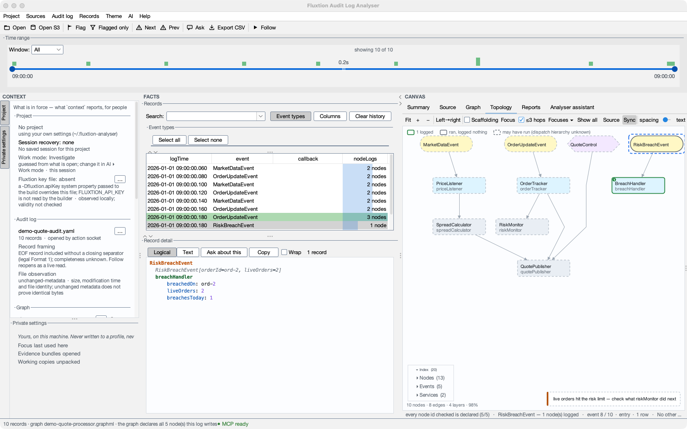

# Site assets

Screenshots, the loop diagram and the downloadable sample log. This page is excluded from the built site
(`exclude_docs` in `mkdocs.yml`).

**Anonymise before committing.** Sample logs and screenshots must contain **no real venue, vendor, book,
thread, logger or account names** — use neutral placeholders (e.g. `DEMO`, `marketMaker-DEMO`,
`com.acme…`). This is a public site.

> ⚠️ **The `grep` sweep in `CLAUDE.md` rule 1 cannot see inside a PNG.** The screenshots shipped with the
> first public release were taken against a real audit log and carried live venue, vendor and project
> names onto this site; the sweep passed the whole time, because it only reads text. Screenshots are
> therefore no longer taken by hand — they are produced by `tools/capture-docs.py`, which drives a real
> analyser **loaded only with the demo fixture**, so an image is anonymous by construction rather than by
> inspection. If you must capture something the harness cannot reach, load the demo fixture first and
> check the title bar, status bar and every visible path before committing.

## Inventory

Generated by `python3 tools/docs_assets_inventory.py` from the pages and the capture scripts: run it after adding,
removing or moving an image. *Used on* names each page by its nav title; **unused** means no page references the file;
*no harness* means no capture script produces it, so it was made by hand or is historical evidence (the
`vendor-topology.png` image is kept unchanged on purpose).

<!-- BEGIN INVENTORY: generated by tools/docs_assets_inventory.py -->

| File | Used on | Produced by |
|---|---|---|
| `ai-menu.png` | Connect your client, Playground to analyser in 10 minutes, Runbooks, glossary and posture | `capture-docs.py` |
| `ai-runbooks-panel.png` | Runbooks, glossary and posture | `capture-docs.py` |
| `ask-menu.png` | Ask the assistant | `M74DocCapture.java`, `capture-docs.py` |
| `assistant-claude-code.png` | The assistant panel | `M74DocCapture.java`, `capture-docs.py` |
| `assistant-in-app.png` | The assistant panel | `M74DocCapture.java`, `capture-docs.py` |
| `assistant-quick-switch.png` | **unused** | `M74DocCapture.java`, `capture-docs.py` |
| `audit-log-menu.png` | Open your own log, step by step | `capture-docs.py` |
| `audit-loop.svg` | Home | no harness |
| `chart-delete-confirmation.png` | Graphs | `ChartDeleteDocCapture.java`, `capture-docs.py` |
| `conv-chart-and-report.png` | Sample conversations | `capture-conversations.py` |
| `conv-deploy-uat.png` | Sample conversations | `capture-conversations.py` |
| `conv-what-happened.png` | Sample conversations | `capture-conversations.py` |
| `conv-why-this-number.png` | Sample conversations | `capture-conversations.py` |
| `conv-will-it-log.png` | Sample conversations | `capture-conversations.py` |
| `flagged-only.png` | Records, detail & filtering | `capture-docs.py` |
| `graph-bands-dark.png` | Graphs | `capture-docs.py` |
| `graph-markers-dark.png` | Graphs | `capture-docs.py` |
| `graph-series-dark.png` | Graphs | `capture-docs.py` |
| `graph-series-light.png` | Playground to analyser in 10 minutes | `capture-docs.py` |
| `graph-step-dark.png` | Graphs | `capture-docs.py` |
| `java-source-spotlight.png` | Source navigation | no harness |
| `journeys/find-the-first-recorded-breach.facts.json` | harness data (read by its producer) | `capture-journey.py` |
| `journeys/find-the-first-recorded-breach.fexp` | Journey: find the first recorded breach | `capture-journey.py` |
| `journeys/journey-assistant-step-1.png` | Journey: find the first recorded breach | `capture-journey.py` |
| `journeys/journey-assistant-step-2.png` | Journey: find the first recorded breach | `capture-journey.py` |
| `journeys/journey-assistant-step-3.png` | Journey: find the first recorded breach | `capture-journey.py` |
| `journeys/journey-assistant-step-4.png` | Journey: find the first recorded breach | `capture-journey.py` |
| `journeys/journey-step-1.png` | Journey: find the first recorded breach | `capture-journey.py` |
| `journeys/journey-step-2.png` | Journey: find the first recorded breach | `capture-journey.py` |
| `journeys/journey-step-3.png` | Journey: find the first recorded breach | `capture-journey.py` |
| `journeys/journey-step-4.png` | Journey: find the first recorded breach | `capture-journey.py` |
| `mcp-claude-code-confirm.png` | Connect your client | `McpSetupDocCapture.java`, `capture-docs.py` |
| `mcp-generic-setup.png` | Connect your client, Playground to analyser in 10 minutes | `McpSetupDocCapture.java`, `capture-docs.py` |
| `permission-dialog.png` | Approvals | `M74DocCapture.java`, `capture-docs.py` |
| `project-panel.png` | The Project panel | `capture-docs.py` |
| `projects-active.png` | Projects, profiles and sharing | `capture-docs.py` |
| `projects-file-menu.png` | Open your own log, step by step, Projects, profiles and sharing | `capture-docs.py` |
| `proposal-review.png` | Set up a project with Claude | `M74DocCapture.java`, `capture-docs.py` |
| `records-overview.png` | Records, detail & filtering | `capture-docs.py` |
| `reports-dark.png` | Investigation reports | `capture-docs.py` |
| `sample-audit-log.yaml` | Build with Claude, Install & run, Log format, Your first diagnosis session | no harness |
| `screenshot-dark.png` | Home | `capture-docs.py` |
| `screenshot-light.png` | **unused** | `capture-docs.py` |
| `settings-assistant.png` | Settings reference | `M74DocCapture.java`, `capture-docs.py` |
| `setup-ai-choice.png` | **unused** | `AiSetupDocCapture.java`, `capture-docs.py` |
| `setup-ai-client.png` | **unused** | `AiSetupDocCapture.java`, `capture-docs.py` |
| `setup-ai-first-run.png` | **unused** | `AiSetupDocCapture.java`, `capture-docs.py` |
| `setup-ai-inside.png` | **unused** | `AiSetupDocCapture.java`, `capture-docs.py` |
| `source-navigation.png` | Source navigation | `capture-docs.py` |
| `sources-menu.png` | Open your own log, step by step | `capture-docs.py` |
| `spotlight-dark.png` | Spotlights, walks and reels | `capture-docs.py` |
| `spotlight-findings-dark.png` | Spotlights, walks and reels | `capture-docs.py` |
| `spotlight-findings-light.png` | Spotlights, walks and reels | `capture-docs.py` |
| `spotlight-walk-dark.png` | **unused** | `capture-docs.py` |
| `spotlight-walk.png` | Spotlights, walks and reels | `capture-docs.py` |
| `spotlight.png` | Guided start with an external assistant, Spotlights, walks and reels | `capture-docs.py` |
| `spring-design.png` | Spring authoring step by step | `capture-spring-authoring.py` |
| `spring-project-landing.png` | Spring authoring step by step | `capture-spring-authoring.py` |
| `spring-starter-preview.png` | Spring authoring step by step | no harness |
| `spring-validation-clean.png` | Spring authoring step by step | `capture-spring-authoring.py` |
| `spring-validation-finding.png` | Spring authoring step by step | `capture-spring-authoring.py` |
| `start-page.png` | Guided start with an external assistant, Guided tour and sample project, Start here, The start page | `capture-docs.py` |
| `start-with-claude-reply.png` | Start with Claude | `OnboardingDocCapture.java` |
| `start-with-claude-setup.png` | Start with Claude | `OnboardingDocCapture.java` |
| `start-with-claude.png` | Start with Claude | `OnboardingDocCapture.java` |
| `template-picker.png` | **unused** | `TemplatePickerDocCapture.java`, `capture-docs.py` |
| `topology-explore.png` | Topology & step-through | `capture-docs.py` |
| `topology-step-through.png` | Topology & step-through | `capture-docs.py` |
| `tutorial-cycle.png` | Playground to analyser in 10 minutes | `capture-docs.py` |
| `tutorial-log-open.png` | Playground to analyser in 10 minutes | `capture-docs.py` |
| `tutorial-new-project-menu.png` | Playground to analyser in 10 minutes | `capture-docs.py` |
| `tutorial-project-open.png` | Playground to analyser in 10 minutes | `capture-docs.py` |
| `tutorial-source.png` | Playground to analyser in 10 minutes | `capture-docs.py` |
| `tutorial-template-picker.png` | Playground to analyser in 10 minutes, Starter templates and examples | `capture-docs.py` |
| `vendor-topology.png` | Integrating a vendor component: a worked example | no harness |

<!-- END INVENTORY -->

### Withdrawn, not yet recaptured

These were removed rather than left published, because each was taken against a real log. The prose on each page
describes what they showed.

| Was | Used on |
|------|---------|
| `assistant-explain.png` | Home, and the old assistant page |
| `record-diff.png` | Records, detail & filtering: diff |
| `adding-to-graph.png` | Graphs: adding series |
| `series-editing.png` | Graphs: the formula and series editor |
| `settings-source-roots.png` | Settings |

## Capturing screenshots

```bash
mvn package                        # the harness drives the built jar
python3 tools/capture-docs.py      # main/demo, chart, project/menu and spotlight shots
python3 tools/capture-docs.py --mcp # regenerates only the isolated MCP setup/dialog shots
mvn -o test-compile && python3 tools/capture-docs.py --m74   # the M74 assistant surfaces (test fixtures, no live claude)
python3 tools/capture-docs.py --tutorial-demo                 # tutorial-cycle / -source from the DEMO fixture
```

The harness launches the analyser on the demo fixture, drives it over its loopback REST endpoint (External MCP/REST access)
(`topology`, `goto`, `flag`, `open`, `screenshot` verbs) and takes a **native** window capture so the
title bar is included. It sets the theme and resets the saved topology view first, so runs are
reproducible rather than depending on whatever state the app was left in.

The MCP dialog pair is different from the main window shots: `tools/McpSetupDocCapture.java` opens the
real Swing setup and confirmation dialogs directly. Before it does, `capture-docs.py` creates neutral
JBang and Claude executables only under `/tmp/analyser-docs`; the confirmation is photographed before
**OK**, so it cannot modify a real client configuration. This is how the visible command remains useful
without publishing a developer's launcher path.

Every capture is taken by **window id** (`screencapture -l`), never as a screen region, under an isolated
`user.home`, with only the DEMO fixture loaded. Capturing by hand is a last resort for a surface the harness cannot
reach: load the demo fixture under an isolated home, capture the one window by its id, and read every visible string
before committing. Reference with a relative path and
real alt text, e.g. from a `user-guide/` page:

```markdown

```

`start-page.png` is captured by closing the log (`open {close: "all"}`), so the shot is the real state, not a mode
built for the camera.

## Capture audit — 2026-10-17 (M74)

Regenerated on `feature/claude-code-p3` for the docs audit's M74 fix list
([audit](../../handoff/docs-audit-2026-10-17.md)): every main-window, menu and spotlight shot (the toolbar's **Ask**,
the record detail's **Ask about this**, the AI menu's *External MCP/REST access*), `start-page.png` (the new start
page), the five `conv-*` shots and the eight journey shots. New, from `tools/M74DocCapture.java` (the test suite's
`FixtureAgent` replaying the P3 capture with DEMO words, and its `FakeProvider`; no live `claude`, no network):
`assistant-in-app.png`, `assistant-claude-code.png`, `assistant-profile-cards.png`, `ask-menu.png`,
`permission-dialog.png`, `proposal-review.png` and `settings-assistant.png`. `tutorial-cycle.png` and
`tutorial-source.png` are now of the DEMO fixture: the bundle's generated processor carried a real person's name in a
Javadoc `@author` line and its events a real equity ticker.

This display is 1920×1080 at 1x, so these images are 1680×1050 (dialogs at their own size), where the previous set was
Retina 2x. Every image was opened and its visible strings read: only DEMO, `com.acme`, `/tmp/analyser-docs/…`,
`~/.fluxtion-analyser`, the demo file names and placeholder plan names appear.

`settings-assistant.png` was regenerated again for the PR #152 review fixes (2026-10-18), with `--m74` under the
isolated home: P3 (`0cafba96`) added the Assistant tab's sentence that a shared settings file carries only the in-app
assistant's two action limits. Its visible strings were read: product text, `/tmp/analyser-docs/exchange` and
`~/.fluxtion-analyser/rest-endpoint` only.

Three capture-path fixes came with it. Menu shots composite the frame and its popup windows, each taken by window id
(`tools/CompositeShot.java`) — since the M74 final-review integration there is no region capture at all, for menus or
windows: a shot that cannot be taken by window id is reported as not captured; the window's top edge is 28 so the whole
window fits a 1080-line screen. Dialog captures moved from `java.awt.Robot` to the window-id protocol of
`tools/DocShot.java` for the M74 and MCP classes, because Robot without the screen-recording grant photographs the DESKTOP and the
harness reported it as success. `tutorial-new-project-menu.png` is no longer ringed on the previous run's image when this
run's Project-menu shot failed.

`mcp-generic-setup.png` and `mcp-claude-code-confirm.png` were regenerated the same way (`McpSetupDocCapture` now uses
`DocShot`). Not regenerated (the harness cannot reach them here): `template-picker.png` and
`tutorial-template-picker.png` (`TemplatePickerDocCapture` still uses Robot, which produced the wallpaper on this
machine, and reads the live catalogue),
`tutorial-project-open.png` and `tutorial-log-open.png` (need the staged bundle, which needs a Fluxtion key), the four
`spring-*` shots, `java-source-spotlight.png`, `chart-delete-confirmation.png`, `vendor-topology.png` and
`spring-starter-preview.png`.

Older capture audits (2026-09-21 to 2026-09-29) are in this file's git history.

## M77-4 — Set up AI and the quick switch (2026-10-18): to regenerate

`assistant-profile-cards.png` is removed: the profile cards are gone (OD-77.3), and no page shows them.
`tools/M74DocCapture.java` now takes `assistant-quick-switch.png` (Assistant ▾ open over the panel) in its place, and
`python3 tools/capture-docs.py --setup-ai` (T20) takes `setup-ai-first-run.png`, `setup-ai-choice.png`,
`setup-ai-inside.png` and `setup-ai-client.png` on a fresh isolated home with no log and no `assistant.rest`, from a
jar copied under the capture root, with a stub `claude`. Neither set is committed yet: the session that wrote M77-4
had no Screen Recording grant, so the harness drove every screen to its state and took no image. Until they are
regenerated, `start-page.png` still shows the retired *Connect an assistant* block and `settings-assistant.png` its
*Connect an AI client…* button. Regenerate with `--start-page`, `--m74` and `--setup-ai`, read every string, and only
then reference the new images from the pages.

The harness now refuses a capture home that is, or runs through, a symbolic link (`require_real_home`,
`DocShot.requireRealHome`): the analyser resolves `user.home` to its real path, and a walk under a symlinked home showed
the account's scratch path in dialogs. On macOS `/tmp` is a link, so the capture root is `/private/tmp/analyser-docs`.
