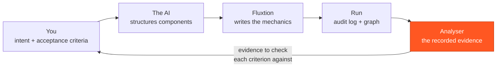
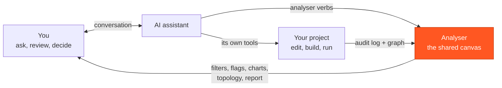

# Build with Claude

Building a Fluxtion application with an AI divides the work four ways:

1. **You state the intent and the acceptance criteria**: what the application is for, and the observable results
   that would show it does that.
2. **The AI structures the components**: the events, the nodes, which node depends on which, and what each one logs.
3. **Fluxtion writes the mechanics**: the dispatch order, change propagation and the audit, generated by its compiler
   rather than written by hand.
4. **You check each criterion against the recorded evidence, for the runs you recorded.** The analyser computes what
   each run did; you, or the AI, read each criterion's answer from it.

The last step is narrow on purpose. Checking shows that your criteria hold, or do not hold, on the runs you recorded.
It does not show that the application does everything you meant, or that your criteria capture everything you meant.
Those judgements stay yours.

## In this section

| Page | What it covers |
|---|---|
| [Set up a project with Claude](set-up-with-claude.md) | Point Claude Code in the analyser at your code's folder. It proposes the set-up, and you answer each item |
| [Check your criteria against the evidence](validate-intent.md) | What exists today to check a criterion on a recorded run, and what is planned |
| [Spring authoring](../spring-authoring.md) | Agree a design in conversation, turn it into a Spring XML project, then inspect the run |
| [Spring authoring step by step](../spring-authoring-getting-started.md) | The same path, illustrated, from download to the first finding |
| [Design and "what if?" conversations](../spring-authoring-conversations.md) | Example dialogues: agreeing the behaviour, then challenging it |
| [Producing an audit log](../producing-a-log.md) | Making your processor write the log the analyser reads |
| [Composing a system from supplier jars](../composing-a-system.md) | Building one processor from components other teams ship |
| [Integrating a vendor component](../integrating-a-vendor-component.md) | A worked example of the same |

## Where to start

On the start page, three entries lead into building. With an assistant, each puts a draft in the assistant's
composer; nothing is sent
until you press Start or Send ([The start page](../user-guide/start-page.md)).

- **Build a new application with me.** Describe what you want in the box and press *Start building*. The analyser
  reads the starter-template catalogue and drafts a request naming the templates. With no AI set up, it offers
  *New project from template…*, *New project…* and *Copy prompt* instead. Claude Code in the analyser then offers a
  starter — Spring first — for you to confirm; you choose the folder, and the analyser downloads it, adds its skills,
  opens the project and its design
  ([Create from a starter with the assistant](../user-guide/projects.md#create-from-a-starter-with-the-assistant)).
- **Teach me by building an example.** Opens the sample DEMO project and drafts a lesson request: explain events,
  triggers and dispatch from the evidence. With no AI it plays the DEMO guided tour.
- **Set up a project from my code.** For code you already have: Claude Code reads the folder and proposes the set-up
  ([Set up a project with Claude](set-up-with-claude.md)). With the in-app assistant, or no AI, it opens
  *New project…*, which offers what it finds and lets you choose.

!!! info "What these entries do today, and what is planned"
    Today these entries draft a request and open what already exists: the starter templates, the new-project dialogs
    and the sample project. Generating, building and running the application is done by the AI with its own tools, or
    by you.

    A fuller authoring journey is **planned and not built**. It would take you from a description to a runnable
    application with an editable input scenario, and then check your acceptance criteria on a run before and after a
    change. [Check your criteria against the evidence](validate-intent.md#planned-acceptance-checks) says what is
    planned.

## Who does what

**Which AI can build.** Building means editing files and running commands, so it needs an assistant with those tools:

- **Full Claude Code in the analyser** is your own Claude Code, with your tools, run inside the analyser. It can edit
  files and run your build, as far as your own permission rules and the mode you choose allow. In the modes that ask
  (`default`, `acceptEdits`), the analyser shows you each request your rules would ask about
  ([Claude Code in the analyser ▸ Full Claude Code](../inapp/claude-code.md#full-claude-code-your-own-claude-code-by-a-second-opt-in)).
  How it differs from Claude Code in a terminal is on that page. If Full Claude Code is already set up in `default`,
  **Start building** offers one line on the Claude Code tab — *Building works best when Claude edits files in this
  project without asking; commands still ask you. Switch?* — **Switch (new chat)** sets the mode to `acceptEdits` and
  restarts Claude Code; **Keep asking** leaves it as it is. Nothing switches unless you press it.
- **Claude Code, Codex or another client in your terminal or IDE** builds with its own tools, and drives the analyser
  over MCP ([Connect your client](../connect-an-llm.md)).
- **Safe analysis**, the default way Claude Code runs in the analyser, reads the evidence and the project's files and
  can propose the analyser's set-up for the project. It cannot edit a file or run a command, so it cannot build.
- **The in-app assistant**, which answers with your own API key, can count and summarise the log, and change the
  views when *Settings ▸ Assistant ▸ Let the in-app assistant change the views as it answers* is on. It cannot read
  your project folder.

[Assistant profiles](../admin/profiles.md) compares the four ways the assistant can work.

**What the analyser itself never does.** It does not edit your Java, run your build or start your application: an
assistant with its own tools does that, or you do. The analyser opens the run's evidence (the audit log, the graph it
was produced from and the source) and shows the same evidence to you and the AI.

Two disciplines keep that evidence honest:

- **The analyser computes; the AI concludes.** Counts, values and coverage come from the log, never from the model.
  An AI's conclusion is a proposal you can check against the records.
- **The analyser says no more than the log supports.** A graph that does not fit the log is reported as not fitting.
  An inferred order is never drawn as cause and effect. A node that logged nothing is not reported as not having run,
  because a node can run and write nothing.

## Why Fluxtion suits an AI author

Fluxtion separates the intent you author from the behaviour its compiler enforces. You author nodes, how they connect
and what each logs. The compiler fixes the dispatch order, so an AI can work one small node at a time, without
holding the whole graph in mind or reasoning about ordering. Compile errors are directive (`use @AssignToField`,
`add @FluxtionIgnore`), so a model can correct itself in a short compile-and-run loop.

- **The compiler.** The ahead-of-time compiler takes the declared graph and emits one total dispatch order: each
  node an event reaches runs at most once for that event, in topological order, so a derived value never reads inputs
  from two different events. The same build writes the audit.
- **The runtime.** [Mongoose](https://github.com/telaminai) is the server the compiled processor runs in, with
  connectors, services and an admin surface. It writes the audit log the analyser reads
  ([Producing an audit log](../producing-a-log.md)).
- **The analyser.** It opens that log with the processor's graph. It shows coverage against the declared graph, the
  recorded execution order and which node logged which value. It charts any logged number over time, and links a log
  line to the source method that wrote it ([Topology & step-through](../user-guide/topology.md),
  [Graphs](../user-guide/graphs.md), [Source navigation](../user-guide/source-navigation.md)).

See also [Fluxtion — Build with AI](https://fluxtion-playground.dev/build-with-ai).

## The shared research canvas

The analyser is the surface you and the AI both work on. The AI investigates and renders; you review and decide.

- **The AI reaches the analyser through its verbs.** These are the same actions you have: open a log, filter, flag,
  chart, step through the topology, write a report. Claude Code in the analyser uses them directly; an outside client
  uses them over MCP or REST ([Connect your client](../connect-an-llm.md)).
- **You ask in your own words**: *which nodes never logged? What changed between these two runs?* The AI answers on
  the canvas. It plots the series, flags records with its reasoning, filters to the window that matters, steps the
  cycle in the topology, and writes a report.
- **You review the result in the analyser, not in a chat log.** A flagged record opens; a plotted point leads to its
  cycle; a coverage claim names its nodes.

Diagnosing an incident uses the same canvas, starting from a log rather than from a design: see
[Diagnose an incident](../diagnose/index.md).

!!! note "Not only Fluxtion"
    The analyser has also been pointed at a log from a different engine, a LangGraph trace translated into the audit
    format by a small adapter, and it worked unchanged. It also flagged a node the adapter had made up.

## What the evidence can and cannot check

| The recorded evidence can check | It cannot check |
|---|---|
| What the processor did on the recorded runs: each value, and which node logged it | Whether that is the right answer for the business |
| Whether a stated criterion holds on those runs | Whether your criteria are complete |
| Coverage: which nodes logged on those runs, and which did not | Behaviour on inputs that were never recorded |

One distinction matters most here: *"no criterion failed"* is not *"a criterion covered this"*. An empty result can
mean that nothing went wrong, or that nothing was looked at. [Check your criteria against the evidence](validate-intent.md)
shows how to tell the two apart.

!!! info "Further ahead: rules"
    A longer-term direction, not built: invariants written as rules, deterministic checks over the processor's
    state, deployed as Mongoose plugins and checked against the same audit.

## Why it matters

When a number derived from events is wrong or surprising, someone has to explain it. Without the record, that
explanation is a plausible story pieced together from logs. With an audit written by the processor itself, the
explanation can point at the cycle, the node and the value, and anyone can check it. Try it on the sample: open the
[guided tour or the sample project](../start/tour-and-sample.md), or download the
[sample audit log](../assets/sample-audit-log.yaml).
