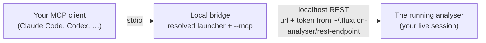

# Connect your client

Connect Claude Code, Codex or another MCP client to the analyser once, and from then on it can drive the analyser you
have open: read the log, filter, chart, flag and point, in your window, as you watch. This page sets the connection up
and checks each link of it before you rely on it. It takes a few minutes.

## How the connection works



Three parts, and it matters which is which:

1. **The analyser you already have open**: the desktop app, with the log you loaded, the charts you opened and the
   flags you set. That is the session the client works on.
2. **External MCP/REST access** inside the analyser, a listener on `127.0.0.1`. It is off by default. When it is on,
   the analyser listens on a port chosen afresh each launch with a token minted afresh each launch, and publishes both
   to `~/.fluxtion-analyser/rest-endpoint` (mode 600, readable only by you), so nothing has to be copied into a prompt
   or a client's configuration.
3. **The bridge.** Your client launches the exact local command Set up AI's **Your own AI client** screen shows (an installed JBang
   launcher, or an absolute Java-and-jar command, followed by `--mcp`) and talks MCP to it over stdio. The bridge has no
   window. It reads the endpoint file **on every call** and forwards each tool call to the running analyser.

**Your client does not launch the analyser.** You start the analyser yourself and leave it open; the client starts only
the bridge, whenever it needs a tool. The point is to drive *your* live session. A freshly started analyser would have
none of it: no log, no charts, no flags. Two things follow:

- **Configure once.** The client's registration holds no token and no port, so nothing needs updating after the
  analyser restarts: the bridge picks up the new port and token by itself.
- **Connecting does not need the analyser.** The client can start the bridge and list the tools with the analyser
  closed; only the *calls* need it running.

The client sees **one tool per verb**, `analyser_open`, `analyser_context`, `analyser_filter`, `analyser_graph`,
`analyser_topology`, `analyser_flag`, `analyser_report` and so on, eighteen in all, each with its parameter schema, so
there is nothing to teach the model. The read-only tools are marked read-only. The six that replace what is loaded or
write files (`open`, `source_root`, `screenshot`, `report`, `walk`, `import`) are marked destructive, so your client can
ask you first. The analyser's own Claude Code session has one extra verb, `propose`; outside clients never see it,
and it is not on `/manifest`. [Verbs](reference/verbs.md)
has every verb's arguments.

Three names, three jobs, so none of them needs renaming:

| Layer | Name | Where you see it |
|---|---|---|
| JBang executable | **`analyser`** | `jbang analyser@telaminai/fluxtionauditlog-analyser`, and normally `~/.jbang/bin/analyser` once installed |
| MCP client registration | **`fluxtion-analyser`** | Codex, Claude Code, or a generic `mcpServers` entry |
| MCP bridge protocol | **`fluxtion-audit-log-analyser`** | the bridge's `serverInfo.name` |

## Connect, step by step

### 1. Turn on External MCP/REST access

Start the analyser and tick **AI ▸ External MCP/REST access**. Turning it on asks first, with **Cancel** as the
default (the same question Set up AI's switch, *Settings ▸ Assistant* and the *Connect an AI client* dialog ask);
turning it off never asks. It is remembered, on this machine only (a shared
settings file never carries it), and it is the same setting as
*Settings ▸ Assistant ▸ External MCP/REST access (for an AI client on this machine)*. Or start the analyser with the
flag that turns it on and keeps it on:

```bash
java -jar fluxtion-auditlog-analyser.jar --rest
# or: jbang analyser@telaminai/fluxtionauditlog-analyser --rest
```

The status bar reads *External MCP/REST access is on: listening on http://127.0.0.1:… for external clients — …*, and the
light beside it reads **MCP ready**. The console prints the URL and only the **first 8 characters of the token**
(`[analyser] assistant REST: http://127.0.0.1:…  (token 1a2b3c4d…)`); the full token is only in the endpoint file. A
script that calls the endpoint itself reads the token from that file and checks its `pid` first:
[Scripts and CI over REST](diagnose/rest-automation.md).


### 2. Register your client

**AI ▸ Set up AI…** — at any time, including with a log open — opens *Set up AI* at **Your own AI client** when one is
set up (Screen 1 otherwise: choose *Your own AI client connects*). The same door is the start page's AI line and
*Settings ▸ Assistant ▸ Set up AI…*. Its four steps — which client, *Let your client reach this window* (external
access, confirmed first), the exact registration command, and a live check that a client reached this window — are in
[Your own client, step by step](admin/profiles.md#your-own-client-step-by-step).

For what the steps do not do — a project-scope command, removing a registration, Claude Desktop's note, *Check
connection* — **More options…** on that screen opens the **Connect an AI client** dialog. It is the dialog's only door
(since M77-4: the AI menu's *Connect an AI client…*, the start page's *Connect an assistant* block and the Settings
button are gone). Opening either screen changes nothing: it only inspects this analyser. Its **Bridge command** is the exact local launcher
this installation can use, including an absolute Java path where one is required. Do not shorten, split or substitute
it. If access is still off, the dialog's *Turn on External MCP/REST access…* button turns it on, after the same
confirmation.

What each client choice does, on Set up AI's screen and in the dialog:

| Choice | What the analyser does | What remains yours |
|---|---|---|
| **Codex** | After an explicit confirmation, runs the installed Codex CLI to add, replace or remove the `fluxtion-analyser` registration. It also offers a copyable command if the CLI is unavailable. | Approve the change, and confirm it in Codex. |
| **Claude Code** | After an explicit confirmation, registers a **user-scoped** `fluxtion-analyser` server with the installed Claude Code CLI. A project-scoped command is copy-only. | Run the project command yourself, from the project root, if that is the scope you want. |
| **Claude Desktop** | Explains the supported fallback and takes you to Generic MCP setup. The analyser does not ship or install a Desktop extension, and does not edit Claude Desktop's configuration. | Use Claude Desktop's own configuration flow. |
| **Another MCP client** | Shows the complete standard `mcpServers` JSON record, built from the exact bridge command; copy it, or save it to a file you choose. | Put the record where your client's documentation says, through its approval flow. |

**Generic MCP setup.** **Copy configuration** copies only the JSON; **Save snippet…** writes it only to a file you
choose, and confirms before replacing one. Neither changes a client's configuration. The JSON holds only the local
stdio launcher and its arguments, each kept separate: never the endpoint, the token, the loaded log or an approval
choice. The path in the picture below is a neutral documentation path; use the exact launcher *your* analyser shows.


**Codex and Claude Code.** Choose **Check … registration** first: the screen reports only the named `fluxtion-analyser`
entry, and does not guess whether an entry at a different scope wins. **Register** or **Replace** then shows the full
command and what will change. It is still only a proposal: **Cancel** neither starts the client nor writes a
configuration.


A successful confirmation says the client's command completed, not that the client is signed in, connected, or
approved to call a tool. Restart or reload your client if it needs that to pick up a new server. Codex may need a
larger tool timeout for an aggregate over a very large log.

### 3. Open a log

Open one in the analyser (**Audit log ▸ Open log…**), or let the client do it with `analyser_open` once you have checked
the connection. Everything the client renders lands in the window you are looking at.

## Check it is working

Do these in order; each one checks a different link of the chain.

**Is this window serving?** Read the status bar's light. **MCP ready** means a client pointed here reaches *this*
window's log. **MCP elsewhere** means another analyser window owns the endpoint, and a client would read that one's
log instead. [Troubleshooting ▸ Which window is serving](diagnose/troubleshooting.md#which-window-is-serving) has every
state.

**Does the bridge reach the analyser?** The quickest normal check is Set up AI's own last step: ask your client *Use
analyser_context and tell me what is open* and the step says when a call with this window's key arrived. The
bridge-only check is **AI ▸ Set up AI… ▸ More options… ▸ Check connection**: it runs the exact command shown on that
screen and makes one read-only `analyser_context` call. A green result proves the analyser-to-bridge chain
for this window. It does not prove that a client has imported the registration or made a model call. For a technical
check, the endpoint file exists while the analyser is serving:

```bash
cat ~/.fluxtion-analyser/rest-endpoint
# {"url":"http://127.0.0.1:52041","token":"…","pid":12684,"startedAt":"…"}
```

No file means the analyser is not running, *External MCP/REST access* is off, or access is closed while an in-app
Claude Code session runs ([below](#while-claude-code-runs-in-the-analyser)). Usually it is the switch: tick
**AI ▸ External MCP/REST access**, or restart with `--rest`.

**Does your client see the tools?** In Claude Code, `/mcp` should show the server connected with **18 tools**. In
Codex, `codex mcp get fluxtion-analyser` shows the registration; then ask it to call `analyser_context` (below).
The block below is illustrative: it shows what to look for, not Claude Code's exact layout.

```text
> /mcp
  ⎿ fluxtion-analyser   ✔ connected · 18 tools
       analyser_aggregate · analyser_series · analyser_read
       analyser_filter · analyser_graph · analyser_goto
       analyser_flag · analyser_coverage · analyser_report
       analyser_context · analyser_topology · analyser_screenshot
       analyser_import · analyser_open · analyser_source
       analyser_source_root · analyser_spotlight · analyser_walk
```

`analyser_propose` is not in the list: it is only for the analyser's own Claude Code session. If the server is missing,
the client
did not launch the bridge: reopen the setup screen, use the exact registration or record it shows, then restart or
reload the client.

**Does a call reach the analyser?** Ask for something harmless and read-only:

```text
> Call analyser_context and tell me what log is open.
```

- **A description of your session** (the log, its record count, the filter, any flags) means the whole chain works.
  Nothing changed on screen: `context` only reads.
- ***analyser not running, or External MCP/REST access is off …*** means the tools are registered but the bridge found
  no serving analyser. Fix step 1 and ask again; no client restart is needed. The same message appears while Claude
  Code runs inside the analyser with external access off, or closed for that session:
  [While Claude Code runs in the analyser](#while-claude-code-runs-in-the-analyser).
- ***no log loaded*** means the chain works and the analyser is empty. Open a log, or ask the client to.

**Does a change land on the canvas?** Ask for one visible change you can undo:

```text
> Filter the analyser to the last 30 seconds and flag the record with the highest spread.
```

The records table narrows and a flagged row appears, in your window, as you watch. You are connected:
[Your first diagnosis session](diagnose/first-session.md) is next.

## While Claude Code runs in the analyser

The analyser can also run Claude Code inside its own assistant panel
([Claude Code in the Analyser assistant tab](inapp/claude-code.md)). That session has its own
private bridge and credential, and it changes what an outside client can reach:

- **External MCP/REST access off.** Claude Code in the panel still works, through a private listener that serves only
  that session and publishes no endpoint file. Your client's bridge says *analyser not running*. Turn the switch on if
  you want both.
- **External MCP/REST access on, with Full Claude Code in the panel.** The session's own tools could then drive the
  analyser as an outside client, through the endpoint file, so the panel says so and offers **Close external access
  while this session runs**. If the person at the analyser chooses it, outside clients are refused until that session
  ends, although Settings still shows the switch on.

[Troubleshooting ▸ While Claude Code runs in the analyser](diagnose/troubleshooting.md#while-claude-code-runs-in-the-analyser)
quotes what a client and a script are told in each case.

## Let your agent set it up

An agent can help with an explicit client registration, but the analyser is the source of the launch command: install
it with JBang, open it, then use **AI ▸ Set up AI…** ▸ *Your own AI client*. It shows the exact bridge command for this machine and asks
before it runs either supported client's CLI. For any other client, copy or save the generic record and apply it only
where that client's documentation says. Your MCP client still asks for approval for its own tools; the analyser cannot
grant that approval on its behalf.

Installing, configuring and launching are deliberately **not** MCP tools. The Connect screen is a screen for a person,
and runs a client's CLI only after you confirm. It would be circular for an MCP tool to install the bridge it needs,
and the analyser's MCP surface is deliberately limited to verbs over the evidence.
