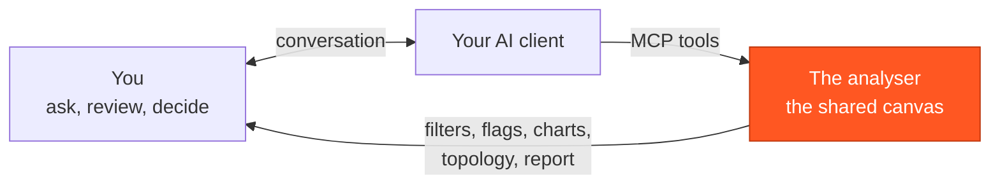

# Diagnose an incident with your AI client

You have an incident, an audit log from the system it happened in, and Claude Code, Codex or another MCP client.
This section takes you from *"a log arrived"* to *"here is what happened, with the evidence"*, and on to a record of
it that someone who was not watching can check.

Your client does not read the log on its own. It drives **the analyser you have open**: it opens the log, filters,
reads records, plots values, steps the topology and flags what it finds. Everything it does appears in that window,
in front of you. Its conclusion is something you can click into and check against the bytes the processor wrote.

You do not have to have written the system. The log is not anyone's account of the incident: nobody wrote it up
afterwards. The processor emitted it as it ran, cycle by cycle, so it answers questions about a night you were not
there for.

## The canvas you share

- **The client has your verbs, and no others.** It can open a log, filter, read, chart, flag, step the topology,
  point at things and write a report: the things you can do in the window yourself. It cannot run anything on your
  machine through the analyser.
- **The analyser computes; the client concludes.** Counts, crossings and series come from the log, never from the
  model. A callout or a sentence in the chat is the model's words. A flagged record, a plotted point or a coverage
  result is something you can open and check.
- **The canvas states no more than it knows.** A graph that does not fit the log says so. A node that wrote nothing
  is reported as *never logged*, not as *never ran*. A log that cannot say whether it is complete reads as `unknown`.

## Once, before the incident

1. **[Install and run the analyser](../install.md).** It is a desktop application: it runs on the machine where you
   read the evidence, not on the server.
2. **[Connect your client](../connect-an-llm.md).** Turn on *External MCP/REST access*, register the bridge from
   **AI ▸ Connect an AI client…**, and press **Check connection**. You do this once; the registration survives
   restarts of the analyser.
3. **Optionally, set up a project** with the system's source roots, its GraphML and its runbooks
   ([Working across projects](../user-guide/projects.md), [Runbooks, glossary and posture](../ai-and-runbooks.md)).
   With source roots, a log line opens the method that wrote it, and your client can read that code through the
   analyser.

## When it happens

You can do every step below yourself in the window. Your client can do each one for you, and you watch it happen.
[Your first diagnosis session](first-session.md) shows the conversation; the
[sample conversations](../sample-conversations.md) are recorded from real runs.

### 1. Open the evidence

- **Open the log**: **Audit log ▸ Open log…**, drag it onto the window, or **Audit log ▸ Open log from S3…** with an
  `s3://bucket/key` URL. Or ask your client to open it: `analyser_open` with the path.
- **Read the status bar** before anything else: how many records, the time range and where the log came from. Trust
  it over the file name.
- **Add the topology if you have it**: **Sources ▸ Open GraphML…**, or **Sources ▸ Find GraphML in source roots…** to
  see which of the available graphs fits this log, ranked. The Topology tab then says whether the graph matches the
  log. If it says it does not, take it seriously: the graph and the log disagree about which nodes exist, and the
  analyser does not say which one is right.

!!! danger "Check which system the log came from, before you answer about it"
    Two environments running the same build produce logs that look the same, often with the same file name. The
    analyser can only tell them apart if whoever exported the log **declared** where it came from. A declared source
    shows in the status bar and in report headers, as `risk-engine · host-7 · prod` rather than `export-2.yaml`.

    If your logs arrive without that, ask whoever automates the export to pass it: a script or agent calls
    `open {log, graphml, provenance: "<service> · <host> · <environment>"}`. One field is what stands between
    "the fix is live" and "the fix is live *in UAT*".

### 2. Check the log is whole

Before you conclude the system was quiet, check that the log can say so. Opening a log runs these checks and reports
what it finds in the status bar. Hover it for the full sentence, which names the fix.

- **Records run together.** The file is missing its `---` separators, so the analyser reads one record however many
  it holds.
- **No `nodeLogs` in any record.** The processor was built without audit logging installed: the run happened, the
  narration did not.
- **Only `EventLogControlEvent`.** The log holds the audit configuration and none of the run.
- **A value broke its record.** A value was written unquoted with a line break in it, so the record is read only up
  to the break and none of its node logs are read; the message names the record and the line.

These are faults in how the log was *produced*, not in what the system did. Send the message back to whoever owns the
export ([Producing an audit log](../producing-a-log.md)). If you were handed "the log is empty" and no log at all, open
the processor's `.graphml`: the **Project panel's Graph section** says *⚠ audit logging NOT installed* when the
processor writes no audit log.

Whether a file is **complete** is a separate question, answered under `context.log.streamEnd`
([Is the log whole?](../user-guide/assistant.md#is-the-log-whole)). Most logs today answer `unknown`, which is not a
fault, but it does mean a missing node is not proof that the node never ran.

### 3. Ask

Ask in your own words. Four questions come up again and again.

| You ask | What answers it |
|---|---|
| **"Did *X* happen at all?"** | A search or filter, then the count. The filter is shared: the table, the charts and the topology all follow it, so a count you see in one place is the same population everywhere ([Records, detail & filtering](../user-guide/records-and-filtering.md)). An empty result means *nothing was logged*, which is not the same as *nothing ran*: a node can run, decide nothing changed, and say nothing. |
| **"The check never fired — is that true?"** | **Coverage**: the nodes that never wrote audit output in this run. A gap means *never logged*, not *never ran*. Against a graph inferred from the run itself, coverage refuses to answer rather than report a comfortable 100%; you then need the real `.graphml` from the build. |
| **"Why is this number what it is?"** | The record's **detail**: the event, and each node that logged, with what it wrote. Then **step through** the cycle on the Topology tab, in the order it ran. For a value over time, plot it as a series ([Graphs](../user-guide/graphs.md)). |
| **"Is it still happening?"** | **Follow** (toolbar, or **Audit log ▸ Follow (tail)**) on a local log appends new records as they are written, keeping your flags, filters and selection. For two fixed exports, open each in turn: a saved report's log fingerprint says when you have reopened a different log from the one it was written against. |

### 4. Check what it shows

The client's answer arrives as a view: a filtered table, a flagged record, a captioned chart, a lit node. Check it:

- Click the plotted point; it resolves to its cycle.
- Open the flagged record and read its node logs.
- Click a node log line to open the source method that wrote it.
- Ask *"show me"* when the client explains something without pointing. It can light up to six things on screen,
  numbered, so its sentence finds its place ([Ask it to show you](../user-guide/assistant.md#ask-it-to-show-you)).

A callout is the client's words. If it says something the screen under it does not bear out, believe the screen.

### 5. Hand it on

A finding is worth keeping when someone who was not watching can check it: a flag with its note and fix, a report or
PDF, or an evidence bundle that reopens the whole investigation on their machine.
[Hand the diagnosis on](hand-off.md).

## Which window your client reaches

One analyser window at a time owns the endpoint your client's bridge reads. The light in the status bar says which:
**MCP ready** means this window is serving, so a client reaches *this* log. **MCP elsewhere** means another analyser
window owns the endpoint, and a client is reading that window's log. With two analysers open, check the light before
you trust an answer. [Troubleshooting the connection](troubleshooting.md#which-window-is-serving) has every state.

## What your client can do to your machine

The MCP connection opens the **same verbs** as the other ways in, and nothing more: one tool per verb, discovered live,
so the list your client shows is the truth.

- **Read**: the loaded log, the source roots you configured (`source` rereads XML and Java under them) and the
  exchange directory.
- **Change what the window shows**: filters, charts, the selection, flags, topology focus and highlights. Most of
  these can be reversed. Two cannot: `graph {delete}` removes a saved chart's definition for good, and it is not
  marked destructive; and a new `note` or `fix` on a flag replaces the old text.
- **Replace or write**, marked *destructive* so your client can ask you first: `open` replaces what is loaded (and the
  session's flags with it), `source_root` changes your saved source roots, `screenshot` writes a file, `report` writes a
  PDF, CSV or bundle (or saves a named report in the project),
  `walk` can replace a saved walk (and `walk {reel}` writes an HTML page), and `import` merges a bundle's saved state
  into your project.
- **Write files only where you allowed it.** `screenshot`, `report {path}`, `report {bundle}` and `walk {reel}` work
  only after you turn on
  *Allow assistant file exchange* (*Settings ▸ Assistant*), write only inside the exchange directory you chose, and
  never overwrite an existing file.
- **It cannot** read your API key, run a program, or start or control a server. The listener is loopback-only, and
  the endpoint file that carries its token is readable only by you.

Your client asks before a destructive call only if its own approval settings say so: the analyser marks the tools,
the client decides. The [FAQ's security answer](../faq.md#is-the-assistants-action-socket-safe-to-enable) is the
canonical statement of this boundary.

!!! warning "Reports about a live system contain real names"
    A report or bundle is evidence about your production estate: hosts, services, instruments, accounts. Treat it like
    any other production artefact, and never paste one into a public issue tracker or repository.
