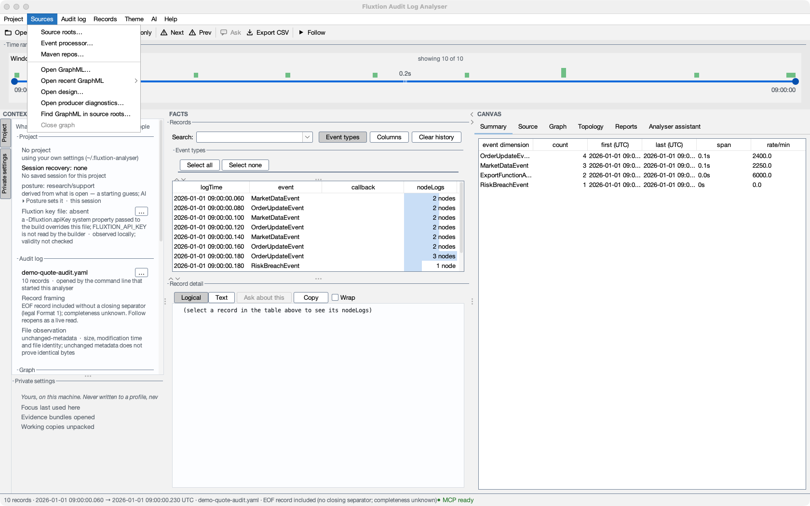
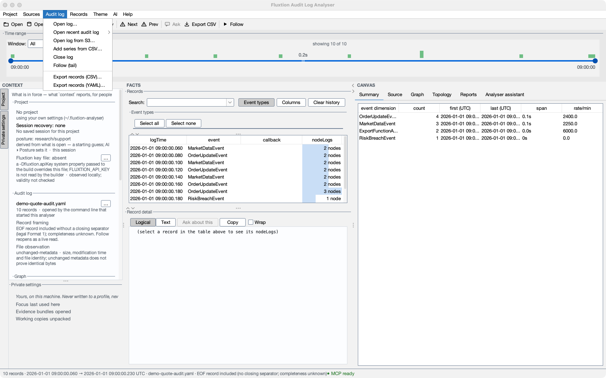

# Open your own log, step by step

You have an audit log from your own processor and want to read it. This page takes you from opening the file to a
log whose lines lead to their source. Only the first step is needed; each later one adds a view.

You need the analyser running ([Install & run](install.md)) and a log your processor wrote
([Producing an audit log](producing-a-log.md)). To look around first with nothing of your own, use the
[guided tour or the sample project](start/tour-and-sample.md).

## 1. Open the log

- **Local file**: **Audit log ▸ Open log…**, drag the file onto the window, or pass its path as the first command-line
  argument (`analyser my-log.yaml`, or `java -jar … my-log.yaml`).
- **A recent one**: **Audit log ▸ Open recent audit log**.
- **From S3**: **Audit log ▸ Open log from S3…** with an `s3://bucket/key` address. It streams the object with your
  local **`aws`** command-line tool and its credentials (profiles, SSO); no AWS SDK is needed. A non-default profile or
  region goes in **Settings ▸ Performance & S3**.
- **Text or binary**: a text log (`---`-separated records) and a Fluxtion binary (`FLXA`) log both open the same way.

Large files open too: a file above the memory threshold (500 MB by default, in **Settings ▸ Performance & S3**) is
memory-mapped instead of loaded into memory, so multi-gigabyte logs open.

You can read, filter, search and chart the records now ([Records, detail & filtering](user-guide/records-and-filtering.md),
[Graphs](user-guide/graphs.md)). The status line and the Project panel say what the log claims about itself, for example
whether it says it is whole ([Is the log whole?](log-format.md#is-the-log-whole)).

## 2. Add the processor's graph

**Sources ▸ Open GraphML…** opens the graph the Fluxtion compiler wrote beside your processor. **Sources ▸ Find GraphML
in source roots…** lists the graphs it finds, ranked by how well each fits the log you have open.

With the graph, the Topology tab shows which nodes logged and which did not, and steps through a cycle node by node
([Topology & step-through](user-guide/topology.md)). The analyser says whether the graph fits the log; it does not
assume it.

## 3. Add the source

1. **Source roots**: **Sources ▸ Source roots…**, then *Add* the source folders for your processor and its node
   classes. A log line or a node then leads to the method that wrote it ([Source navigation](user-guide/source-navigation.md)).
2. **Your event processor**: **Sources ▸ Event processor…**, its fully qualified class name, marked active. The
   analyser uses it to map each `instanceId` in the log to a source file. It is usually inferred when the log opens.

These belong to the project when one is open. To keep them for next time, make a project for this application:
**Project ▸ New project…** ([Projects, profiles and sharing](user-guide/projects.md)), or let Claude Code propose the
set-up ([Set up a project with Claude](build/set-up-with-claude.md)).

## 4. Ask about it (optional)

Select a record and press **Ask** on the toolbar. The question is drafted in the assistant's composer and sent only when
you press Send ([Ask the assistant](inapp/ask.md)). Which assistant answers, if any, is your choice
([Assistant profiles](admin/profiles.md)). No assistant set up? **Copy prompt** gives the question to any assistant you
use. To drive this window from Claude Code, Codex or another client in your terminal, see
[Connect your client](connect-an-llm.md).

If you later **regenerate a Fluxtion processor**, that build needs a different key: the Fluxtion build key, not an
assistant's. **AI ▸ Fluxtion API key…** (also on the start page) writes the usual `~/.fluxtion/fluxtion.apiKeyFile`;
named local profiles let one machine switch between, for example, a work and an evaluation key. The analyser reports
only whether a key is present; it does not check it or show it again. A `-Dfluxtion.apiKey` passed to the build
overrides the file, and the builder does not read `FLUXTION_API_KEY`. Existing generated processors and the bundled
demo run without this key.

## Connect a compiler account

If your compiler service uses accounts, **AI ▸ Compiler account…** connects this analyser to yours. Enter the service's
address (for example `https://compiler.example.com`; plain `http` is accepted only for this machine), or pick one
this machine has connected with before from the drop-down, and press
**Connect compiler account**. The analyser asks the service for a sign-in code, opens your browser at the service's
sign-in page and shows the code to enter there. While you approve it, it checks back only as often as the service
asks, slows down when told to, and stops when the code expires; **Cancel sign-in**, or closing the dialog, stops it
with nothing stored. It never shows or logs the device code, or the credential it receives.

Once you approve, the credential is kept in your operating system's credential store: the macOS Keychain, or the
Secret Service keyring on Linux (through `secret-tool`). Where neither is available (Windows, or Linux without
`secret-tool`), it is kept in `~/.fluxtion-analyser/compiler-account.credential`, a file only your account can read.
That protects it from other users of the machine, not from programs you run yourself. The same is true of the
Keychain entry: it is written by the system's `security` tool, so other programs running as you can read it through
that tool without a prompt. The credential never reaches a
command line, a project, a settings export, a report, a walk, an evidence bundle or an assistant's `context`. It also
remembers which service issued it, so changing the address later never sends it anywhere else.

The sign-in names this device "Fluxtion analyser on" followed by your machine's name (letters, digits, spaces and
`._:-` only, at most 64 characters), so you can tell your machines apart later.

Once connected, the dialog shows:

- **Account**: the account id, whether it is a *Personal* or an *Organisation* account, your role in it, the plan,
  and whether the account is *Active*. Below them are the plan's key limits, as the service states them: the most
  nodes and event types a graph may have, the languages it may generate, whether the WebAssembly (WASM) host bundle
  is included, and the software assurance it carries (*None*, *Provenance*, or *Provenance + verification report*).
  A limit an operator set for your account says *(set for this account)*. A service that does not report plans
  shows the plan's name only, and says *Plan details unavailable from this service*.
- **Credits**: one row for **Compile** (generating source) and one for **Interpret** (running a graph without
  compiling it). Each kind has its own allowance, and one never spends the other. Each row shows what remains, what
  was used, what requests in progress hold, and how many requests completed or failed. A service without a separate
  interpret allowance shows compile only, and says *Not reported by this service* on the Interpret row. The section
  also says whether the allowance is one-time (*One-time allowance (no reset)*) or when it next resets.
- **This device**: the name and credential id this analyser signed in with.
- **Your devices**: every device credential the service still accepts, with a short credential id (point at it for
  the whole id), its kind, and when it was created, to the minute in UTC. This machine is marked *(this machine)*. Select one and press **Revoke selected** to stop the service accepting it,
  for example a laptop you no longer use; you are asked to confirm first. Choosing this machine's own row is the same
  as **Revoke this device**.

**Refresh** reads everything again. **Copy details** puts a plain-text summary on the clipboard for a support request:
the service, account, type, role, plan, the compile and interpret figures, the plan's limits and rates, this device's
credential id and name, the analyser version and the time in UTC. It never includes the credential itself. Deleting the account is not available in the
app yet; ask the service's support.

The analyser reads the account and never grants credits or changes it; the only change it makes is revoking a
device you choose. **Disconnect** deletes the credential from this machine, and the service keeps accepting it until
it is revoked. **Revoke this device** asks the service to stop accepting it, then deletes it here. If the service does
not accept the credential at all (HTTP 401, for example because it was already revoked), the device stays connected:
use **Disconnect**.

## Investigate a compiler charge

A compiler service that uses accounts can export an **investigation** of one account: why each generation or
interpretation was allowed, refused, charged or released, every credit an operator granted or removed, and every
limit an operator set for the account. Account and attempt ids may
be replaced by aliases such as `account-1`.

**Getting the file.** An operator downloads it from the service's admin page: the account's **Download audit log**
button gives a zip holding `investigation-<account>.yaml` (the log) and `EntitlementProcessor.graphml` (the graph it
ran on), with a *pseudonymous* option for anything shared outside the operator team. For work the admin page cannot
reach, such as a restored copy, the service's export tool writes the same two files. Unzip into a working folder, not
into a repository: the log may hold personal data.

Open the `.yaml` with **Audit log ▸ Open log…** and the graph with **Sources ▸ Open GraphML…**. Open the graph
explicitly: its name does not match the log's, so the analyser will not pick it up by name. Each record is one
transition the service committed, at the time it was decided, in the order it was committed. The values on the nodes
are recomputed from those rows alone, by replaying them through the same graph; nothing is added after the fact.

- **Find one request:** type its request id in the search box above the records table. Its reservation, then its
  settlement or release (and, once its result is past the retention window, its expiry) are the rows that remain. A
  refused request has a single row.
- **Read why:** the record detail shows the nodes that applied the transition. **requests** carries the request's
  `status` (`RESERVED`, `SETTLED`, `RELEASED`, `EXPIRED`), the `reason` it was decided under (`within_allowance`,
  `generation_succeeded`, `not_charged`, `retention_elapsed`) and the `result` reference or `failure` code. For a
  refusal it carries only the request id and the reason (`exhausted`, `account_inactive`, `no_account`,
  `request_changed_under_same_id`). **ledger** carries the
  `bucket` it drew from and that bucket's `available`, `bucketReserved` and `bucketConsumed` after the transition. A
  refusal shows as `refused` on **ledger**, with the code the caller was given, such as
  `CREDIT_ALLOWANCE_EXHAUSTED`.
- **Credits an operator removed:** an `ALLOWANCE_REMOVED` row takes back unspent, unreserved credit from one bucket.
  **ledger** shows the units actually `removed` and the bucket's `available` after it; the row's detail says what was
  asked (`requested:5` here; requested:all for everything left), which can be more than was left. An operator's grant or removal carries
  who and why in its reason, such as `operator:ops:goodwill`. A removal the service declined (`UNKNOWN_BUCKET`, or
  `ALREADY_REMOVED` and `NOTHING_TO_REMOVE` when nothing changed) was answered to the operator and is not in the log.
- **Compile or interpret:** every row since credit kinds says which credit it moved, `creditKind=compile` or
  `creditKind=interpret`, and **ledger** shows the same as `kind`. An interpretation is recorded like a generation,
  a reservation then a settlement or release, under a request id that starts `interpret:` (such as
  `interpret:model-0001`), and it only ever draws on interpret credit. A grant or removal names its kind too.
- **Refused for the plan:** a request beyond the plan's limits is refused before any work and charges nothing. It is
  a single `GENERATION_REFUSED` row with failure `CAPABILITY_EXCEEDED` and reason `capability_exceeded`, and its
  detail names the limit, such as `capability=maxNodes;limit=20;requested=120;plan=free`. The caller was answered
  HTTP 403 with the same limit. An interpretation with no interpret credit left is refused
  `INTERPRET_ALLOWANCE_EXHAUSTED` (HTTP 429 to the caller), with reason `exhausted`, just as a compile without
  credit is refused `CREDIT_ALLOWANCE_EXHAUSTED`.
- **A limit an operator set:** a `CAPABILITY_SET` row records one per-account limit. Its detail is the capability
  name, an equals sign and the value (`maxEventTypes=10` here), and its reason says who and why
  (`operator:ops:contract`). **capabilities** shows the `capability` and its `value`. The service keeps such a limit
  on any plan but applies it only on a plan that allows per-account limits, so a refusal's detail is the authority
  on the limit that was in force.
- **See the balance over time:** in the Graph tab, **Add key** `ledger.available`. It is the balance of the bucket
  the row names, so with more than one bucket each step belongs to the bucket in that row. With both kinds of credit,
  type `creditKind=interpret` (or `creditKind=compile`) in the search box first.
- **See which nodes applied a row:** the Topology tab, stepping through the records.

A failed generation always appears as a reservation followed by a release with `reason: not_charged`. A charge is
always a reservation followed by a settlement against the same bucket, even when a billing period ended in between.

## Watch a log as it grows (Follow)

Turn on **Follow** (the toolbar toggle, or **Audit log ▸ Follow (tail)**) to watch a local text log that another
process is still writing. It polls the file, adds each newly completed record and scrolls to the newest, keeping your
flags, filters and selection. Open charts re-extract as records arrive. A chart showing the whole log grows with it;
one at the live edge slides; one zoomed into the middle stays put. While following, the status line keeps what it said
at load (the log's provenance, its record count and its warnings, including a time-order problem in the new records)
and says so on the same line if a read fails.

Follow is not available for an S3 log, a memory-mapped file or a binary log. An exported snapshot does not grow:
export again and reopen it instead.

## Finding the right menu

| Menu | What it changes |
|---|---|
| **Project** | Open, create, save or close a project; run saved analyses; import or export settings. |
| **Sources** | Source roots, event processors and Maven repositories; open a topology, a design or producer diagnostics. |
| **Audit log** | Open a local or S3 log, follow new records, add external CSV series or export records. |

**Records** holds flags and the selected records' actions; **Theme**, **AI** and **Help** are separate. Closing a log
keeps the project and its saved chart definitions. **Project ▸ Close log and topology** closes both and keeps the
project. **Help ▸ Start page** brings the start page back over what you have open.

Every Settings tab is described in the [Settings reference](admin/settings.md).
