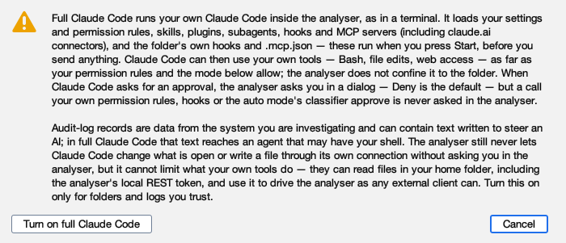
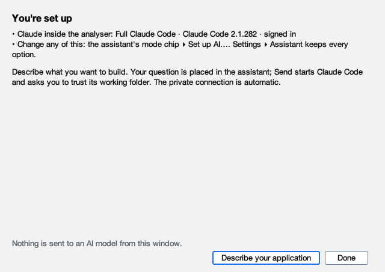
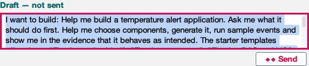

# Start with Claude in the analyser

Follow these six steps to start building with Claude.

**Before you start:** install [JBang](https://www.jbang.dev/download/) and
[Claude Code](https://code.claude.com/docs/en/quickstart), then sign in to Claude Code.

!!! info "Preview"
    These screenshots show the unreleased welcome screen. The command currently runs the published release;
    use its [Set up AI guide](admin/profiles.md#set-up-ai) until this screen is released.

## 1. Open the analyser

Paste this into your terminal:

```bash
jbang --fresh analyser@telaminai/fluxtionauditlog-analyser
```

Review JBang's trust prompt if it appears. In the analyser, click **Build with Claude Code**.


## 2. Check Claude is ready

Wait for the **Installed** and **Signed in** ticks. Leave **Full Claude Code** selected, then click
**Continue — confirm Full…**.


## 3. Allow Claude to build

Read the confirmation: Full Claude Code can edit files and run commands. To continue, click
**Turn on full Claude Code**.



## 4. Start your application

Click **Describe your application**.



## 5. Say what you want to build

Type your idea, or copy this example:

> Help me build a temperature alert application. Ask me what it should do first.

Click **Start building**.


## 6. Send your first message

Review the draft, then click **Send**. If a folder-trust prompt appears, review it and confirm the folder to continue.



Continue the conversation with Claude. When it proposes a project, click **Review…** and choose a new or empty
folder. [Creating your first project](user-guide/projects.md#create-from-a-starter-with-the-assistant) shows the next steps.

**Need help?** [Installation](install.md) · [Claude setup](inapp/claude-code.md)
