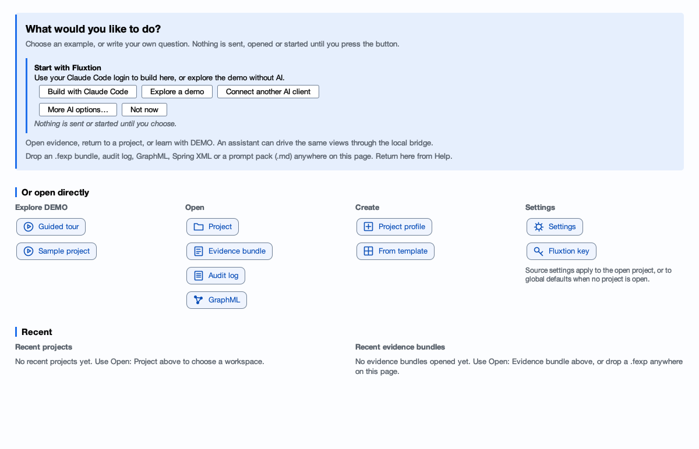
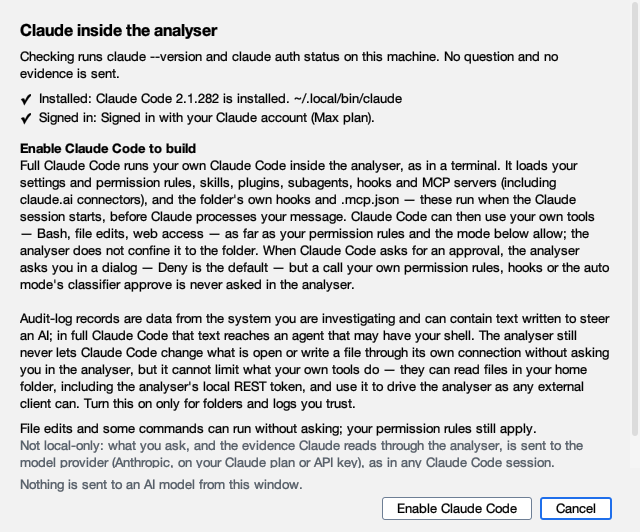
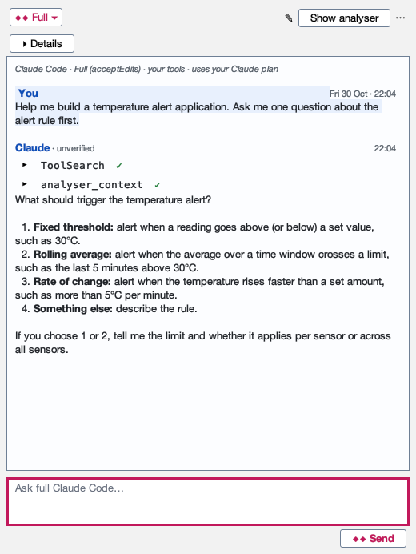

# Start with Claude in the analyser

Open the analyser, enable Claude, then describe what you want to build.

**Before you start:** install [JBang](https://www.jbang.dev/download/) and
[Claude Code](https://code.claude.com/docs/en/quickstart), then sign in to Claude Code.

**Preview:** the command below downloads the onboarding preview shown here. It is separate from the normal release.

## 1. Open the analyser

Paste this into your terminal:

```bash
jbang --java 21 https://github.com/telaminai/fluxtionauditlog-analyser/releases/download/v1.41.0-onboarding.1/fluxtion-auditlog-analyser.jar
```

Review JBang's trust prompt if it appears. In the analyser, click **Build with Claude Code**.
This button stays on the start page when you return later.



## 2. Enable Claude

Check the installation and sign-in results. Read what Claude can access, then click **Enable Claude Code**.
This allows Full Claude Code to use your tools and edit files; it does not send a message yet.



If a check needs attention, follow its instructions and click **Check again**.
You can cancel, finish installing or signing in, and return to **Build with Claude Code**.

## 3. Describe your idea and send

Type what you want to build, or copy this example:

> Help me build a temperature alert application. Ask me one question about the alert rule first.

Click **Send**. Claude connects inside the analyser and replies. If a folder-trust prompt appears, review it
and confirm the folder to continue.



Continue the conversation. When Claude proposes a project, click **Review…** and choose a new or empty folder.
[Creating your first project](user-guide/projects.md#create-from-a-starter-with-the-assistant) shows what happens next.

**Need help?** [Installation](install.md) · [Claude setup](inapp/claude-code.md)
