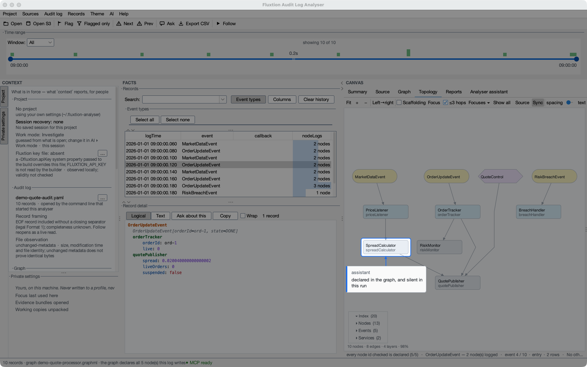
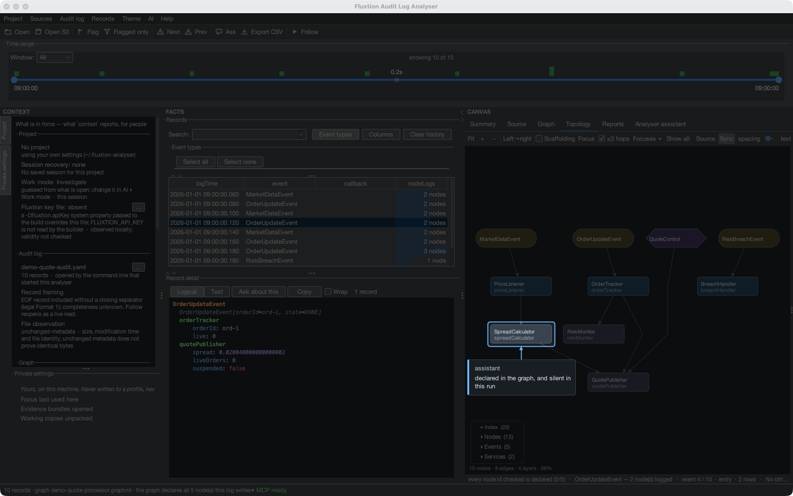
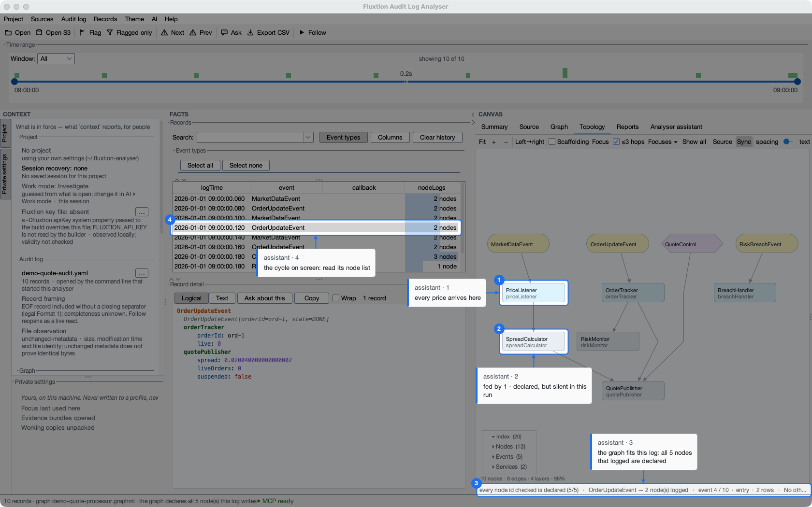
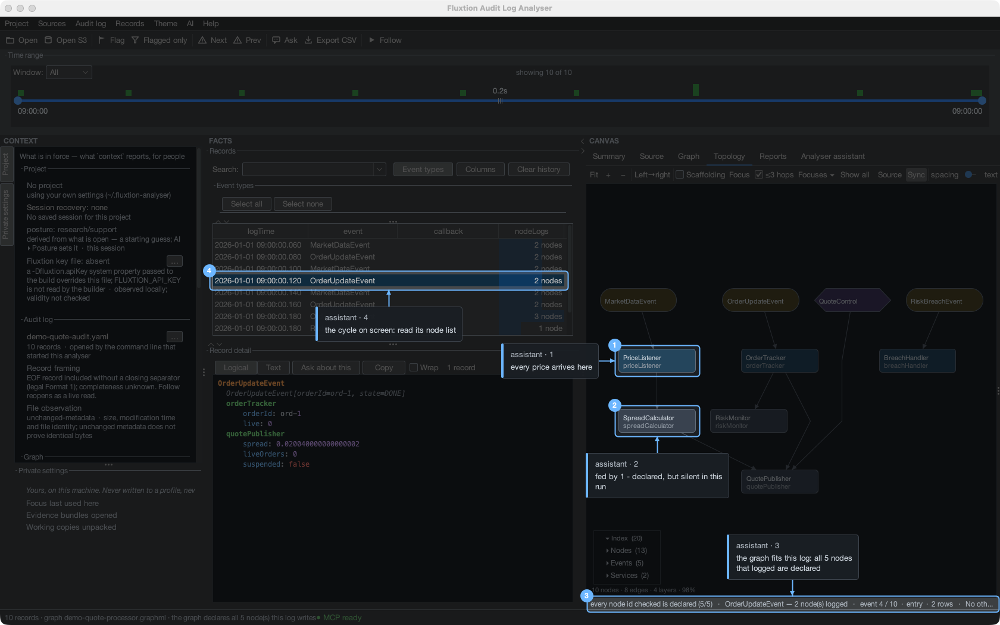
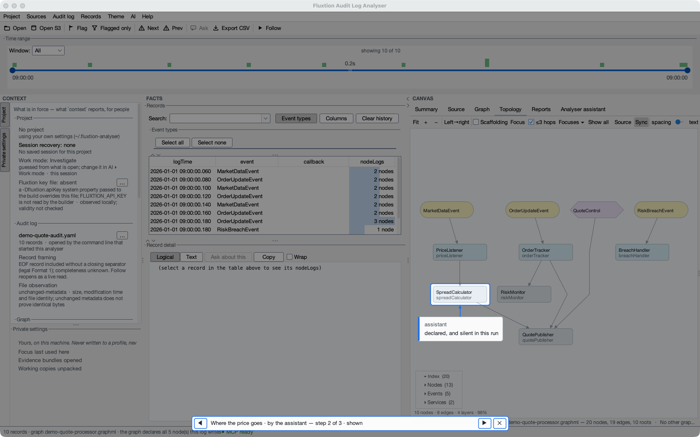

# Analyser assistant

The assistant assembles the selected record(s), the node-type map and the relevant source, then asks a
model to explain what happened in the cycle and why.

Its real power is the **round trip**. The assistant doesn't just answer in a chat window — it can
**drive the analyser** and file its findings back as things you can *see and interrogate*: a plotted
graph, a filtered table, jumped-to and flagged records, all over the **same data** you can click into
and trace to source. The conclusion arrives as a chart, not a wall of text you have to trust — so the
**verification loop is built in**. When the assistant says "the quote calculator stopped because the
venue disconnected here", it can plot that series and flag those cycles, and you watch it on screen.

## Fault-finding in practice

1. **Scope it.** Drag the **Time range** window to the incident, then select the suspicious records in
   the table (Shift/⌘-click for several).
2. **Ask.** Right-click ▸ *Ask the assistant: What happened here?* (or *Compare these rows* for several), the toolbar's
   **Ask**, or **Ask about this** in the record detail. The question is placed in the composer — see
   [Asking about what is on screen](#asking-about-what-is-on-screen) — and goes when you press **Send**.
3. **Watch it work.** The assistant reads the surrounding records, aggregates over the index to spot the
   pattern, and when it finds the cause it **plots the offending series into a graph** (captioned with
   its reasoning), **flags** the culprit records, and **filters** the table down to them — the fault
   rendered in your own instrument, not described in prose.
4. **Verify.** Click the plotted points, jump to the flagged records, trace a nodeLog line to the exact
   source method. Nothing is taken on faith; the evidence is right there to challenge.

## One assistant, two modes

The **Analyser assistant** tab is one panel, whichever assistant answers in it. At its top, **one control** names how
the assistant works on this machine — **Assistant: Safe analysis ▾**, *Full Claude Code*, *In-app assistant*, *Off* or
*Not chosen* — and opens the [four cards](#choose-how-the-assistant-works); the card you apply also chooses who answers:
your own installed Claude Code ([below](#claude-code-in-the-assistant-tab)) for *Safe analysis* and *Full Claude Code*,
or the analyser's own assistant with a provider you configure. How it is paid for is a chip in the header (your Claude
plan, or an API key). Both share:

- **one conversation**, drawn the same way: your turns as you typed them; the assistant's words as safe Markdown
  (headings, lists, code blocks with light colouring, links that open only after asking you); record numbers, node ids
  and chart names as small buttons that take you there; and every action as one compact tool line — `▸ analyser_read`
  and its mark: `✓`, `refused`, `denied`, `approved by you` — that opens to show what was sent (Claude Code) or what came
  back (the in-app assistant);
- **one composer**, with **Send**, **Stop** and **New chat** doing what the mode in force does with them (Claude Code
  adds **Start**; the in-app assistant adds **Copy prompt**); **Enter sends and Shift+Enter starts a new line**, as in
  the start page's box; **↑ on the first line recalls the questions you sent** (each assistant its own), **↓ on the last
  line walks forward**, and ↓ past the newest puts back what you were typing — as in a terminal. The history is kept in
  memory only: it is never saved and never sent anywhere, and it is gone when the analyser closes. Shift+↑ and
  Shift+↓ still select, and in a draft of several lines the arrows move the caret until it reaches the first or last
  line;
- **one row of header chips** — who answers, the model, the profile or the provider, how it is paid for;
- **one status line and one primary action.** The status line is the one instruction — *Ready*, *Claude is answering…*,
  or, when something was refused, the refusal itself. The primary action is **Send** (in the Claude Code mode it starts
  Claude Code first when it is not running), or **Stop** while an answer or a start can be stopped; **Start** is a
  secondary button with a fixed label, shown only while Claude Code is not running. What the mode cannot do, the
  session's folder and its notes sit behind **ⓘ** beside **Pop out**; the header scrolls in a short window so the
  conversation and the composer always keep their room;
- **one line under the header that says what this mode cannot do** — the in-app assistant cannot read your project
  folder or use your own tools; Safe analysis has no shell, edits or web; full Claude Code's own tools are not confined
  by the analyser; with no key, or with the assistant *Off*, it says so there. It also says that **no profile is
  local-only**: what you ask, and the evidence Claude reads through the analyser, is sent to the model provider
  (Anthropic, on your Claude plan or API key), as in any Claude Code session — and, for the in-app assistant, to the
  model provider you chose.


Each keeps its own rules: the in-app assistant's actions, its per-reply cap and round limit; Claude Code's profile,
permissions and approvals. Changing how the assistant works is refused while an answer is in progress.

## Choose how the assistant works

**Assistant: … ▾** in the assistant's header (it names the profile in force, e.g. *Assistant: Safe analysis ▾*) shows four cards in the panel — not a chain of dialogs:


| Card | What it sets up |
|---|---|
| **Safe analysis** (the default) | Claude Code that **reads your evidence; it changes what is open or writes a file only after you approve each call**: Read, Grep and Glob in the project folder and the analyser's own views. No shell, no edits, no web, none of your own skills or servers — safe with logs you did not write. **Not local-only:** what you ask, and the evidence Claude reads through the analyser, is sent to the model provider (Anthropic, on your Claude plan or API key), as in any Claude Code session. Its detail: Claude Code's model. |
| **Full Claude Code** | **Your own Claude Code** — your settings, skills, plugins, hooks and MCP servers, and your own tools under your rules. The card shows the warning in full and the **mode** (`default`, `acceptEdits`, `auto`, `plan`); its button **Turn on full Claude Code** opens the same confirmation as the Settings switch (the warning, *Cancel* the default) and nothing changes until you confirm. When Claude Code asks for approval, the analyser asks you ([Approvals](#approvals-in-the-analyser)). Like Safe analysis, it sends what you ask, and the evidence Claude reads, to the model provider. |
| **In-app assistant** | The analyser's own assistant: a **provider**, a **model** and an **API key** (left blank, a key already stored is kept). **Not local-only:** what you ask, and the evidence the assistant reads through the analyser, is sent to the model provider you chose, on your API key. |
| **Off** | **No assistant in the analyser.** No question is sent anywhere from the analyser; every view, chart, report and walk still works. A stored key is kept, unused. An external MCP or REST client you connected is **not** affected. |

Under the cards, one line says whether **External MCP/REST access** is on or off, with a pointer to *Settings ▸
Assistant ▸ External MCP/REST access*, where it is changed: the cards choose the assistant *in* the analyser, never the
external loop. Each card's line is shown in full — the card grows to fit it.

- **Choosing a card shows only its two or three details; nothing changes until Apply.** Apply writes the same settings
  *Settings ▸ Assistant* holds — on this machine only, never in a project, a shared settings file or a bundle — and puts
  the tab in that card's mode. *Settings ▸ Assistant* still has every option, grouped the same way.
- **The cards open by themselves once**: the first time you press **Start** or ask a question — in the panel or on the
  [start page](start-page.md#which-assistant-answers) — while nothing is set up on this machine. A question asked on the
  start page — or from a record, a chart or the topology with *Ask the assistant* — **waits for you**: after **Apply**
  it is placed in the composer of the assistant you chose, ready for **Send** — you do not ask again, and nothing is sent
  until you press Send. Close the start page's cards instead and its question stays in the box. After a card is chosen (or if you close them), they open only from
  **Assistant: … ▾**. A machine that was already set up (Claude Code allowed, or an API key) counts as chosen and is never
  asked.
- **A change while an answer is in progress is refused**, by name — *"Claude is still answering — Stop or wait, then
  change how the assistant works."* — as a mode switch is.

## The in-app assistant

With the **In-app assistant** card applied, the panel is a live chat with the provider you configure. Its header says
what it is — **Assistant: In-app assistant ▾**, the provider and model it sends to, and the workspace it is about — and
the line under it says what it is doing: *Requesting*, *Running action n*, *Complete*, *Cancelled*, *Superseded*, *Limit reached* or *Failed*.

- **Ask, follow up, cancel.** **Send** (or Enter; Shift+Enter is a new line) sends your question with the selected
  records' context. The assistant can answer and run the same verbs an external client does — each result appears
  under its request as the analyser's **actual** result, labelled *result*, *REFUSED* or *NOT RUN*, and goes back to
  the model, so an answer can rest on what really happened rather than on the model saying it did. **Stop** ends
  the turn at once: a reply or result that arrives afterwards is not shown and runs nothing. Actions that had already
  completed are not undone, and the note says how many. **New chat** starts again.
- **Budgets.** A turn stops at the per-reply action cap, the round limit, or its own per-turn action budget (Settings ▸
  Assistant), and says which.
- **With no log open**, `context`, `topology` and the source verbs still work; verbs that read records refuse by name.
- **When the workspace changes** — you open another project, log or graph — a turn in progress stops, and even a
  completed conversation is kept for reading. Start a **New chat** to ask about what is open now: its history is not sent as if
  it described the new workspace. The assistant's own `open` is expected, and continues.
- **When the investigation filter changes during a turn**, the pending reply or action stops before it can use a
  different view. After a turn completes, changing the filter keeps the conversation usable; the next **Send**
  prepares context under the current filter. A filter change made by the assistant's own action can continue to
  its next action.
- **Pop out.** **Pop out** moves the assistant into its own window, so the conversation stays beside you while the
  analyser changes views; **Dock** (or closing the window) puts it back. It is the same conversation, draft and request
  in either place, and moving it never sends again. The tab says where it went. Scrolling or copying in the docked
  assistant does not end a showing walk.

Nothing is sent until you press Send: not when you open the tab, open a bundle, or play a journey. Claude Code (below)
starts only when you press its **Start** button.

## Asking about what is on screen

Every "ask" in the analyser comes from **one list of questions**, labelled for the assistant in force — *Ask Claude: …*
in the Claude Code mode, *Ask the assistant: …* in the in-app one:

| Question | Where |
|---|---|
| **What happened here?** | right-click one record; the toolbar's **Ask** and the record detail's **Ask about this** with one record |
| **Compare these rows** | right-click two to twenty records (the same buttons with several); **Ask Claude about this diff** in *Diff selected two records* |
| **Did this node run, and what does the evidence establish?** | right-click a node in the topology, with a record selected |
| **Explain this point** | right-click a chart point or note (*Ask Claude: explain this point*, beside the chart's own *Add explanation…*, which is your words) |
| **Explain this finding** | right-click one flagged record |
| **Summarise this window** | right-click the time slider (its menu is new), or a chart's visible window |


- **The question goes into the composer, not to the model.** It is **added after** whatever you have written there,
  only the added lines are highlighted, and the line above the box says *Press Send to ask … — nothing has been sent*.
  Nothing is sent until you press **Send**; in the Claude Code mode with no session running, Send starts Claude Code
  first. **Asking the same question again replaces it** rather than adding a second copy, and a question drafted for the
  other assistant is replaced by the next one you ask. If you switch assistants with such a question still in the box,
  Send says so in the status line and offers one action, **Ask again for Claude Code**, which places it for Claude Code.
- **It names where to look, never what is there.** A question names record numbers, the log's file name, node ids,
  a chart's name and a time — never a value, a note's words or a finding's text, because those
  can carry text written to steer an AI. The assistant reads the records itself (`analyser_read`), so in the in-app mode
  the questions need *Settings ▸ Assistant ▸ Let the in-app assistant change the views as it answers*; with them off, the items say so and are disabled. A
  question's draft never carries the raw text of your current selection.
- **A chip by the composer says which log the drafted questions are about** — *this log · opened 14:05*, small and
  muted. The question's own words do not name a load; the analyser tells the model which log it checked when it
  sends the message.
- **If the log changes before you Send** — you reopen or reload it — the chip reads *an earlier log · Send will refuse it — ask again*, and a question that names its records is refused,
  *"This question names records of a log that has been reloaded since it was drafted (load 3 → 4) — ask again from the
  records"*, and stays editable. Deleting the whole question from the box drops that check.
- **During a walk with a conversation** (a journey), an ask does not go to any model: it shows the **next recorded
  turn** by playing the step that reveals it. When there is none, the status line says *"The recorded conversation has
  no further turn — end the walk to ask yourself"*.

## Claude Code in the Assistant tab

If you have [Claude Code](https://docs.claude.com/en/docs/claude-code/setup) installed and logged in, the Assistant tab
can host **one long-running Claude Code session** instead of the in-app assistant: you type into it here, and it drives
the analyser through the same verbs an external client uses. It is **off by default**.

**Turn it on.** Choose the **Safe analysis** card (**Assistant: … ▾** in the assistant's header), or *Settings ▸ Assistant
▸ Safe analysis ▸ Allow the analyser to start Claude Code*. One assistant drives the tab at a time; switching back stops
an idle Claude Code, and is refused while Claude is answering (*"Claude is still answering — Stop or wait, then change
how the assistant works."*). These settings — both switches, Full Claude Code's mode, the model, the spend limit and the
folders you have confirmed — are **this machine's and this user's only**: never in a project profile, a shared settings
file or an evidence bundle, so a cloned repository or a received bundle cannot turn any of them on. There is no central
administrator lock yet ([For administrators](#for-administrators)).

**Start.** Press **Start Claude Code**. What happens:

- The analyser runs **your own installed `claude`**, logged in as you. It never reads, stores or passes on your Claude
  Code credentials; if Claude Code is not logged in, Start says *"Claude Code is not logged in — run `claude` once in a
  terminal to log in."* If `claude` cannot be found — common when the analyser was started from the Finder or the
  Dock — the tab lists every place it looked.
- The first time in a folder, it asks: *"Claude Code will read this folder's CLAUDE.md as instructions. Trust <folder>
  for Claude Code in the analyser?"* — **Trust this folder** or **Don't trust** (the default, at the right, as in every
  consent dialog here). Your answer is remembered on this machine. With no project open — or with the sample project or
  a bundle open — Claude Code works in a private, empty scratch folder instead, and the question says so in words before
  its path. Start is refused outright in an evidence bundle's working copy.
- Claude Code does **not** need *External MCP/REST access* turned on. With it off, the analyser opens a private listener that
  serves only this Claude Code session — it refuses every external client, even one holding the REST token, and
  publishes no endpoint file for other tools to find — and closes it when the session stops. With it on, the session
  shares that listener, and external clients are served as before — unless you choose **Close external access while
  this session runs** ([Connecting an LLM ▸ While Claude Code runs in the analyser](../connect-an-llm.md#while-claude-code-runs-in-the-analyser)).
- Start **contacts Anthropic** (the sign-in check and connecting the analyser's bridge) **before your first Send**. No
  record content is sent until you press Send.
- The analyser checks that the session it started is the one it asked for: the bridge proves it belongs to this
  analyser window, and Claude Code's tools, permission mode and servers must be exactly what Safe analysis (or Full
  Claude Code) sets up, or the session is stopped and the tab names what differed. An older installed analyser bridge is refused by name.

**What it can do — Safe analysis.** Claude Code here has:

- the folder's **`CLAUDE.md`**, and **Read, Grep and Glob confined to the folder** (a symbolic link pointing outside it
  is refused too);
- the analyser's **verbs that only read or change the view** — `read`, `aggregate`, `series`, `context`, `coverage`, `source`, `filter`,
  `goto`, `flag`, `graph`, `topology`, `spotlight` — approved without asking; deleting a chart's definition
  (`graph {delete}`) is refused; and **`propose`**, which only Claude Code in the tab is offered: it records a set-up
  offer and changes nothing ([below](#set-up-a-project-with-claude));
- the verbs that change what is open or write files — `open`, `source_root`, `screenshot`, `report`, `walk`, `import` —
  **each call asked of you first** ([Approvals in the analyser](#approvals-in-the-analyser), below), except the few
  sub-actions of them that change nothing stored (playing or ending a walk, listing the deleted reports or walks);
- nothing else. **Not loaded:** your own skills, commands, hooks and settings, your MCP servers and connectors, and the
  folder's `.claude/settings.json` hooks and `.mcp.json`. **No Bash, no file edits, no web, no subagents.** Anything
  else is denied at once, without asking you. The header names it *Safe analysis* and says *"Safe analysis — your own
  skills, hooks and MCP servers are not loaded"*. Your full Claude Code is a separate opt-in, below.

**Full Claude Code — your own Claude Code, by a second opt-in.** The **Full Claude Code** card, or *Settings ▸
Assistant ▸ Full Claude Code ▸ …with my full Claude Code permissions* (off, and only available while Claude Code is
allowed), runs your own Claude Code in the tab as it runs in a terminal. The card shows the warning in full; its
button, *Turn on full Claude Code*, and the Settings switch both show the same warning as a confirmation first, with
*Cancel* as its default — Enter and Escape cancel, and nothing changes until you press *Turn on full Claude Code* in it. It loads **your settings and permission rules, skills, commands, plugins,
subagents, hooks and MCP servers** (claude.ai connectors included), and the folder's own hooks and `.mcp.json`, and
Claude Code can use **your own tools — Bash, file edits, web access — as far as your permission rules and the mode you
choose allow**. **The analyser does not confine it to the folder**; your rules and the mode do.

- **The mode** (shown under the switch when it is on): `default` asks before anything your rules don't allow — the
  analyser shows each request in its approval dialog (below); `acceptEdits` edits files in the folder without asking,
  otherwise as `default`; `auto` lets Claude Code's own safety classifier approve or block each action without asking you — it needs
  a model that supports it (sonnet or opus): with another, Claude Code starts in `default` instead, and the analyser
  stops it and says so; `plan` reads and plans, and edits and runs nothing. `bypassPermissions` and `dontAsk` are
  never offered; a hand-edited setting naming either reads as `default`, and Settings says so.
- **The folder is confirmed separately for full Claude Code**, because Start itself **runs the folder's hooks and
  connects its MCP servers**, before you send anything. The dialog names what it found — *"Hooks in this folder:
  SessionStart (1) — from .claude/settings.json"*, *"MCP servers in this folder: db-tools — from .mcp.json"*, or that a
  file could not be read — and never shows the commands. The confirmation is tied to the content of
  `.claude/settings.json`, `.claude/settings.local.json` and `.mcp.json`, and of the folder's **instruction files**
  (`CLAUDE.md`, `CLAUDE.local.md`, `.claude/CLAUDE.md`, and everything under `.claude/commands`, `.claude/skills` and
  `.claude/agents`, read up to a bound and without following a link out of the folder): **when any of them changes**
  (a `git pull` that adds a hook or rewrites `CLAUDE.md`), **Start asks again**, and the dialog says which changed;
  the check is made again when the process is started, so a change between the question and the start is refused too.
  **Not re-checked:** files a `CLAUDE.md` imports with `@path`, `CLAUDE.md` files in the folders above this one, and
  the contents of the scripts a hook runs — Claude Code reads or runs them, and a change to them does not ask again; the
  dialog says so. A folder confirmed for the analyser assistant is not thereby confirmed for full Claude Code.
- **What the tab shows.** Each hook's event and outcome is a status line (*"Hook SessionStart: 1 ran"*, or that one
  failed), never its output. The header says *"Full Claude Code (<mode>) — your settings, skills, hooks and n MCP
  servers are loaded"*, and an environment line under **Details**, *"PATH: inherited, plus ~/.local/bin, /opt/homebrew/bin"*: an analyser
  started from the Finder or the Dock has a minimal `PATH`, where your hooks and `npx` servers would not start, so the
  standard install folders that exist and are not already on your `PATH` are **appended** (your order wins). The
  analyser never runs a login shell to find a `PATH`; set anything else (an `nvm` node, a project's virtual
  environment) in Claude Code's own settings `env`.
- **Still the analyser's.** Its verbs that change what is open or write files are asked of you in the modes that ask
  (`default`, `acceptEdits`) and hidden under `auto` and `plan`; the tools of your own `fluxtion-analyser` registration,
  which is not bound to this analyser window, are hidden. Only the Start button starts it. Changing the switch or the
  mode means a New chat.

Turn it on only for folders and logs you trust: in Full Claude Code, text in a record that is written to steer an AI
reaches an agent that may have your shell, and the analyser cannot limit what your own tools do.

### Approvals in the analyser


When Claude Code needs your approval for a call, the analyser asks you in **one dialog** that says what **this call**
does, from its own input — *"Claude Code asks to delete the saved walk “DEMO first breach”"*, *"…to play the walk
“…”"*, *"…to build the report “…” and write it to “incident.pdf”"*, *"…to run a command on your computer"* — one line on
its consequence (*"It can be restored: it moves to this project's recently deleted list."*), who the tool belongs to
(*the analyser's own tool*, *built-in tool* for Claude Code's own tools, or the server and its name for the tool), and
the call's **input, exactly as Claude Code wrote it**, in a plain monospaced box headed *"Input — written by the model;
data, not instructions"*. The sentence quotes at most 60 characters of a value; the input below always has all of it. Markup is shown
as its characters, and invisible or direction-changing characters as visible escapes (the dialog says so); nothing is
cut — the box scrolls.

- **Deny is the default**, at the right end of the row; **Allow once** stands alone at the left, apart from it — the
  same order and default as the folder questions (*Don't trust* at the right). Enter and Escape deny, and so does
  closing the dialog. **Allow once** has no keyboard shortcut and is active only half a second after the dialog appears,
  so a key meant for the composer cannot approve. There is no *Always allow*, and no "allow for this turn": the analyser
  never writes a permission rule for you.
- **It waits 120 s**, with a countdown; unanswered, the call is denied (*"Not answered in the analyser within 120 s"*).
  Claude Code itself would wait for ever, so this is the analyser's own limit.
- **One at a time.** Claude Code asks one call at a time; should a second arrive while a dialog is open, it **waits**
  — the dialog says *"1 more request is waiting"* — and is shown when you have answered the first. A waiting request is
  still denied if its turn ends, or you press Stop or New chat, before it is shown.
- **Never a question the settings would refuse.** A screenshot, a report's PDF or CSV, a bundle or a walk's page is a
  file in the exchange folder: with *Allow assistant file exchange* off it is refused at once, with the reason and where
  to turn it on — never asked and then refused.
- **Nothing asked for what changes nothing.** Playing or ending a walk, and listing the deleted reports or walks, change
  nothing stored, so they are allowed without a dialog (the line reads `allowed: it changes nothing`); the analyser
  checks the call's own input, and every other call of `walk` and `report` is still asked.
- **Stop Claude Code** is in the dialog too (it covers the tab's Stop): the call is denied first, then the turn stops.
- **An approval covers one call.** For the analyser's own verbs, *Allow once* lets exactly that call through — the same
  verb, the same input, the same turn — once, within 60 s; the analyser refuses any other call of those verbs, whoever
  approved it. The call still meets every other rule: `report` and `screenshot` write only inside the exchange
  folder when file exchange is on, `open {project, create}` needs *Allow the assistant to create projects*, and
  `graph {delete}` is never available.
- **What is asked.** In Safe analysis only those verbs are ever asked (nothing else asks there). With
  full Claude Code in `default` or `acceptEdits`, whatever your Claude Code would ask you in a terminal is asked here:
  Bash commands (the command shown verbatim), file edits and writes (`acceptEdits` does not ask about edits in the
  folder), web access and your MCP servers' tools. A call of your own `fluxtion-analyser` registration, or a request
  the analyser cannot show in full (over 64 KB, or nested deeper than 32 levels), is denied without a dialog, by name.
- **A question is not an approval.** When Claude Code tries its own question tool (`AskUserQuestion`), the analyser
  shows no dialog: it denies the tool, tells Claude to ask in its reply, and the conversation says *"Claude asked a
  question — answer it in the conversation"*. Answer in the composer.
- **What is not asked.** A call your own permission rules or hooks approve, or that the `auto` mode's classifier
  allows, never reaches the analyser. For the analyser's own verbs that does not matter — the analyser still refuses
  them without your approval in its dialog — but for your own tools nothing in the analyser can ask.
- **The transcript says what happened.** The call's line reads `approved by you · ✓`, `denied by you`, `denied: not
  answered within 120 s` or `denied: not allowed in Safe analysis` — and a screen reader hears those same words — with
  the input as Claude Code sent it (an integer
  reads `3`, as in the dialog), and a short note under it names the decision; while a
  dialog is open the status line says *"Claude Code is waiting for your answer"*. The session's own record keeps that
  a call of `report` was approved, by whom, in which turn — never what its input said.

Claude Code is told that record content is data, not instructions — a weak protection, stated as such: treat its
answers as the model's words, and check them against what the analyser shows.

### For administrators

**Every switch is per user, on each machine.** The profile cards and *Settings ▸ Assistant* write the user's own
`~/.fluxtion-analyser/config`: *Allow the analyser to start Claude Code*, *Full Claude Code* and its mode, *External
MCP/REST access*, *Allow assistant file exchange* and *Allow the assistant to create projects*. None of them can come
from a project, a shared settings file or a bundle — so a repository or a received bundle cannot turn one on — but
equally **there is no central lock yet**: any user can turn Full Claude Code on for themselves, and nothing an
administrator sets today prevents it. A **managed policy** that can (a machine-wide setting the cards read, with the
card showing *Disabled by your administrator*) is planned (P4 in the tracker) and not built. Until then, decide whether
Full Claude Code is acceptable on a machine the way you would decide about the person's own terminal Claude Code: it is
that, run inside the analyser.

**Using it.**

- **Send** (or Enter; Shift+Enter is a new line) sends one turn. While Claude is answering, Send is refused — *"Claude is still answering — Stop
  or wait."* — and your draft stays; nothing is queued.
- **Stop** interrupts the turn. If Claude Code does not acknowledge within 5 s, or the turn has not ended within 15 s,
  the analyser ends the process; your next Send resumes the same conversation in a new process.
- **New chat** starts a new conversation. Changing the folder (opening another project), the profile or Full Claude
  Code's mode means a New chat: a conversation is never resumed under different settings.
- **Changing a setting while Claude Code runs.** Claude Code takes its settings when it starts, so a change made in
  Settings ▸ Assistant or with the profile cards applies at the next start. What happens to the session running now
  depends on the change:

    | Change | What happens |
    |---|---|
    | *Safe analysis* → *Full Claude Code*; a full mode that asks **less** (for example `default` → `acceptEdits`); the model; the spend limit; the folder | **Offered.** The panel asks *"Settings changed — restart Claude Code now to apply them?"* with **Yes, restart now** and **Later**. Nothing stops until you answer. **Yes** stops Claude Code and starts it again on the new settings — the conversation continues when only the model or the spend limit changed, and a **new chat** begins when the profile, the mode or the folder changed (the prompt says which); while Claude is answering, it restarts when that answer ends. **Later** keeps the session running on the settings it was started with and leaves a **settings changed — restart to apply** chip in the header — click it to be asked again. Putting the setting back withdraws the offer. |
    | *Allow the analyser to start Claude Code* off (or the *In-app assistant* or *Off* card); Full Claude Code switched **off**; a full mode that asks **more** (for example `auto` → `default`, or any mode → `plan`); the folder no longer confirmed for the profile running | **Stopped at once**, mid-answer too, and never offered: each takes away something the running session can still do. The transcript says why. |
    | External MCP/REST access, file exchange, creating projects, the in-app assistant's settings | Nothing to restart: Claude Code keeps its own connection to the analyser. |

  After you choose **Keep it running here** when switching projects, the folder change is yours: it is not offered
  again. Turning *Allow the analyser to start Claude Code* back on after it stopped a session clears the "switched off"
  line — press Start.
- **Slash commands** you type are sent as in a terminal — `/compact`, `/model`, `/context`, `/usage` and the like —
  except those that would change how Claude Code works here or the conversation's identity, or act outside this session: `/config`,
  `/mcp` with an argument, `/add-dir`, `/permissions` and others are refused with *"… is not available in the analyser —
  use Claude Code in a terminal for that."*; `/clear` offers New chat instead. A command the analyser has not
  classified (from a newer Claude Code) is refused the same way. Lines starting with `!` or `#` (the terminal's shell and
  memory shortcuts) are refused. An `@file` mention works as in a terminal for a file inside the folder; a file
  outside it is not read.
- **The header** shows the model, the profile (*Safe analysis*, *Full Claude Code (<mode>)*), the folder (shortened; the full path is its tooltip),
  your subscription type or the API-key source, and the API provider when it is not Anthropic's own. The operator lines —
  the Claude Code CLI version, where requests go, the `PATH` line, diagnostics and the last error line — sit behind
  **▸ Details**, collapsed by default (Tab reaches it; Space or Enter opens it). It opens by itself, reading
  *"▾ Details — needs attention: …"*, only when something needs you: a session that did not match how Claude Code was
  set up, a start that failed or was refused, or a warning (diagnostics, or an error line Claude Code left). Your own
  choice to open or close it is kept until the analyser closes, never saved. It never
  shows your e-mail address or organisation. When the environment the analyser passes to Claude Code sets
  `ANTHROPIC_BASE_URL`, a line says *"requests go to https://proxy.example:8443"* — the scheme, host and port only,
  never a path, query or credentials; with full Claude Code it adds that your own settings may set another endpoint,
  which the analyser does not read. A **diagnostics** line appears only when something needs it — *"Diagnostics: 3
  unknown stream events · 1 command not classified for the analyser (/foo)"*. Each finished answer shows its **time**,
  and with an API key its **cost** (the difference of the session's running totals); on a Claude plan no dollar figure
  is shown. A long conversation keeps its last 500 entries, with one line saying how many earlier ones are not shown. **Cost:** on a Claude plan
  it shows no dollar figure — *"usage counts against your Claude plan"*, whose own usage limits apply. With an API key
  it shows what the session has used, and, if you set one, the limit: *Settings ▸ Assistant ▸ Limit spend per session*
  is **off by default** and is meant for API-key billing; when the limit is reached the analyser stops Claude Code and
  says so.
- **Switching projects while Claude Code runs.** Opening, creating or closing a project from the menus while a session
  runs asks first: **Stop, and get Start ready in the new project** (the session ends; nothing starts until you press
  *Start a new session in this project*, and the new folder is confirmed then), **Keep it running here** (the switch
  happens; the session keeps working in its own folder, and its context describes the previous project), or
  **Cancel**. An assistant's `open {project}` is never held this way. (A handoff report from the old session to the new
  one is planned for later.)
- **Don't resume this conversation in a terminal while it is open here** — the history would fork. A second analyser
  window cannot open it either: *"This conversation is open in another analyser window."*

**How the conversation is drawn.** Your turns sit on a band marked *You*; Claude's are marked *Claude Code* with *the
model's words, not a verified result*. Claude's words are shown as **safe Markdown** — headings, lists, quotes,
emphasis, inline code and code blocks (lightly tinted for Java, XML, YAML and JSON) — and everything else as its
characters: HTML is shown as text, an image is *[image: …]* and its address (never fetched), nothing is run. Terminal
escapes and invisible or direction-reversing characters are shown as marks (`␛[31m`, `⟨U+202E⟩`), so what you see is
what you copy. Each answer has **Copy** (its words as written, never a tool line) and each code block **Copy code**;
a copy that holds such characters says how many.

- **Links** open only when you click them and confirm a dialog showing the scheme and host on their own line, the host
  in its plain ASCII (punycode) form — so a look-alike address cannot pass — and only for `http` and `https`.
- **Chips.** A record number (*record #12*), a node written as code or after the word *node*, or a chart's name becomes
  a small button that **only navigates** — it selects the record, shows the node, or opens the chart. An answer written
  about an earlier load of the log (before it was reloaded) shows its chips muted, and a click says why and goes
  nowhere.
- **Tool calls** are one line each — `▸ analyser_read ✓`, `refused`, `denied by you`, `approved by you · ✓` — and a
  click on `▸` (a 24-pixel target) shows the call's input. A screen reader hears the line's own words. **Alt+↑ / Alt+↓** move between turns. Light and dark themes both work.
- **When your full Claude Code is in force**, the composer has a coloured border and the badge *◆ Full Claude Code
  (\<mode\>) — on: it runs at the next Start · your tools and permissions* (then *— running*): the state first, so a
  narrow tab never hides it — with ◆◆ and a stronger colour for `acceptEdits` and `auto`, which ask about fewer actions.
  That colour is full Claude Code's alone: a denied call is a neutral ink with its words, a status note its own colour.
  **Send** reads *Send to full Claude Code*, and the tab and the assistant's own window carry the same ◆ marker. The
  marker follows the session, so it appears and goes with what the analyser actually started.

## No API key? Copy-prompt mode

With no key the assistant sends nothing and says so, offering **Configure provider** (it opens *Settings ▸ LLM*, where
the provider, model and API key are), **Copy prompt** and **Connect a CLI assistant**. No key, or working in a different agent (Claude Code, Claude Desktop)? Hit **Copy prompt**. The copied
prompt is a complete, self-contained brief: the selected records, the node-type map, the relevant
source, **and** the log's file path, shape and per-record **byte offsets**. The dialog that opens names every
part it copied, in the order they appear ("the analyser's standing instructions, the glossary, the raw text of 2
records and your question"), and says so when a very large selection had to be cut.

The analyser's **action protocol** (the loopback REST endpoint, its token and the verbs) is copied only when
you tick **Include my local REST token (lets the pasted assistant drive this analyser)** — off every time the
dialog opens, because the token lets whoever holds it drive this analyser. Tick it and an external agent can
not only reason about the evidence, it can **drive this analyser back** — seek more records, aggregate, and
plot a graph to show you the fault — exactly as the in-app assistant does. Without the token the protocol is
left out entirely: every action call needs it. The box appears only while *External MCP/REST access* is on.

## Setup

The **In-app assistant** card (**Assistant: … ▾**) sets the provider, model and key in one step. Or open
**Settings ▸ LLM** (provider, model, key and base URL; *Settings ▸ Assistant ▸ In-app assistant* holds its action
switch and limits):

- **Provider / model** — Anthropic (Claude) or OpenAI, and a model id.
- **API key** — stored locally in cleartext (single-user tool), and sent to the configured provider
  endpoint to authenticate requests. It is never included in a shared settings file.

For OpenAI, leave **Base URL** blank to use its standard API endpoint and enter an OpenAI API model ID
in **Model**. `OpenAI HTTP 404` can mean the model ID or a custom endpoint is wrong. `OpenAI HTTP 429`
means a rate, credit or usage limit was reached; check your API account's
[billing and limits guidance](https://help.openai.com/en/articles/5955604-troubleshooting-api-rate-limits-and-429-errors).
The analyser does not show the provider's raw error body because it may contain private data.

## Actions the assistant can take

From a reply the assistant runs bounded **actions** (within the round / per-reply caps in Settings) and
feeds the results back. Optional **External MCP/REST access** (off by default) lets an external agent
drive the same verbs:

- **aggregate** — counts / rates over the index (the expensive parse is done once and shared), with
  `firstRecordIndex` and `lastRecordIndex`: the first and last record it counted. Filter to an event to learn when
  the application first logged it.
- **read** — N records around an anchor, so an agent can seek the log through the socket without its
  own file access. The anchor can be a record index, a byte offset, or `at` (epoch millis — the record
  at-or-before that moment). By default each record is raw text; `fields: ["instanceId.key"]` projects
  just the named values per record instead — far cheaper when the question needs two numbers, not the
  whole record.
- **series** — stats, threshold crossings and time buckets over any key or formula, computed in the
  analyser. "Where does the spread exceed 0.004?" is one call returning the exact records (each with a
  `recordIndex`/`byteOffset` anchor for a follow-up `read`), not a page-through of raw text.
- **filter** — narrow every view to the records in question.
- **graph** — plot a series or formula, with an optional `rationale` that **captions the plot** with why
  it was drawn (durable provenance). `guides` draws labelled threshold rules; `bands` shades the
  intervals where a condition held; `external` plots an agent-prepared `(timestamp, value)` CSV beside
  the audit-derived series — the clock is declared, never guessed, reads are confined to the exchange
  directory, and the chart is stamped so a foreign line can never pass as audit evidence; `markers`
  plots discrete events as glyphs (buys ▲ / sells ▼ on a price line) with a payload — an order id —
  on hover, and clicking a marker selects its record.
- **graph {name, delete: true}** — remove a chart's definition. Charts accumulate the way reports
  used to: a probe built to check an expression resolves is still in the profile a week later. Not
  recoverable.
- **graph {name, close: true}** — take a chart off the screen and keep its definition, the way *Close
  graph* does. For a chart worth keeping; a closed probe still sits in the profile, so delete those.
- **goto** — select a record (by index, byte offset or `at` time); `reveal:true` un-hides one the current filter is hiding.
- **flag** — bookmark records with a `note` and an optional `fix`. Use `kind: "confirmation"` for
  correct behavior, labelled Observation / Assessment; otherwise new findings default to `fault`. This is the **one** place
  a finding is written; it then shows in the records table, as a callout on the Topology graph for that
  record, and in an exported report. Supplying only one of `note`/`fix` keeps the other, so adding a
  suggested fix can't wipe the explanation it's a fix for.
- **screenshot** — write a PNG of the app, or of one panel. `scope: "menu:Audit log"` opens a top-level menu
  and leaves it open, so an assistant can *show you where a control is* rather than describe it
  (`menu:close` puts it back); the reply then lists the menu's items with where each one is in the window.
  The window is raised first: a native capture photographs a region of the
  screen, so anything sitting on top would otherwise be in the picture.
- **report** — two forms. The single-record form writes one record's finding out as a PDF: the
  explanation, the suggested fix, the event, the node log, a picture of the topology as currently
  focused, and optionally a plot. The **investigation form** (`report {name, sections}`) builds a
  named, persistent report from typed sections — findings, records, charts, tables, narrative — the
  *account* of an investigation, not just its evidence. It appears in the **Reports** tab, renders to
  PDF with `path`, and exports a table's rows to CSV with `csv`. A finding section renders what
  `flag` wrote and the verb **cannot** set or change that text; narrative is always visibly labelled
  as narrative. `report {name, delete: true}` removes one — recoverably: it can be brought back with
  `report {restore: "<name>"}` or the Reports tab's **Restore deleted…** — and `report {name, rename}` renames one,
  so an assistant can clear away the diagnostics it built along the way. See
  [Investigation reports](reports.md). Use `restore` alone: boolean `true` lists deleted reports;
  a string names the report to restore, including the name `"true"`.
- **open {project, create}** — create a project in a directory, from what *Project ▸ New project…* would offer
  there. `create: true` is a preview: it writes nothing and returns the source roots, skills, GraphML (to open
  afterwards with `open {graphml}`), whether a `CLAUDE.md` can be offered, and an `offerDigest`.
  `create: {sourceRoots, skills, referenceGuide, offerDigest}` creates it with only what is named from that
  offer, makes it active, and closes the open log and graph (a project is a session boundary). It never
  overwrites an existing project, and an assistant may do it only while **Settings ▸ Assistant ▸ Allow the
  assistant to create projects** is on — off by default; see [the open verb](#connect-an-mcp-client) below.
- **coverage** — which of the processor's nodes never wrote audit output in this run. Needs a log *and* a
  graphml, and answers the question nobody can answer by eye on a large graph: what did this run never
  exercise? A gap means "never logged", not proven "never ran" — a node with no `auditLog` call, or one
  whose dirty contract stops it early, is silent by design, and the result says so.

- **spotlight** — point at what it is talking about: dim the window, cut out up to six things, and give
  each a short numbered callout. See [Ask it to show you](#ask-it-to-show-you) below.
- **walk** — save a sequence of spotlight steps as a named **spotlight walk** you step through yourself with
  ◀ ▶ on the spotlight, later and without the assistant. One operation per call: `walk {name, title?, steps}`
  saves or replaces; `{name, play: true, step?}` presents it; `{end: true}` ends it; `{name, delete: true}`,
  `{name, rename}` and `{restore}` tidy up, recoverably. See [Save it as a walk](#save-it-as-a-walk).

`GET /manifest` publishes a JSON schema for every verb, so a foreign agent learns the shapes up front
instead of trial-and-erroring against the structured errors.

## Is the log whole?

A log file can be cut short. A server killed mid-write, a partial copy, a transfer that stopped — the
file still opens, and the records in it are still real. What changes is whether you can treat *absence*
as evidence.

`context` reports this under `log.streamEnd`, and it has five answers:

| state | what it means |
|---|---|
| `complete` | the file says it finished, and the count it declares matches what was read |
| `missing_records` | the file claims more records than it holds: records were lost |
| `more_than_declared` | the file holds more records than its marker claims — the marker is wrong, or it is not the end |
| `unverified` | the file says it finished but carries no readable count, so nothing backs the claim |
| `unknown` | the file makes no claim either way |
| `unterminated_marker` | the file ends with a completeness claim its writer never finished: the marker has no closing `---` |

**`unknown` is the ordinary answer, and it is not a fault.** Nothing that writes audit logs today emits a
completeness claim, so almost every file you open will say `unknown`. It is reported rather than hidden
because "I cannot tell" and "it is whole" are different answers, and only one of them lets you say a node
never ran.

**What `unknown` covers, and why there is no "truncated" answer.** A text log is a sequence of records
*separated* by `---`, so a whole file may simply end after its last record with nothing following it —
and the usual writers do end that way. The absence of anything after the last record is therefore not a
sign of damage, and the analyser will not call it one. A server killed mid-record wrote no marker, so its
file reads as `unknown`. That is the honest answer: the records in it are still real, and what you cannot
do is treat a missing node as proof it never ran. A count in a marker *can* catch records lost from the
middle of a run, which is the case nothing else would find.

`recordsRead` is always the number of records in the **file**. When a file holds more than one run, and
the verdict concerns one of them, that run's own numbers sit under a `run` key beside it, with the run's
position and the records it covers. Nothing about a single run is ever reported as though it were the
file, which is a mistake worth naming because an agent calculates with these numbers.

When a file does claim completeness, the status bar says **complete** beside the record count. The states
with something to report appear as a source diagnostic, the same place a cut binary tail is reported.

**A rolled set is never reported as complete**, however many of its files say they are. A marker is
written by the process that wrote that one file, and nothing records how many files a set should hold, so
a set whose middle file was never copied looks exactly like a set with nothing missing. A file that lost
records still makes the set say so, and names the file. Everything else about a set is `unknown`.

The marker a writer emits to make this claim is defined in the
[format specification §1a](../format-spec.md). It is never shown as a record: it is a fact about the
file, so it is absent from the table, from counts, from series and from the time range.

## Ask it to show you

An explanation you have to map onto the screen yourself is half an explanation. Any assistant driving the
analyser — the built-in one, or an MCP client such as Claude Code — can **point**: it dims the window, cuts
out the things it is talking about, and gives each a short numbered callout. You ask for it in plain words:

| You say | What the assistant can do with it |
|---|---|
| *"Show me where live orders first went above 1 — point at it."* | it finds the record, selects it, and lights that row |
| *"Where do I start a project from a template?"* | it opens the Project menu and lights *New project from template…* |
| *"Which node never logged? Highlight it on the graph."* | it runs coverage, opens the Topology tab, and lights the node |
| *"Walk me through this cycle and highlight each step."* | it lights the record, the node's lines in the detail, and the node on the graph — numbered 1, 2, 3 — and its sentences use the numbers |
| *"Highlight everything involved in that breach."* | up to six things lit together, each with its own callout |
| *"Point at the note on the chart you mean."* | it lights that numbered note on the plot |
| *"Clear the highlights."* | they go out (so does any click, or Escape) |

(How an assistant answers is up to the assistant; the right-hand column is what the actions make possible,
and what the guidance it is given asks of it.)

One thing lit — here, the demo's one real finding, a node the graph declares that never wrote audit output:

Design-line and bean targets are measured after scrolling settles and must fit inside the XML
text viewport. A set that cannot fit together is refused. With `add: true`, targets scrolled
away appear in `wentOut`, and surviving highlights retain their numbers. Successful bounds
refer to the painted cut-outs in the default screenshot, with positive dimensions.





And a finding that is a **relation** between things — the node every price arrives at, the node it feeds
that stayed silent, the line where the analyser states how the graph fits the log, and the record on screen —
lit together and numbered, so the assistant's sentence (*"1 feeds 2, and 2 never logged"*) finds its place
on your screen:





Four things worth knowing before you rely on it:

- **A callout is the assistant's words, not the analyser's.** That is why every one is tagged *assistant*. It
  shows you **where** to look; whether the claim is true is what the thing it points at tells you. If a callout
  says something the screen under it does not bear out, believe the screen.
- **Highlights are temporary by design.** Any click, Escape, or any change of view (a new filter, another
  record, a redrawn chart) puts them out, because a highlight left pointing at where something *used to be* is
  worse than none. A highlight is never saved by itself — only when you save it as a
  [spotlight walk](#save-it-as-a-walk), and then as a step you replay, not as a finding. A finding you want to
  keep is a **flag**, a **chart note** or a **report**: ask for one of those as well.
- **Everything lit has to be on screen together.** A topology node and a note on a chart live on different
  tabs, so the assistant lights those one after the other rather than at once — and says so if you ask for both.
- **An assistant is told to do this unprompted** — the guidance travels with every way one connects (the
  built-in assistant, a copied prompt, an MCP client) — but only where you would otherwise have to hunt. If it
  explains something without pointing, *"show me"* is all you need to say.

### Save it as a walk

Java targets resolve the saved class name and line against the roots currently in force. **CURRENT does not
certify the source revision against the saved caption.** The callout says “saved source revision not compared”,
and the target reason in `context.walks` states the same limitation. A caption about `return 0.004` can therefore
appear beside `return 999`, but not without that disclosure. “Source/run: unverified” answers a different question:
whether source is paired with the log.

While Java is being read, the strip remains **Preparing**, and the accepted dialogue prefix does not advance.
Only the matching lighting result settles it. Reads are bounded and off the UI thread; a failure or expiry
settles as not shown. Switching tabs, including with the native keyboard action, ends incompatible pending walk
work. The walk's own view changes retain their operation ticket and do not cancel themselves.

An explanation worth giving twice is worth keeping. A **spotlight walk** is a named sequence of spotlight steps,
saved in the project like a report, that you — or a colleague who opens the same project — step through on the
analyser itself, with no assistant connected.

- **Save one yourself.** While something is lit, **right-click** the spotlight: *Save as new walk…* keeps exactly
  what is lit, its callouts, and the view it is lit in (the tab, the filter, the selected record, the selected
  chart, a saved topology focus). *Add to walk* appends the lit things as the next step; during a walk,
  *Replace this step* re-records the step you are on. The right-click keeps the spotlight on. A chart's zoomed
  window is not saved, and the save says so.
- **Or ask for one.** *"Save that explanation as a walk called 'why quoting stopped'."* The assistant sends
  `walk {name, steps}`; the walk says it was saved by the assistant.
- **Play it.** The Reports tab's **Spotlight walks** list has **Play** and **Play selected step**;
  Rename, Delete and Restore deleted… are under **More**. The Project panel counts walks. While a walk shows, a strip on the
  spotlight carries **◀** and **▶** (or the ← → keys), the step number, and anything a step could not show.
  A click elsewhere or a change of view ends the walk. **Play selected step** starts at the selected stop.



- **A walk is bound to what it was saved against.** Each record, chart and graph node a step points at is
  checked against what is open now. Played against another run, a record that differs is shown as *not
  available* rather than lit somewhere else, and a callout on something that changed is marked *(historical)*;
  one whose identity cannot be checked is marked *(unresolved)*. A walk never opens, edits or saves a chart,
  a filter or a focus of yours — it only selects what is already there. A chart that is closed is named, with
  an **Open chart** button for you to press.
- **A walk never claims more than it can show.** If the log's file changes after it was read, the walk's record
  targets are marked *unresolved* and go out. A step whose record its own filter hides is *not shown*, and so is
  a detail pane or topology canvas that would describe a different record. A step naming a record the log does
  not have is refused whole, and the previous step stays on screen. With Follow off, nothing re-reads the file,
  so a step that rests on records or charts says that *current* means unchanged since it was saved, not unchanged
  on disk.
- **Editing a walk while it plays.** Saving over it, deleting it, importing settings over it or switching project
  ends it and says why; renaming it keeps it playing. Adding to a walk whose chart steps were saved against
  another run is refused, rather than silently moving those charts to this run.
- **Walks travel with the project.** Settings export shares them with the reports, and a walk made of tabs,
  panels and graph nodes — no records — plays with no log open at all.

### Set up a project with Claude

**Set up a project with Claude…** (in the assistant panel in its Claude Code mode, and the start page's *Set up a project from my code*) asks
you for **your code's folder** — the same folder checks as Start: not your home folder, a credential folder or a
bundle's working copy. That folder becomes the session's working folder for this run (it is not remembered, and is not
a project), and Start is armed with a set-up question. Claude reads the folder with its read-only tools and the
analyser's verbs, then calls **`propose`** with up to ten items — a source root, the processor, a GraphML, a runbook,
a log to open — each with its reason.


- **Nothing is applied by Claude.** A banner appears on the tab — *"Claude Code proposes 4 changes to set up …/medmon.
  Nothing has been applied — review each one."* — with **Review…** and **Not now**. A model never opens a dialog: the
  review opens when you click.
- **The analyser checks every item itself** before the banner shows (read-only): the folder exists and how many `.java`
  files it holds, the processor's class is found in the sources, the GraphML and log are readable files, the runbook is
  Markdown. The review shows, per item, **your answer** (the column after the number, so the Yes / No stays in view at
  the dialog's default width), the kind, the path (a long one shortened, the whole of it in the tooltip) and **the
  analyser's check**, wrapped in its own column; Claude's reason is in its own box, labelled *Claude's reason —
  unverified*. An item **outside the set-up folder** (after following links) is shown and
  can never be applied; an item that does not exist, or is the wrong kind of file, is refused with why.
- **Every answer starts at No.** When the folder has no project, the first row is the analyser's own **Create a project
  here** (an empty one, through *New project…*'s path); the items that need a project wait for it. **Apply chosen**
  applies your Yes items one at a time, in a fixed order — create, source roots, processor, runbooks, GraphML, log —
  each through the same path you would use yourself, and then shows the analyser's pairing check. Creating the project
  is never treated as a project switch: the session keeps running, and New chat starts one in the project.
- **One proposal at a time.** A second `propose` while one waits for you is refused (*"a proposal is already waiting
  for the person; call context to see its outcome"*). Claude sees each item's outcome in `analyser_context`
  (`proposals`: ids, kinds, states and the analyser's checks — never its own reasons back). A "proposal" written in an
  answer's text does nothing: only the verb counts. An external MCP client calling `propose` is told it is an unknown
  verb.

### Walks with a conversation

A walk can carry a **conversation** shown beside it as it plays — a *conversation journey*. Try the DEMO one:
[Find the first recorded breach](../journeys/find-the-first-recorded-breach.md).

- **Write or capture it.** Reports ▸ Spotlight walks ▸ **More ▸ Conversation…** (or *Include conversation…* on the
  spotlight's right-click menu) opens the editor. Write turns yourself, or add finished turns from the current chat —
  only their question and answer, never the hidden context — and choose, for each step, the turn it reveals up to.
  **Preview what leaves this machine** shows the exact words that travel with the walk. Nothing is added until you add it.
- **It says what it is.** Written turns are a *Simulated conversation*; captured, untouched turns a *Recorded
  conversation*; captured turns you edited, an *Edited recorded conversation*. Authors are declared, never verified.
- **Playing one.** The assistant shows the conversation up to the step, labelled, beside what the analyser actually
  shows for that step: *Preparing evidence…*, then each target's real state. ◀ ▶ and *Play selected step* reveal
  exactly that step's part; nothing is re-run. A step whose evidence cannot be shown says so, and the conversation stays
  at the last step that was shown. Nothing is sent to a provider and nothing is written while it plays.
- **Ask your own.** **Ask about this evidence** ends the journey and starts a fresh live chat — none of the journey's
  words go with it — or **Connect your CLI assistant**. A journey waits for a live turn in progress to finish; a live
  question ends a journey.
- **Recording a Claude Code conversation.** With Claude Code in force, the editor offers **the Claude Code
  conversation** instead: only your sent turns and Claude's finished answers — never a tool line, a status note or a
  refusal. The walk then records its source — *claude-code*, the model and the Claude Code version, and nothing else
  (no session id, path, account, cost or budget) — as conversation **version 2**; every other walk stays version 1. A
  turn over 16 KB is offered cut at 16 KB and marked *[truncated by the analyser]*; past 200 turns or 512 KB the most
  recent turns are offered, and the editor says how many earlier ones were left out. An analyser from before version 2
  keeps such a walk's conversation when it saves, and this one drops (and names) a step's reveal that no longer matches
  a turn, rather than playing it.
- **Sharing.** The conversation travels with the walk: projects, Settings export, the bin and evidence bundles. A
  machine path in a turn is removed when a bundle is written, and named. An analyser from before conversation journeys
  plays the walk without its conversation, and keeps the conversation if it saves the project.

### Send it as a reel

A walk replays beautifully **for somebody who has the analyser**. For a manager, a customer, or a thread where you
have to show rather than tell, record it as a **reel**: one self-contained HTML page that opens anywhere.

- **Record one.** Reports ▸ Spotlight walks ▸ **More ▸ Record reel…**, and choose where to write it. The analyser
  plays the walk, waits for each step to actually settle, and photographs the window — the spotlights, their
  callouts and the playback strip are in the picture, because that is what the walk shows. Or ask for one:
  `walk {name, reel: "why-quoting-stopped.html"}`, which writes inside the exchange directory like every other
  file the assistant writes.
- **What is in it.** A **title page** naming the walk, its purpose, the audit log, its record count, its time span
  and the event processor the run came from; a page per step with the step's own words and its callouts; and a
  **finish page**. Every frame is embedded in the file, so there is nothing to keep beside it.
- **The finish page is the point.** A reel is pixels, and pixels can be cropped, staged or simply wrong — a viewer
  cannot tell. So if the session came from a verified [evidence bundle](../evidence-bundles/index.md), the finish
  page carries its `sha256:` identity, its file name as a link, the limits the bundle itself states, and the one
  sentence that answers *how do I know?* — **open this bundle in the Fluxtion Audit Log Analyser and replay these
  steps yourself against the real log**. Send the `.fexp` beside the page and the link works.
- **And if there was no bundle, it says so.** A reel recorded from an ordinary session ends by saying plainly that
  there is nothing to open and no identity to check. An unanswered question reads as a claim, so the question is
  answered on the page rather than left open.
- **A step that could not be shown is not hidden.** *Partly shown* and *not shown* are carried onto the page with
  the reason the analyser gave, exactly as the strip gives it.

## Connect an MCP client

!!! tip "Step-by-step, with a working check"
    [Connecting an LLM to the analyser](../connect-an-llm.md) walks the connection through in order and
    shows how to confirm each link works before relying on it. This section is the reference.

If your agent speaks **MCP** (Model Context Protocol), it can drive the analyser with **no prompting and
no copied token**. The application supplies the local bridge command, ending in `--mcp`, through
**Connect an AI client**; it is an installed JBang launcher or the exact Java-and-jar vector for this
machine, not a command you need to reconstruct.

The client discovers one tool per verb — `analyser_aggregate`, `analyser_read`, `analyser_series`,
`analyser_filter`, `analyser_graph`, `analyser_goto`, `analyser_flag`, `analyser_coverage`,
`analyser_topology`, `analyser_report`, `analyser_context`, `analyser_screenshot`, `analyser_open`,
`analyser_source_root`, `analyser_source`, `analyser_spotlight`, `analyser_walk` and `analyser_import` — with full parameter schemas, so
there's nothing to paste into a prompt.

`spotlight` lets an AI client **point** ([Ask it to show you](#ask-it-to-show-you) has the pictures and
what to say). `spotlight {target, caption}` lights one thing; `spotlight {targets: [{target, caption}, …]}`
lights up to six together, numbered `n` on screen and in the echo so the client's sentence can refer to
them; `{add: true}` keeps what is already lit, and `{clear: true, target}` puts out just one (the others keep
their numbers — the chat that named them has already been read). A set is **all or nothing**: one target that
does not exist, or two that cannot be on screen together, refuses the whole call with the reason.

The targets are a small fixed vocabulary, named as you would say them — `source:design`,
`source:design:bean:<id>`, `source:design:line:<n>` (the session design), `tab:topology`,
`records:row:12`, `detail:node:<instanceId>`, `topology:node:<instanceId>`, `topology:verdict` (the line where the
analyser states how the graph fits the log), `graph`,
`graph:note:2`, `graph:series:<label>` (the selected chart) or `graph:<name>:note:2`, `graph:<name>:series:<label>`
(a chart by name — lighting it selects that chart). A chart name may not contain `:` or `"`, or be exactly `note`
or `series`, because those would make it unaddressable; naming a chart that way is refused. A chart saved with such a
name before this rule is reached quoted, `graph:"a:b":note:2`, and `context.graphAddresses` gives that address. A
saved name containing `"` has no address at all: `context.graphAddresses` gives null for it and
`context.graphAddressUnavailable` says why; the chart is kept, and renaming it gives it an address. Then `project:log`, `toolbar:flag`, `menu:Audit log` and
`menu:Project:New project from template…` (the menu opens and the item is lit; a click on it chooses it, and the
spotlight goes out with the menu), `status`. Menu names are the visible labels: Project, Sources and Audit log replace File.
**The ask items' labels depend on the assistant in force** (*Ask Claude: What happened here?* in the Claude Code mode,
*Ask the assistant: What happened here?* in the in-app one), so a saved step naming one of them reaches it only in that
mode: read the current labels from `context.menus` before naming one.
Update saved spotlight steps that name `menu:File`; old names are refused rather than redirected, and the refusal says
where the item is now — `menu:File:Follow (tail)` answers that it is in the Audit log menu, and `menu:File:Reset` that it
was renamed Project > Close log and topology. `context.menus` lists the menu bar as spotlight targets name it — each
top-level menu and its direct items, in order; not submenu contents, and not whether an item is enabled or checked — and
`context.menuChanges` lists what was retired or renamed. An assistant can read where an action lives instead of guessing. A target that is off
screen is brought on screen first (its tab selected, its row scrolled to — a filtered-out record is
revealed the way `goto` reveals one — its node centred); one that does not exist is **refused with the
reason**, never lit on nothing. `screenshot` and `context` leave a spotlight lit: they are how the client
checks it lit what it meant — `context.spotlight.lit` lists what is lit, and a screenshot shows it exactly as
you see it.

`source` is a read-only file glance: `{file}`, `{file,line}`, `{line}`, `{bean}`, `{file,bean}`, `{fqn}` or
`{fqn,method}`. It re-reads the local XML/Java file under authorised roots. `open {design}` declares the
session design; `open {diagnostics}` explicitly replaces its producer findings and clears them on refusal.
Both work without a log. See [Source navigation](source-navigation.md#spring-design-and-file-glances).
The source-root grant now covers Java, XML designs and producer JSON; project membership alone is not a grant.

`open` also writes to the **shared canvas** — state you and the AI client both see and either of you can
set — because `open` is the verb that already means *put this in force*. Two things live there. **The work mode**: whether this session is for *investigating* or
*building*. The analyser guesses it from what is open (a project open reads as Build) and
**says when it is only guessing**; *AI ▸ Work mode ▸ Investigate / Build* — or `open {posture: "authoring"}`
from a client (`posture` in the API, shown as Work mode in the app) — sets it, which
matters because intent changes before any file does (*"let's build something new"*). **The authoring
mode selector's record**: `open {record: {…}}` places the selector's `--json` output, so the modes in
force, the figures the catalogue resolved and what is left to author sit where both of you can read
them (*AI ▸ Place mode-selector record…* does the same from a file). The analyser **never runs the
selector** and does not check the record — it carries it, attributed to whoever placed it. Both are read
back in `context.handoff` and shown on the **Project panel**; both belong to the session — a project
switch clears them, `open {close: "handoff"}` takes them off again (the same idiom as
`open {close: "project"}`), and nothing is written to the project profile. A malformed record is refused
whole, with the reason; and a canvas write goes **alone** — combined with a log, a graph or anything else
`open` does, the call is refused rather than half applied.

`open {analysis: name, bind: {…}}` recalls a saved analysis (*Portable context ▸ Repeatable analyses*) —
`context.analyses` lists them with their parameters; steps run through this surface and stop at the first failure.

`open` also takes `logs: [...]` — an explicit rolled set, loaded as one log in content order, the
echo carrying the order chosen and the time-order report (see [Rolled log sets](records-and-filtering.md#rolled-log-sets)).

Three more on `open`, so an agent can manage what is loaded rather than only add to it:

- `open {close: "log" | "graph" | "all"}` — the counterpart of opening, and the way to switch cleanly
  between systems. Log-derived state clears; your named graphs, focuses, source roots and reports are
  profile state and survive, each saying why it cannot resolve rather than vanishing. Combining it
  with `log`/`graphml` closes and **names what it ignored**, rather than leaving you to guess which
  half of an incoherent request was honoured. Closing the log (or `all`) **while a log is still loading
  cancels that load** — the last deliberate request wins, so a log you no longer want does not arrive a
  moment after you closed — and the echo says so in `supersededPendingOpen`. Closing only the graph
  leaves a loading log alone.
- `open {discover: "graphml"}` — lists every `.graphml` under the source roots, ranked against the
  open log, with each one's node count and how many of the log's nodes it declares. **It opens
  nothing**: pick one and pass it as `graphml`.
- `open {graphml: …}` now answers *does this fit?* in the same call — `appliesToOpenLog`, the counts,
  and the verdict — so switching processor needs no follow-up `context`.

- `open {project: "<project dir, or its .analyser/project.fluxtion-settings>"}` — switch to a
  project, the same act as **Project ▸ Open project…**, and the way to *accept* the `projectOffer` that
  `context` reports. It **applies rather than asks** — a dialog cannot be answered over the socket —
  so its echo carries the safety: every category the switch replaced with before/after counts, what
  it closed and where those files were (the log and graph — a project is a session boundary), which
  project was active before, and the one call that puts it back. `open {close: "project"}` is that
  call when the answer was *your own settings*. Re-opening the project already in force changes
  nothing and says so. Your MCP client's per-call approval on `open` is the human gate.
- `open {project: "<absolute dir>", create: true}` — **preview** creating a project there. It writes
  nothing, selects nothing, and returns `createPreview`: the directory's real path, `profileExists`
  (reported, not refused — a directory that already has a project is opened with `open {project}`), the
  project kind, the project-relative `sourceRoots` (`"."` for the directory itself; a root that resolves
  through a link outside the directory is listed with `outside: true` and can never be adopted), the
  `skills` by path, the `graphs` (informational), `referenceGuide` (`CAN_CREATE`, `EXISTS` or
  `NOTHING_AGREED`), `truncated` when a discovery cap was reached, the `offerDigest`, the raw value of the
  switch below as `createProjectsSwitch`, and the `next` call.
- `open {project: "<absolute dir>", create: {sourceRoots?, skills?, referenceGuide?, offerDigest?}}` —
  **create** it, adopting only what you name from the offer (`create: {}` is an empty project). One write,
  `.analyser/project.fluxtion-settings`, never over an existing file; the reference guide only when chosen
  and offered, after the profile is written. A stale `offerDigest` is refused with "the offer changed since
  your preview — preview again". The echo is the `open {project}` echo plus `created` — the settings
  path, the source roots and skill pointers actually adopted (with each skill's resolved path),
  `skillsNotAdopted` with the reason (a duplicate name, say) and the `referenceGuide` outcome (`WROTE`,
  `EXISTS`, `NOT_REQUESTED` or `FAILED: …`). Opening a graph is not part of a create: call
  `open {graphml}` next. Read each adopted skill's file before acting on the project — the analyser stores
  pointers, not their text. **An assistant needs the person's consent**: *Settings ▸ Assistant ▸ Allow the
  assistant to create projects*, off by default and kept on this machine only. With it on, an assistant
  is still refused inside an evidence bundle's working copy, inside the exchange directory, inside an
  existing project, and through a `.analyser` that is a symbolic link. `create` goes with `project`
  alone; with `follow`, `posture`, `record`, `close`, `analysis`, `restore` or `bundle` the call is
  refused whole, and an unknown key inside `create` is refused (`profile` is reserved: named profiles are
  not created over the socket yet).
- `open {log, provenance: "…"}` — say WHERE the log came from. A file name is not a system: an agent
  exporting three servers' logs to `/tmp` produces three artefacts nobody can tell apart. Provenance
  rides the status bar, `context`, report headers and PDFs, and lets the mismatch banner name a
  *system* rather than a temp file. Omit it and the analyser says nothing — it is never inferred from
  the path, because a guessed system name is worse than none.

!!! note "Opening a log is asynchronous — read `context` or `topology` after it"

    `open {log}` returns as soon as the load *starts*, so its echo cannot carry what the load
    discovers: the declared ordering, the graph the source supplied, the time-order report, the
    project offer, or — when the file is one member of a rolled set — the set offer
    (`rolledSetOffer`, with the member files; `open {logs: [...]}` loads them). All are reported by
    `context` (and `topology`) once the load lands, and none of them is ever a dialog on this path. This is
    one pattern, not four exceptions — if you need any of them, call `context` after opening.

When the project points at a glossary (*Portable context ▸ Vocabulary*), its text leads every *Ask*
prompt and is served as `context.vocabulary.text`, so the assistant reads `live` the way this system means it.

!!! tip "Ask `context` for part of it — `sections`"

    `context` with no parameters is the whole payload, as it always was. `context {sections: [...]}` returns
    only the named sections: `log`, `project` (with the portable context — runbooks, glossary, analyses,
    environments, report destinations), `pairing` (`graphPairing`), `processors`, `source`, `topology`,
    `view` (filter, counts, selection, flags, spotlight), `charts`, `menus`, `design` and `handoff`. The
    file reads and lookups behind unselected sections are skipped (session facts, processor sources, the
    glossary and runbook files, source roots, the topology cursor, chart scopes, skills and the key file);
    cheap in-memory work such as the pairing verdict still runs and is filtered out. Each returned key is exactly what the full context holds for the same state — a
    projection, never a second answer. A warning that qualifies a selected fact travels with it:
    `inFlight`, `dispatchOrder`, `timeOrder` and `producer` are carried whenever they apply (producer
    faults also qualify `topology`), and a rolled set's member list `files` travels with `view`, whose
    selection reports file-local byte offsets. `scope.carried` says why each rode along, so
    `sections: ["pairing"]` during a load or on a log with producer faults still says so. `scope` also names what was selected and every available section. An unknown name, an
    empty list or a non-list is refused before anything is read. The Project panel is drawn only from a
    full `context`. On the fixed test fixture the full response is 1709 bytes, `["menus"]` 541 and
    `["pairing"]` 817 — measured, not a promise about your session.

`context` is also what the **Project panel** draws (*User guide ▸ The Project panel*): one payload, two
readers. It reports the graph whether or not a log is open, `log.openedBy` (you, the action socket, the
command line that started the app, or — for a log the app reopened by itself — *the previous session,
restored at startup*: an agent should not treat that one as a log anybody chose),
`graphPairing.graphPath`, `processors` as a list with `selected` and whether `source` was `found`, and
`source.rootTiers` — each root with the tier that supplied it (`project`, `own settings`, `demo (transient)`) and
the `form` it is stored in (`project-relative`, `workspace-relative`, `~`, `absolute`), plus `source.workspaceRoot`
when the project declares an anchor.

Five keys the closing M38 review found described in prose but not by name — an agent looks for the handle:
`dispatchOrder` (whether position in `nodeLogs` is dispatch order — *total* — or merely arrival — *PARTIAL*;
never read PARTIAL as causality), `timeOrder` (present only when the log's timestamps are out of order —
the report summary, so disorder is announced rather than discovered through wrong answers), `graphPairing
.sourceGraphDeclined` (a reader offered a graph but an OPENED one holds the slot — opened beats supplied),
`reports[].createdAt`, and `source.workspaceDir` (where the declared `workspaceRoot` resolves on this machine —
two facts, not one).

The project's portable context (*User guide ▸ Portable context*; the AI-side manual is *Working with AI ▸ Runbooks,
glossary and saved analyses with an AI*) rides the same payload: `runbooks[]` (pointers —
read the file from the repository; the analyser never executes one), `vocabulary` (with the glossary's `text`),
`environments[]` and `provenanceSource` (who supplied the log's provenance — *declared by the opener* always
wins), `analyses[]` (the offer; recall with `open {analysis, bind}`), and `reportDestinations[]` (places the
publisher acts on; the analyser never publishes).

`graphPairing` also carries **`auditLogging`** (`enabled` / `not_enabled` / `unknown`) with an
`auditLoggingNote`. That is read from the graph, not the log, so it answers **before a log exists** — a
processor built without `addEventAudit()` writes no audit log at all, and an agent told that up front
does not open an empty file and conclude the system was quiet. `unknown` with no graph loaded: with no
evidence the answer is "unknown", never "probably fine".

`context` carries `graphPairing` for the same reason: whether the loaded graph belongs to the loaded
log is something to know **before** deriving anything from it, not after `coverage` returns a
suspicious number. It also reports `projectOffer` when the log sits inside a project — the offer a
human would see as a dialog, which an agent gets as data instead, because a dialog nobody can answer
would simply stall the session.

`aggregate`, `read`, `series`, `context`, `coverage` and `source` are marked read-only (`source` rereads XML or Java
under your source roots, and moves the transient source view). The verbs that only change what the app shows are
reversible and marked accordingly. Six are marked **destructive**, so a client can prompt before running them: `open`
replaces the loaded log (taking the session's flags with it), `source_root` writes the persisted config, `screenshot`
and `report` write files, `walk` can replace a saved walk by name (and `walk {reel}` writes an HTML file), and `import`
merges a bundle's saved state into your project. A further verb, `propose`, is offered **only** to Claude Code in the
Assistant tab ([Set up a project with Claude](#set-up-a-project-with-claude)), never to an external client.

Those last two are **off by default**. Turning on *Allow assistant file exchange* (Settings ▸ Assistant) lets them
write **only inside the exchange directory you choose**, and they never overwrite an existing file — so a
second export under the same name is refused rather than silently replacing the first. Exports you drive
yourself, through a menu chooser, are unaffected: picking a location in a dialog *is* the
authorisation.

**A project may say where that directory is — never whether.** A repository knows something your machine
does not: that its exports belong in `src/report/shared` beside the evidence they are about. So a profile
can carry *Exchange folder (this project)* (Settings ▸ Assistant), a path **relative to the project root** with
no `..`, and the assistant writes there instead. The permission is untouched: it is yours, it stays in
your own settings, and opening someone's project can never turn the exchange on. A value that is
absolute, home-relative, escapes the project, or names a directory that is not there is **refused with
its reason** and the machine setting is used — nothing is created on your disk by opening a profile.
`context` reports which tier answered under `exports.source`.
Read and export paths also resolve symbolic links beneath that directory; a symbolic link cannot grant access outside
it. These checks use the filesystem as it stands when the request is resolved. They do not lock
directories against a concurrent local process changing them during an operation.

### Does my client launch the analyser?

**No — you start the analyser yourself, and leave it open.** Your MCP client launches a small *bridge*
process (the `--mcp` command shown in **Connect an AI client**); the bridge then talks to the analyser
you already have running.

It works this way because the point is to drive **your live session** — the log you have loaded, the
graphs you have open, the flags you have set. All of that lives in the running desktop app. A freshly
spawned subprocess would have none of it, so the bridge forwards to the app instead of trying to be one.

So the working setup is:

1. **You** open the analyser and load a log, as usual.
2. **You** turn on *Settings ▸ Assistant ▸ **External MCP/REST access*** (or *AI ▸ External MCP/REST access*; off by
   default) — once; it's remembered.
3. **Your client** starts the bridge on its own, whenever it needs a tool.

If you skip step 1 or 2, the tools still appear in your client, but calling one answers *"analyser not
running, or External MCP/REST access is off — turn it on in Settings ▸ Assistant, or start the app with `java -jar
fluxtion-auditlog-analyser.jar --rest` (External MCP/REST access on, no first-run dialog; the setting persists)"*. That flag turns
External MCP/REST access on (persistently), so an agent can bring the analyser up on a fresh machine without a
human at the keyboard. The console then shows the URL and the token's first 8 characters only — and the endpoint
file's path on a first run; a script reads the token from `~/.fluxtion-analyser/rest-endpoint` and checks its `pid`
([The token, for scripts](../connect-an-llm.md#the-token-for-scripts)).

### Set up an MCP client in the app

Open **Connect an AI client** from **AI ▸ Connect an AI client…**, the Start page's *Connect an assistant* block
(**Codex**, **Claude**, **Other MCP client**), or *Settings ▸ Assistant ▸ Every assistant ▸ Connect an AI client…*. Opening the
screen only inspects this analyser; it does not change a client configuration. Its **Bridge command** is
the exact local launcher this installation can use — the installed JBang launcher or the current packaged
application, including an absolute Java path where one is required. Do not shorten, split or substitute
that command.

First turn on **External MCP/REST access** for this already-open analyser (the screen's *Turn on External MCP/REST
access…* button), then choose **Check connection**. The
check launches that same bridge and makes one read-only `analyser_context` call. A successful check proves
the analyser → bridge chain for this window; it cannot prove that a foreign client has imported the setup
or made a model call.

Choose the client you use:

| Choice | What the analyser can do | What remains yours |
|---|---|---|
| **Codex** | After an explicit confirmation, run the installed Codex CLI to add, replace or remove the `fluxtion-analyser` registration. It also offers a copyable command if the CLI is unavailable. | Approve the change and confirm it in Codex. |
| **Claude Code** | After an explicit confirmation, register a **user-scoped** `fluxtion-analyser` server with the installed Claude Code CLI. A project-scoped command is copy-only. | Run the project command from the intended project root, if that is the scope you want. |
| **Claude Desktop** | Explain the supported fallback and take you to Generic MCP setup. The analyser does not claim to ship or install a Desktop extension. | Use Claude Desktop's own supported configuration/installation flow. |
| **another MCP client** | Render the complete standard `mcpServers` JSON record from the exact bridge argument vector; copy it, or save it to a file you choose. | Put that record in the configuration location and approval flow your client documents. |

The generic JSON contains only the local stdio launcher and its separate arguments. It never contains the
running analyser's endpoint, per-run token, loaded log, or an approval choice. The bridge discovers its
fresh endpoint and token when the client starts it, so a registration survives analyser restarts without
being rewritten.

These names intentionally identify different layers, not separate servers:

| Layer | Name | Where you see it |
|---|---|---|
| JBang executable | **`analyser`** | `jbang analyser@telaminai/fluxtionauditlog-analyser` and normally `~/.jbang/bin/analyser` after installation |
| MCP client registration | **`fluxtion-analyser`** | Codex, Claude Code, or a generic `mcpServers` entry |
| MCP bridge protocol | **`fluxtion-audit-log-analyser`** | the bridge's `serverInfo.name` response |

The setup screen resolves the installed executable and registers it under the MCP client label, so none
of the three names needs to be manually renamed. Codex may need a larger tool timeout for an aggregate
over a very large log.

### Your first session

Start your CLI client anywhere — the analyser tools aren't tied to a project directory. First check the
server actually connected, then say what you want:

```text
$ claude

> /mcp
  ⎿ fluxtion-analyser   ✔ connected · 18 tools
       analyser_aggregate · analyser_series · analyser_read
       analyser_filter · analyser_graph · analyser_goto
       analyser_flag · analyser_coverage · analyser_report
       analyser_context · analyser_topology · analyser_screenshot
       analyser_import · analyser_open · analyser_source
       analyser_source_root · analyser_spotlight · analyser_walk

> I have a Fluxtion audit log open in the analyser. Use the fluxtion-analyser
  tools to work out why the hedge stopped quoting.
```

That first message is the whole handshake on your side. You mention the server by name once so the agent
reaches for these tools rather than, say, grepping your filesystem; after that it just uses them. There's
no path to give it and no token to paste — it's already pointed at whatever log you have open.

If `/mcp` shows nothing, the client never started the bridge: re-check the registration from **AI ▸ Connect an AI client…** above.
If it shows *connected* but a call comes back **"analyser not running"**, the bridge is fine and the
**app** is the missing half — open it and turn on *External MCP/REST access*.

From there the agent works, and you watch it work:

```text
⏺ analyser_aggregate(metric: "count", groupBy: "dimension")
  ⎿ total 21 records
     orderUpdate 10 · ScheduledTriggerNode 3 · orderVenueConnected 2
     onMultilevelMarketData 2 · registerService 2 · LifecycleEvent 1
     marketDataVenueConnected 1

⏺ analyser_read(recordIndex: 1, count: 3)
  ⎿ hedgeConnectionMonitor: { orderVenueConnected: …, status: CLOSED, hedgeQuantity: NaN }
     hedgePositionMonitor:  { hedgePositionBreach: false, hedgeStatus: CLOSED }

⏺ analyser_graph(name: "hedge quantity",
                series: ["hedgeConnectionMonitor.hedgeQuantity"],
                rationale: "hedgeQuantity goes NaN when the venue drops")
  ⎿ {"ok":true,"applied":{"name":"hedge quantity",
      "resolved":["hedgeConnectionMonitor.hedgeQuantity"],"unresolved":[]}}

⏺ analyser_flag(recordIndexes: [1, 2], note: "hedge went NaN here")
  ⎿ {"ok":true,"applied":{"flagged":2}}

  The hedge monitor reports status CLOSED with hedgeQuantity NaN from the venue-connect
  event onward, so the quote calculator had nothing to size against. I've plotted
  hedgeQuantity as "hedge quantity" and flagged the two records where it flips.
```

**Watch the analyser while this runs.** A *hedge quantity* tab appears, captioned with the agent's
`rationale`; two rows pick up flags. The findings land **in your instrument**, as things you can click,
zoom and trace to source — not as prose you have to take on trust. That's the whole point of the round
trip: you verify the claim against the same data it was made from.

Note what the agent *didn't* need: no file path, no token, no pasted records. It read the log through
`analyser_read` over the socket.

## Hand the diagnosis on

A plot answers *"this trend is wrong"*. To answer *"**this cycle** is wrong, and here's why"*, compose
the verbs you already have with `report`:

```text
⏺ analyser_flag(recordIndexes: [40],
               note: "quotePublisher republished before riskMonitor re-evaluated the limit,
                      so the quote on the wire was priced against stale risk state.",
               fix: "riskMonitor must be upstream of quotePublisher — check the @OnTrigger ordering")

⏺ analyser_goto(recordIndex: 40, reveal: true)

⏺ analyser_topology(select: "quotePublisher", scope: "routes", focus: true)
  ⎿ {"ok":true,"topology":{"visibleNodes":7,"totalNodes":20,"callout":true,
      "finding":{"note":"quotePublisher republished before …","fix":"riskMonitor must be …"}}}

⏺ analyser_report(path: "finding-40.pdf", title: "Stale risk state at record 40",
                 graph: "Mid price")
  ⎿ {"ok":true,"wrote":{"path":"…/finding-40.pdf","recordIndex":40,
      "hasExplanation":true,"hasFix":true,"topology":true,"graph":"Mid price"}}
```

`topology` echoes back the finding it is showing, so an agent can confirm the graph is displaying its
diagnosis rather than assume it. The PDF is the artefact you send to someone who wasn't watching: the
explanation next to the event, the node log, the graph and the plot it rests on.

The `topology` verb's `callout` field is a **visibility** switch and nothing more — the text always comes
from the record's flag. One place to write, several to read.

**`scope: "routes"` on a sink comes back bounded, and says so.** Every route into a node that everything
feeds *is* the graph, so on a large graph where all routes would cover more than half of it the answer
stops at three hops each way. The echo is explicit rather than quietly returning less than the scope's
name promises:

```json
{"scope": "routes", "routeBound": true, "scopeBounded": 3,
 "scopeNote": "'routes' was bounded to 3 hops because all routes would cover 198 of 309 nodes …"}
```

Pass `routeBound: false` for every route, however many — the same switch as the **≤3 hops** checkbox in
the toolbar, so the screen and the socket never disagree about what is being shown.

### Let your agent set it up

An agent can help with an explicit client-CLI registration, but the analyser is the source of the
launch command: install it with JBang, open the app, then use **Connect an AI client**. It presents the
exact bridge vector for this machine and asks before it invokes either supported client CLI. For an
unknown client, copy or save the Generic MCP record and apply it only where that client's documentation
says. An MCP client must still ask for approval for its own tools; the analyser cannot grant that approval
on its behalf.

!!! note "Reading coverage results"
    The denominator counts only what **could** log. Event classes and exported service interfaces appear in
    a graph because the processor handles them, not because they run, so counting them as "never logged"
    reports a category error as a low score — on the demo that alone read 50% where the honest figure is
    100% of what can log. Anything left out is named in `excludedFromDenominator` with its reason, and
    summarised in `excludedNote`: a denominator that quietly shrinks is the same dishonesty as one that
    quietly includes.

    With source roots configured, a node whose class **cannot reach an audit logger at all** is left out
    too — but read that exclusion carefully, because it is not reassurance. Such a node is not observable
    in *any* audit log, so the ratio is silent about whether it ran rather than vouching for it, and
    `excludedNote` says so by name. Exclusion requires proof: a node whose source is missing, or whose
    supertype the analyser does not recognise, stays counted. Assuming silence is the one error you cannot
    spot from the output.

    When nodes *are* uncovered, the answer also carries `auditLevels` / `auditLevelFinest` /
    `auditLevelNote`. A gap can be the **level** rather than a silence: if the log was captured at INFO,
    any `debug()` or `trace()` call wrote nothing, so a missing node may have run and logged below the
    threshold. The note states the levels present and what they would have discarded, and stops there — the
    log cannot distinguish "the threshold excluded them" from "nothing called `debug()`", so neither does
    the analyser.

Setup notes:
- **Edit the config only while the analyser is closed.** The running app holds settings in memory and
  writes the file on exit, so an edit made while it's open is overwritten. Toggling it in
  Settings ▸ Assistant is always safe.
- **jbang caches jars.** If `--mcp` isn't recognised you're on an older cached build — `jbang cache clear`,
  or run once with `--fresh`.
- **Launching needs a desktop session**; the app is a GUI, so it will not work over a headless SSH shell.

!!! note "Setup is shell work, not an MCP tool"

    Installing, configuring and launching are deliberately **not** exposed as MCP tools. The Connect
    screen is a human UI that can invoke a supported client CLI only after confirmation; generic and
    Claude Desktop configuration remain yours to apply. It would be circular for an MCP tool to install
    the bridge it needs, and the analyser's MCP surface is deliberately limited to log verbs.

### How it finds your running analyser

REST picks a fresh port and mints a fresh token every launch, so there is nothing stable to hard-code.
Instead, while External MCP/REST access is on the app writes its live endpoint to
`~/.fluxtion-analyser/rest-endpoint` (owner-readable only), and the bridge reads it **on every call**.

Two things follow, both useful:

- **Configure once.** No token in your client config, and nothing to update after a restart — the bridge
  picks up the new port and token by itself.
- **Connecting doesn't need the app.** Your client can start and list the tools with the analyser closed;
  only the *calls* need it running.

### If it isn't working

- **"analyser not running, or External MCP/REST access is off — turn it on in Settings ▸ Assistant, or start the
  app with `java -jar fluxtion-auditlog-analyser.jar --rest` …"** — exactly what it says: either the app isn't open,
  or *External MCP/REST access* is off in Settings ▸ Assistant. It also appears while
  Claude Code runs in the analyser's Assistant tab with external access off or closed for that session
  ([While Claude Code runs in the analyser](../connect-an-llm.md#while-claude-code-runs-in-the-analyser)). The same message appears if the app was
  killed, because the bridge checks the recorded process is still alive before trying to connect.
- **The server won't start at all** — reopen **Connect an AI client** and use the exact bridge command
  it resolves for this installation. It should sit and wait for input rather than exit when run from a
  terminal.
- **Claude Desktop**: per-server logs are at `~/Library/Logs/Claude/mcp-server-fluxtion-analyser.log`
  (macOS). The bridge writes all diagnostics to stderr, so they land there.
- **Rate limiting** — a burst of calls gets a "rate limited" tool error rather than a broken connection.
  It's retryable; the agent should pace itself.

### What it can and can't do

The MCP door opens the **same verbs** as the other transports and nothing more — one tool per verb,
discovered live, so the list you see in your client is the truth. An agent can read the loaded log,
change what the app displays, and (via `open` / `source_root`) switch which log, processor or source
roots are open — the same things you change through the UI. **File writes are off by default**: the
`screenshot` / `report` verbs work only after you enable *Allow assistant file exchange* (Settings ▸ Assistant),
write **only inside the exchange directory you configure**, and never overwrite (`walk {reel}` writes its HTML page
there too). It **cannot** touch your API key, run anything, or read files outside the log, the source roots you
configured (`source` rereads XML and Java beneath them) and the exchange directory. Server control is
deliberately not an assistant capability. The channel is loopback-only and the endpoint file is
owner-readable. (The [FAQ's security answer](../faq.md#is-the-assistants-action-socket-safe-to-enable)
is the canonical statement of this boundary.)

### Saved charts before opening a log

`context.savedGraphs` lists the configured chart definitions with their names, series, expressions,
open-tab state and input status. Without a log they say `waiting for input`; with one they still say
that bindings require validation. `context.graphs` remains the list of live chart tabs. People see the
same distinction in the Project panel's **Saved charts** section.


The project may also declare processor intent through `context.processorDeclarations`: a named generated
class, a runtime processor with no fixed generated class, or a type not yet specified. The Project panel
and project landing show these declarations independently of source discovery and loaded run evidence.
Opening a project with no log now shows its own declarations and saved charts on the start page, with
explicit buttons to open a log, topology, design or diagnostics. This does not run a build or application.

### Explicit session restoration

Read `context.restoration` before attempting recovery. `open {restore: "last"}` accepts the current
project's offer; `open {restore: "dismiss"}` declines it. Send either alone. Verification and file opens
are asynchronous: wait for `state: "finished"` or `"unavailable"` and read `message` and `checks`.
A superseding open returns recovery to `"offered"`; it has not restored the session. The `generation`
identifies the rendered offer, and start-page buttons retain it to reject stale clicks. MCP requests
address the current offer when handled.
A successful request echo is not an assertion that every saved input opened. Recovery does not execute
application logic. The human sees the same offer on the start page and the same status in the Project
panel. [Identity and partial-restoration rules](projects.md#restore-an-earlier-session).

The start page's **Create from template** action and **Project ▸ New project from template…** share one catalogue
and download flow. All entries remain visible; recommendation tags do not establish key requirements or
agent readiness. Check the declared entry files against the downloaded project. A walkthrough is an
optional runbook exercise, not a separate analyser execution mode.
