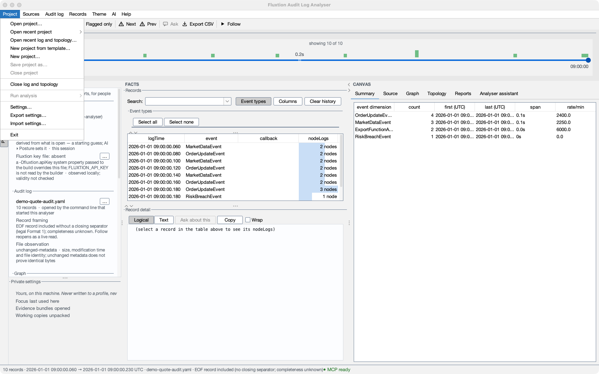
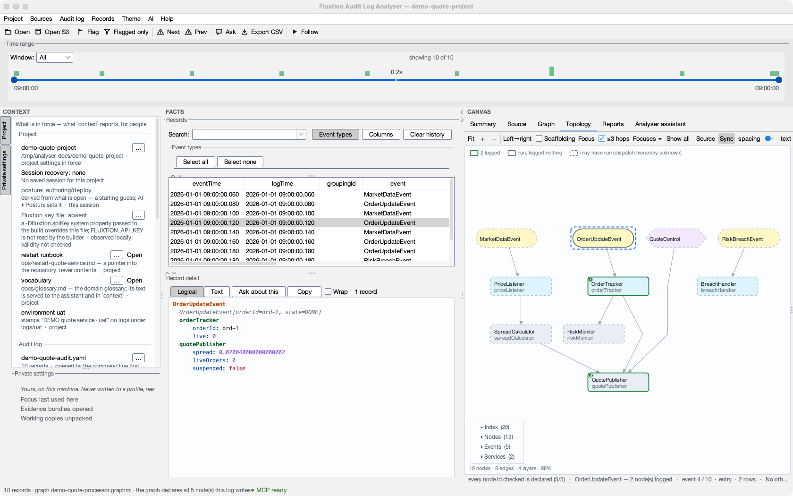

# Projects, profiles and sharing

If you look after more than one Fluxtion application, you keep swapping the same things: source roots, Maven
repositories, event processors, saved charts, reports. A **project profile** holds them in one file beside the
project's code, `<project>/.analyser/project.fluxtion-settings`, so moving between applications is one click.

A profile also carries what the team knows about the system: pointers to its runbooks and glossary, its environments,
the analyses it runs every time, and where its reports go. It is designed to be committed with the code, so a
colleague who clones the repository opens the same workspace. And settings can travel without a project, as a
*shared settings file*.

With **no project open**, the analyser uses your own settings. Projects are opt-in.

## What is kept where

Every setting has one home. **Project** settings live in the profile, and switching project swaps them. **Machine**
settings live in `~/.fluxtion-analyser/config`, for you on this machine, and a project never carries them. Nothing
is in both, so there is no rule about which wins.

| Setting | Home | In a shared settings file: category (default) | In an evidence bundle |
|---|---|---|---|
| Source roots, and the workspace anchor | project | Source roots (on) | no |
| Maven repositories, and whether to search them | project | Maven repos (on) | no |
| Event processors, and the active one | project | Event processors (on) | no |
| Saved charts and named topology focuses | project | Graphs and named focuses (on) | yes, except a chart with an external CSV series or markers |
| Investigation reports and spotlight walks | project | Investigation reports and spotlight walks (on) | yes |
| Hidden columns | project | View (on) | yes |
| Runbook pointers and their descriptions | project | Runbook LOCATIONS and descriptions (**off**) | no |
| The glossary pointer | project | Domain glossary LOCATION (on) | no |
| Environments | project | Environments (on) | no |
| Saved analyses | project | Saved analyses (on) | no |
| Report destinations, and the project's exchange folder | project | Report destinations (**off**); the exchange folder only in a project profile | no |
| The in-app assistant's two action limits (*Max action rounds* and *Max actions per reply*) | machine | Assistant limits (on) | no |
| **External MCP/REST access**, *Let the in-app assistant change the views as it answers*, and the in-app assistant's per-turn budget | machine | never: an import that finds one of the two switches names it and ignores it | never |
| The in-app assistant's provider, model and base URL | machine | LLM provider/model/base-URL (never the API key) (**off**) | no |
| The in-app assistant's **API key** | machine | never | never |
| Claude Code's switches, mode, model and spend limit; confirmed folders; file exchange; project creation; the machine's exchange folder | machine | never | never |
| AWS profile and region, theme, window size, recent files, search history, topology display | machine | never | never |
| Session-recovery candidates | machine | never | never |

The **Fluxtion build key**, for regenerating a processor, is not an analyser setting. It lives in
`~/.fluxtion/fluxtion.apiKeyFile`, managed from **AI ▸ Fluxtion API key…**, and cannot enter a profile, a settings
file or a bundle. The Project panel says whether that file has a key; it cannot know whether a build will be given an
overriding `-Dfluxtion.apiKey`, and says so.

!!! note "A shared settings file cannot turn on External MCP/REST access"
    The *Assistant limits* category carries only the in-app assistant's two action limits, *Max action rounds* and
    *Max actions per reply*. No access switch is ever exported, applied on import or kept in a project profile:
    *External MCP/REST access*, *Let the in-app assistant change the views as it answers*, file exchange, project
    creation and the Claude Code switches are set on each machine. A file that carries one anyway (made by an older
    analyser, or by hand) has it ignored, and the import summary says so, for example *"External MCP/REST access is
    set on this machine only — this file's value was ignored"*. To turn external access on for a team, each person
    ticks it once on their own machine.

A generated project may also carry `skills.provenance`, a value-free identity such as `canonical@<revision>` saying
which vendored skill snapshot it received. The Project panel shows it as a fact; the analyser never fetches anything
because of it. A hand-edited `skills.source` is refused: a shared project must not redirect the instructions an agent
reads.

Source roots also authorise reading the Spring XML design and the producer results under them. For Spring design
rendering, include the design directory and a root containing `target/`. A file inside the project but outside the
configured roots is refused ([Source navigation](source-navigation.md#spring-design-and-file-glances)).

## Start a project

- **From a template**: *Project ▸ New project from template…*, or **From template** on the start page, downloads a
  starter project from the playground's catalogue into a new or empty folder, and opens the project profile it
  ships, if it ships one. It builds and runs nothing ([Starter templates and examples](../start/templates-and-examples.md)).
- **With the assistant**: ask Claude Code in the analyser to build a new application, and it offers one of the
  analyser's starters for you to confirm ([Create from a starter with the assistant](#create-from-a-starter-with-the-assistant)).
- **For code you have**: *Project ▸ New project…*, below; or let Claude Code look at the folder and propose the
  set-up ([Set up a project with Claude](../build/set-up-with-claude.md)).
- **From a log**: open an audit log that sits inside a project folder, and the analyser offers to open that project
  ([Opening a log inside a project](#opening-a-log-inside-a-project)).

### Create from a starter with the assistant

Spring is the preferred route: start with a template, then load the skills. Claude Code in the analyser can list the
analyser's starter templates (`context.starters`: each one's id, name, description, how its graph is authored, where
it runs, and whether its build needs a Fluxtion key, Spring first and recommended) and **propose** one. It never
creates the project itself, and it never names a folder.

1. **The proposal.** A banner says Claude Code has a proposal; **Review…** opens one row: *Create a project from
   starter* **Fluxtion Spring XML** *(Spring XML · embedded · AOT · build needs a Fluxtion key; none found on this
   machine)*, Claude's reason in its own words, a **Folder** with **Choose…**, and *Downloads from
   fluxtion-playground.dev; nothing is built or run.* The row starts at **No**, and **Apply chosen** stays disabled
   until you choose a new or empty folder. A starter's build that needs a key says so whether or not one is found.
2. **The download.** Only your Apply downloads, from the configured HTTPS origin, and unpacks with the same checks as
   *New project from template…*. Nothing is built or run.
3. **The skills.** The analyser writes the project's skills from its own copy — the canonical set for the starter's
   authoring and host and, for Spring, the playground's design skill and XML contract, each checked against its
   pinned digest — under `.claude/skills/`. A file already there is never overwritten. The design skill and contract
   are bundled with the publisher's permission (owner, 2026-10-18); the playground's licence statement is pending (UP-PG-10). Once every pin has
   matched, one thing is filled in: *add-a-node*'s placeholder for the regeneration command becomes the starter's own
   steps from the analyser's first-run record (for the Spring starters `./check-fluxtion-key.sh`, `./setup.sh`,
   `./validate.sh`, `./generate.sh`) and whether they need a Fluxtion API key. A starter with no such record keeps
   the placeholder. `.claude/skills/.vendored.json` lists each file's pinned source digest and its written digest,
   and marks the substituted file.
   Filesystem writes are not transactional: a failure can leave some skill files without a new digest record.
   The status reports incomplete installation; inspect those files before relying on the skill set. Existing files
   and an existing digest record are never overwritten. The project review still proceeds.
4. **One review.** What opening the project puts in force: with the starter's own profile, one row opens it (its source
   roots, processor and runbooks named); without one, each discovered source root and skill is a row. Every row
   starts at No except the Spring design folder (`src/main/fluxtion/designer`), which is pre-ticked: it is inside the
   project you just created, and it is needed to show the Spring design. **Close** opens nothing and leaves the
   files.
5. **Synced.** The project opens, its Spring design is shown at once, and the analyser watches for the first build's
   GraphML and offers to open it, which pairs it with the project's logs.
6. **Back to Claude.** The project's folder is not the folder the session started in, so the analyser offers to
   restart Claude Code there (the folder is confirmed as for any Start); the new session loads the project's
   `CLAUDE.md` and the skills. A short draft is placed — *Project … was created from starter …; read PROJECT.md and
   the spring-authoring skill, then lead the Spring design conversation.* — and nothing is sent until you press
   **Send**.

Your Apply is the consent, so *Allow the assistant to create projects* does not gate this path. The same chain runs
from *Project ▸ New project from template…*, which ends by showing the starter's own commands instead of a draft.

Switching to another project, or closing the project, cancels this starter's later automatic opens and drafts,
including an unanswered first-build graph offer. Downloaded files stay where they were written; a draft already
placed is not erased. A failed switch or re-opening the active project leaves the starter running.

## Opening and switching



Project actions have their own top-level menu: they change *which project's settings are in force*.
Use Sources and Audit log for the inputs you inspect. **Save project as…** and **Close project** are greyed out until
a project is open.

**Project ▸ Open project…** — pick the project directory, or its `.fluxtion-settings` file directly.

Opening a project can offer to reopen its log and topology. Only an open you started yourself can make that offer: an
assistant's `open {project}` cannot inherit your permission to be asked. The offer's lists say whether they come from
**project locations** or from **machine recent files**; the second makes no claim that the file belongs to the
project.

- **Project ▸ Open recent project** — the last ten, most recent first.
- **Project ▸ New project from template…** — downloads a catalogue-selected starter into a destination
  you approve, safely extracts it and opens its bundled profile. It shows commands but runs none. Its
  destination dialog carries one unchecked option to **create a `CLAUDE.md`** of canonical authoring links
  in a legacy or support-disabled project. Current support-enabled templates ship agent entry files; a template that does
  ship one keeps it — the file is never overwritten, and the status line says which happened.
- **Project ▸ New project…** — chooses a directory, then offers the Java source roots, `SKILL.md` runbooks
  and GraphML it can already see there, plus one option that is different in kind: **creating a
  `CLAUDE.md`** in that directory pointing at the canonical Fluxtion authoring documentation. Every box
  starts off: finding is not adding. Confirm only the facts this analyser should adopt; an empty directory
  produces an ordinary empty offer and can still become an empty profile — the `CLAUDE.md` offer appears
  there too, since it is the case where it helps most. It never inherits whatever you happened to have
  open, or "new project" would just be a slow way to copy one.
  If the directory already has a project you are asked straight away whether to open it instead, before any
  offer is shown, and a folder that does not exist is refused (make it first — *New project…* does not create
  one); discovery reads only inside the folder you chose, never through a link to somewhere else; and if the profile cannot be written — or one appears while the dialog is open — the
  create is refused with a warning and the settings you had stay exactly as they were.
- **Project ▸ Save project as…** — forks the current settings to another project, which becomes active.
- **Project ▸ Close project** — returns to the settings you had **before you ever opened a project**.



With a project open, its name sits in the window title — so *which settings am I using right now* is
never a guess.

### The day-two journey

After trying a prepared example, use **Project ▸ New project…** on your own repository. The one offer is
the hand-off from demo to real work:

1. review the detected `src/main/java` roots (including one-level Maven modules);
2. choose any project-owned skills that should become declared runbook pointers;
3. optionally choose one discovered GraphML topology to open;
4. optionally ask it to create a `CLAUDE.md` — see below, this one writes a file;
5. confirm once. Only those checked facts enter the new profile.

The scans are bounded and skip build output, dependencies and symlinks. If a safety cap is reached the
dialog says the offer is partial rather than presenting it as the whole repository.

### The one option that writes to your repository

Choices 1–3 record **pointers** in the analyser's own profile and change nothing in your working tree. The
`CLAUDE.md` option is different and is described separately for that reason:

- it **creates a file in the directory you chose** — the only documentation the analyser ever writes into
  a repository;
- it contains **links and one line each**, to the canonical Fluxtion authoring resources, and deliberately
  restates none of their content. Improving those pages improves the file, which is the point of pointing
  rather than copying;
- a link that applies only to Spring-authored projects is written **only** when the directory looks
  Spring-authored;
- it **never overwrites an existing `CLAUDE.md`.** If you already have one, the dialog says so and the
  option is not offered; if one appears while the dialog is open, the write is refused and you are told;
- it is **unchecked by default**, like everything else in that dialog, and it does **not** enter the
  profile — the profile records pointers to files, and this is a file, not a pointer to one.

!!! info "Switching replaces, it doesn't merge"

    Open project B while A is active and A's source roots are **gone**, not listed underneath B's. That
    is the whole point: importing one project's settings on top of another's is how you end up with
    four projects' source roots and no idea which is which.

    A profile that mentions no graphs leaves you with no graphs — the replace covers every project
    category, not just the ones the file happens to contain.

!!! note "Switching a project closes the log and graph"

    A profile owns your source roots, event processors, named graphs, focuses and reports. Swap it
    and all of those change underneath whatever you were looking at, so the log and its topology are
    closed with it — otherwise you'd be reading one project's log through another's settings.

    The exception is accepting the *"this log sits inside a project"* offer: there the project is
    adopted **because** you opened that log, so the log stays.

## Your own settings are kept

The first time you open a project, the source roots and graphs you had are **not** deleted. They become
your "no project" settings, and **Close project** brings them back. A year of accumulated configuration
is not something a single click should consume.

## Edits save as you make them

There is no **Save project**. Change a source root, add a graph, hide a column — it persists to the
active project, the same way the analyser has always saved its config. Writes are **debounced**, so a
burst of edits becomes one write rather than fifteen; a profile is often a committed file and a legible
diff is what gets it reviewed.

This includes edits made by an **assistant over the socket**. If an agent adds a source root with
`analyser_source_root`, that lands in the active project like any other change.

## Committing a profile to your repo

`.analyser/project.fluxtion-settings` is designed to be committed, like `.vscode/settings.json`. Clone
the repo, open the analyser, and the project's source roots, event processor and curated graphs are
already configured.

For alternative configurations of the same project, keep named profiles alongside it, such as
`.analyser/project.demo.fluxtion-settings`. Open a named profile explicitly with
`open {project: "path/to/project/.analyser/project.demo.fluxtion-settings"}`. Canonical and named
profiles both resolve relative paths from the directory containing `.analyser/`. Automatic discovery
still looks for `project.fluxtion-settings`; other settings filenames retain their own directory as
the relative-path base.

!!! success "Why it's safe to commit"

    **A profile cannot contain either your LLM API key or your Fluxtion build-key value.** The LLM key
    is outside the project tier, while the build key never enters `AppConfig` at all: its dialog writes
    straight to the established local Fluxtion file and then forgets the value.

    The same holds for your AWS profile, your theme and your window size: all machine-tier, none of them
    written to a profile. And paths under your home directory are stored `~`-relative, so a teammate's
    checkout resolves them on their own machine.

    A path that is neither absolute nor `~`-prefixed is **relative to the project root** — the directory
    that holds `.analyser/` — so a hand-written `sourceRoot.0=src/main/java` means what it says, the way
    it would in `.vscode/settings.json`. The analyser writes the file the same way: paths under the
    project come out project-relative, and there is no timestamp, so opening a project and changing
    nothing leaves the committed file **byte-for-byte as it was**. A diff in that file means a setting
    changed.

Treat a committed profile as config-as-code: it evolves, and the diffs are worth reviewing like any
other change.

## Opening a log inside a project

Open an audit log that sits anywhere under a project directory and the analyser offers to load that
project. This is what makes a downloaded example configure itself — get the bundle, open its log, and
the source roots and graphs are set up without touching Settings.

It asks **once per log**, never for a project that's already open, and takes "no" for an answer for the
rest of the session. Opening a log from `s3://` never triggers it: the object is streamed to a temporary
file, and a temp directory isn't a project.

## From an agent

An assistant working over the [action socket](../reference/verbs.md) sees the same offer as data —
`context` reports `projectOffer` with the settings path — and accepts it with
`open {project: "<that path>"}`; the same call opens any project by directory. It also reads which
project is in force (`context.project`) and leaves one with `open {close: "project"}`.

The verb **applies rather than asks**, because a question nobody can answer over the socket would
freeze the app. What makes that safe is the answer it gives back: every project-owned category with
its count before and after the switch, the log and graph it closed and where they were (an explicit
switch is a session boundary, exactly as it is from the Project menu), the project that was active before,
and the one call that undoes it. Your MCP client's own approval prompt on `open` is where a human says
yes or no.

An agent can also **create** a project, through the same discovery as *Project ▸ New project…* rather than
by writing a profile by hand: `open {project: "<absolute dir>", create: true}` previews the offer and writes
nothing, and `open {project: "<absolute dir>", create: {sourceRoots, skills, referenceGuide, offerDigest}}`
creates it with only the items named from that offer. Opening a graph is a separate `open {graphml}`.
See [the open verb](../reference/verbs.md#open) for the full contract.

!!! warning "An assistant creates a project only with your consent"

    **Settings ▸ Assistant ▸ Allow the assistant to create projects** is off by default, and it is this
    machine's setting alone: it is never stored in a project profile, a shared settings file or an evidence
    bundle, so a repository you clone cannot turn it on. It gates an assistant — over MCP/REST or the in-app
    assistant — and never you: *Project ▸ New project…* works whatever it says. A create never overwrites
    an existing project; the project it creates becomes the one opened at the next start.

## If a project moves

If the active project's file is gone — repository renamed, checkout deleted — the analyser starts
normally, says so in the status bar, and forgets the pointer. It never fails to open because of a
project, and your machine settings are untouched.

Saved chart definitions remain visible in the Project panel and `context.savedGraphs` after reopening
a profile without a log. They are waiting for input, not proof of restored data or valid series bindings.

A project's processor declarations, and opening a project with no log, are described on
[The Project panel](project-panel.md).

## Restore an earlier session

Closing a project or quitting records a recovery candidate in your local analyser settings. Opening the
project again or relaunching offers **Restore last session** on the start page. Nothing opens until you
accept. **Dismiss** leaves the project declarations available without opening evidence. The Project panel
states the same recovery status; its buttons remain navigation only.

Restoration checks file contents and then opens the unchanged log (or complete rolled set), topology,
design and producer diagnostics. Missing or changed parts are named individually. An incomplete or changed rolled
set is refused as a unit, including a member that changes during the restoring read. Saved record filters, selection and topology navigation require matching input
identities; a replaced file cannot silently acquire the old cursor. Recovery reports the record filter's
visible/total count and any saved chart window wholly outside the log. A pin is preserved deliberately:
unpin that chart explicitly to follow the current data.

`context.restoration` reports the offer, verification, pending opens and final outcome. Use
`open {restore: "last"}` to accept or `open {restore: "dismiss"}` to decline, each alone. A pending response
is not proof that the files loaded: wait for the final state and inspect the outcome. Neither action runs
the project, its build scripts or its runbooks. If a newer open supersedes recovery, its state returns
to `offered`; wait for that open to finish before accepting again, or dismiss the offer. Buttons retain
the generation of the offer they displayed, so a stale button cannot accept another project's offer. An MCP request
addresses whichever offer is current when it is handled.

Candidates are keyed by canonical project-profile location, with a separate no-project bucket. They are
not shared in profiles or exported ZIPs. A moved or missing project never inherits another project's
session.

Each candidate also records which profile captured it. The identity is a random `profileNonce` that the
analyser writes into the profile once, when it creates the profile, and keeps on every later save. It is
taken when the session is captured, not later when the candidate is written out. A project deleted and
created again at the same location has a new profile with a new nonce, so it is not offered the old
project's session even though the path matches. The offer is withheld, and `context.restoration` reports
`capturedBy: "different profile at this path"`, when the session was captured (`capturedAt`) and what it
would have opened (`inputs`). A re-extracted download is withheld too: its profile usually has no nonce
yet (see below).

The nonce is part of the file's contents, not a file-system property, so it behaves the same on macOS,
Linux and Windows. The tools that usually rewrite a committed profile are a `git pull` or checkout and an
IDE that saves by writing a temporary file and renaming it. Both keep the identity as long as they keep the
`profileNonce` line. Checking out a version that has a different nonce, or none, changes it. A copy of the
file (a clone, or an archive of a committed profile) carries its nonce. At another location it is a
different recovery key anyway; at the same location it counts as the same profile, and every input is
still checked before anything opens. A share export never includes the nonce, and importing settings never
changes it.

A profile with no nonce, written by an older analyser version or shipped in a downloaded bundle, gets one
the first time the analyser saves a change to it. Opening it alone writes nothing. Until then, and for any
candidate saved by an older analyser version, the session is withheld with `capturedBy: "unknown"`. A
missing identity is never treated as a match.

Legacy global recent-log/topology paths remain explicit recent-menu choices, not automatic
startup opens. A command-line log opens only that requested log.

Identity here means observed file bytes, not proof of the application's build or execution identity.
Record navigation is withheld when an input has no stable local read identity (including a growing log
changed since loading or a temporary remote input). Topology navigation requires an unchanged explicit
graph file; a reader-supplied graph has no separate file identity. Commentary and spotlight captions are
not saved by session recovery. Reports retain their existing evidence and freshness rules.

Built-in YAML and rolled files calculate the full SHA-256 from the indexing read; there is no size cutoff
or metadata-only shortcut. Capture and accepted restoration still verify current file bytes. Plugin
readers that own their I/O retain before/after full-file checks. Thus the indexed-reader optimisation
removes two extra traversals on native opens, not all hashing costs or verification passes everywhere.

### Files changed outside the analyser

The Project panel and `context.log.freshness` / `context.graphPairing.freshness` separate
loaded file observations from metadata on disk. The loaded record count, time range and byte size
do not quietly adopt a newer file's size. Reopen the same log or GraphML path explicitly to replace
the loaded snapshot. The analyser does not select new evidence just because a file changed.

These observations compare size, modification time and file identity. `unchanged-metadata` is
**not** proof of identical bytes; a writer preserving all metadata can evade this cheap check.
Recovery's full SHA-256 verification is unchanged. Unknown observations stay unknown. Follow still
uses its explicit append/rotation route; a growing pending tail can be reported changed before
its next complete record is indexed. Exported reports identify the loaded snapshot and its metadata
observation instead of presenting it as the latest disk contents.

Producer comparisons are **as of intake**. If an observed result, receipt, authoring record or
Java source changes, the Source header and design input facts expire the old comparison and ask
you to reopen diagnostics. `open {discover: "diagnostics"}` lists the candidates; it does not
select a newer result. Context and returning focus to the window refresh these observations.

## Portable context: what the team knows

A profile carries more than settings: named focuses **with the reason each was saved**, investigation reports, and
pointers to the team's runbooks and glossary. That makes it a **workspace**: what the team knows about this system,
portable between a person and an AI working on the same log, and between one machine and the next. What is allowed in
is decided by one rule. For the AI side, how an assistant finds and uses these, see
[Runbooks, glossary and saved analyses with an AI](../ai-and-runbooks.md).

### Three tiers, decided by whether the stored thing runs

| Tier | What it is | Examples | Travels in a shared profile? |
|---|---|---|---|
| **1 · Facts** | Inert statements about the system | glossary, environments, runbook *locations* | **Yes**: this is what sharing is for |
| **2 · Analyses** | Sequences of **analyser** verbs | saved charts, focuses, reports, saved analyses | **Yes**: a saved analysis can only drive this viewer, because no server verb is on the analyser's action socket |
| **3 · Runbooks** | Knowledge that causes something to happen elsewhere | build, deploy, restart, pull logs | **Never as content**: only as a pointer |

### A runbook is a pointer

The profile records *"the deploy runbook for this system is `ops/deploy.md`"*, relative to the project
root. It does **not** record the commands.

> anything in a profile that an agent will act on must be inert, or a pointer to something under
> version control — never an instruction the profile itself carries.

Why it matters: profiles move by email and in repositories. If a profile could carry
instructions, opening a colleague's project with an agent attached would execute text written by
whoever sent the file. With a pointer, the executable content stays in your repository — reviewed,
diffed, attributable, revertible — and the trust boundary becomes *"you cloned this repo"*, which every
developer already evaluates, instead of *"you opened a file someone sent you"*, which nobody does.

**What the analyser does with a pointer: shows it — to you.** *Open* on the Project panel's runbook row
reads the file in a read-only viewer, as written; *Show file* opens it in the file manager. The analyser
never **executes** a runbook and never **serves its contents to an agent** — an agent that wants to deploy
reads the file from the repository with its own tools; the analyser only tells it where.

#### Recording one

In the profile itself — `.analyser/project.fluxtion-settings`, committed with the repository:

```properties
runbook.count=2
runbook.0.name=deploy
runbook.0.path=ops/deploy.md
runbook.1.name=pull-logs
runbook.1.path=docs/runbooks/pull-logs.md
```

That is deliberate, and it is the whole point of the tier: the file that says *where the runbooks are*
is reviewed, diffed and attributed like the runbooks themselves. There is no action-socket verb for it —
an agent recording pointers into a profile would be the one unreviewed path into a reviewed file, and the
analyser's verb surface is a compatibility surface that grows only when a verb has no home in an existing
one (`open` absorbed close, discover and project for the same reason).

The value is validated **at every entrance** — the profile loader, share import and share export — and
refused **with a reason** when it is anything but a plain relative path inside the project:

- absolute paths, drive letters, `~`, URLs
- `..` anywhere in the path
- spaces, quotes, `$`, `;`, `|`, `&`, `<`, `>`, `*`, `?`, backticks, line breaks — everything a command
  line needs
- more than 200 characters

Opening a project whose profile carries such an entry says so in the status bar — *"⚠ runbooks: 1 entry
REFUSED — not a project-relative path: …"* — and the pointer beside it still loads. A share file that
carries runbook *contents* imports the same way.

#### Write it in the skill shape

The analyser needs only the path, but write the runbook file the way an AI harness loads a **skill** —
frontmatter `name` and `description`, then the steps (see [Runbooks, glossary and posture](../ai-and-runbooks.md)). A pointer may target a skill file directly (`.claude/skills/deploy/SKILL.md`), so one
file serves the team, Claude Code and the analyser. Its `description` appears in `context` and on the Project panel,
so a model can pick the right runbook without opening all of them.

#### Where you see it

The **Project panel** lists each pointer under the project row — *`deploy runbook: ops/deploy.md ·
project`* — with *Open* (read it here), *Copy* and *Show file* acting on where it lands on your machine,
and a warning when the file is not there. `context` reports the same under `runbooks` (`name`, `path`, `resolved`, `exists`, `from`),
so an agent and a person read one set of facts.

#### Sharing it

*Project ▸ Export settings…* has a **Runbook LOCATIONS and descriptions** checkbox. It is **off by default**: a path such as `ops/deploy.md` says something about how your
repository is laid out, so it leaves only when you tick it.

### Vocabulary — what `live` means *here*

Two readers need exactly the same thing and neither has it: an **LLM** answering about a processor it has
never seen, and a **support engineer in their first week** answering about a system they did not build.
The node is called `spreadCalculator`; what the number means is in somebody's head.

The project points at a glossary — a markdown file in the repository, the same rule as a runbook (owner
decision, 2026-08-27: one rule for pointed-at content, not two):

```properties
vocabulary=docs/glossary.md
```

The file is yours to shape. What earns its place: what each domain term means in *this* system (`live`,
`suspended`, `breach`), what a normal value looks like (a typical spread, an unusual one), which nodes
matter and which are plumbing, which events are routine and which never are.

**What the analyser does with it — this is the one pointer whose contents it reads.** A glossary is
tier-1 fact: inert, read, never acted on. So its text is served in `context` (`vocabulary.text`, capped at
16 000 characters) and placed **first** in the in-app assistant's prompt for every *Ask* question — before the record, because
what `live` means decides how every number in the record reads. A runbook's contents are never read; a
glossary's are the point.

The pointer is validated at every entrance like a runbook's; a refused value is announced in the status
bar on project open. It travels by default under **Domain glossary LOCATION (a markdown file in your
repository — never its contents)** — inert, so there is nothing to consent to beyond a path.

The Project panel shows it under the project row — *`vocabulary · docs/glossary.md`*, warning when the
file is missing.

### Environments — which system this log came from

Two environments running the same build emit logs identical in shape and usually in filename. Only a
declared value separates them, and today that value is typed by whoever wrote the export script, per
site. The failure this prevents has no symptom: an answer **correct about UAT and read as production**.

The project declares its environments and, for each, the **§E provenance** a log from it carries:

```properties
environment.count=2
environment.0.name=prod
environment.0.provenance=risk-engine · prod · ldn
environment.0.logDir=logs/prod
environment.1.name=uat
environment.1.provenance=risk-engine · uat
environment.1.logDir=logs/uat
environment.default=uat
```

When a log is opened **without** a declared provenance, the analyser looks for the first environment
whose `logDir` contains the file, then the default; the match supplies the provenance that rides the
status bar, report headers and the mismatch banner. It never guesses: with no `logDir` match and no
default, the log has no provenance, as before.

**A declaration always wins.** `open {log, provenance}` from an agent — or a server that knows which
environment it is — beats the project's environments, and `context.provenanceSource` says
which answered: *declared by the opener*, *project environment 'prod' — the log is under logs/prod*, or
*project default environment 'uat'*. The Project panel's log row carries the same words.

A matched provenance is **qualified wherever it leaves the session**: a report's header reads *"risk-engine ·
prod (matched by directory, not declared) · 5821 record(s)"*, because directory matching is a heuristic
about the filesystem standing in for a claim about a system — a prod log copied into `logs/uat/` to be
looked at matches honestly and wrongly, and the report is read by someone who was not there. Two rules
worth knowing: with nested log directories the environment declared **first** wins, so declare the more
specific one first; and a remote open (S3) with no local copy takes only the **default**, which is then
reported as exactly that — a project that does not want remote logs stamped declares no default.

Environments **travel by default** in a shared profile, under **Environments (names, the provenance
string each stamps — which may name systems and hosts — and their log directories; never log data)**:
the label says exactly what leaves, because a provenance string is estate detail even if it is not a
secret. `logDir` is a pointer and passes the same gate as a runbook's.

### Repeatable analyses — the one we run every time

*Open this log, filter to that node, build those series, produce that report* — saved by name, with
its **rationale**, because a saved view without its reason is an unexplained view (the pattern named
focuses set). Parameters are declared and bound when it runs, so one analysis serves every incident of a
kind.

```properties
analysis.count=1
analysis.0.name=spread breach
analysis.0.rationale=every breach incident starts the same way: the spread before it
analysis.0.param.count=2
analysis.0.param.0.name=log
analysis.0.param.1.name=node
analysis.0.param.1.default=quotePublisher
analysis.0.step.count=3
analysis.0.step.0.action=open
analysis.0.step.0.params={"log": "{log}"}
analysis.0.step.1.action=filter
analysis.0.step.1.params={"text": "{node}"}
analysis.0.step.2.action=graph
analysis.0.step.2.params={"name": "Spread — {node}", "series": ["{node}.spread"]}
```

Each step is an action-socket verb with its params exactly as the socket would receive them; `{name}`
anywhere in a value is replaced by the bound parameter.

**Tier 2, by construction — and by enumeration.** A saved analysis can drive this viewer; open a log or
graph **inside the project** (or one you bind at run time as a `{parameter}`); add source roots inside
the project; and write a report or screenshot **only into the exchange directory**. It cannot switch or
close a project (a session boundary is a person's act — refused as a step), cannot name a path outside
the project (every path in a step — `open.log/logs/graphml`, `source_root.add/remove`, `report.path`,
`screenshot.path` — passes the same gate as a runbook pointer: project-relative, no `..`, no command
shapes), and cannot reach a server, because server verbs never appear on the action socket. Project-
relative paths in `open` and `source_root` steps resolve against the project root when the analysis runs,
so the same analysis works from any checkout; report and screenshot paths are relative to the exchange
directory. Closing a log or a graph is a legitimate step.

**Recall is an offer.** `context.analyses` lists each analysis with its rationale and the parameters it
declares; nothing runs by itself. To run one:

- **Project ▸ Run analysis ▸ *name*** — a small dialog asks for the parameters (defaults prefilled).
- `open {analysis: "spread breach", bind: {log: "/path/to/audit.yaml"}}` over the socket.

Steps run in order through the same dispatcher the socket uses, so every guard a verb has applies, and
the run **stops at the first failure** — the echo reports each step and where it stopped. A parameter
with no value and no default refuses the run and names itself.

Analyses travel by default under **Saved analyses (named analyser-verb sequences with their rationale —
they can only drive this viewer, never a server)**. The Project panel lists them under *Analyses* — the
offer stated, with no run button, because a button that runs verbs would change what the app shows.

### Report destinations — a place, never a credential

The project may record **where** an investigation report is published — a bucket, a directory, a ticket
system's base URL:

```properties
destination.count=2
destination.0.name=incident-bucket
destination.0.location=s3://acme-incident-reports/quote-service
destination.1.name=shared-drive
destination.1.location=/mnt/shared/reports/quote-service
```

It may **never** record how to authenticate there, and the gate makes that structural rather than
polite: a URL with user info, a query or a fragment is refused (tokens travel there); anything matching
a credential's shape (`AKIA…`, `token=`, `password=`, `Authorization:`) is refused with the reason; S3
locations must be `s3://bucket[/prefix]` and directories plain paths. Credentials continue to come from
the environment the publisher already runs in.

**The analyser does not publish.** It states the place — in `context.reportDestinations` and the
Project panel's Reports section (*publish to incident-bucket: s3://… · s3*) — so the agent that rendered a
report knows where it belongs and publishes with its own credentials. File-writing verbs stay inside the
exchange directory, and the analyser gains no server-side code, which is a standing decision.

**One shape no inspection can catch: a webhook.** `https://hooks.slack.com/services/…` is a credential
in path form — anyone holding it can post to the channel — and "publish the incident report to the team's
channel" is the first thing a support team would paste. The known webhook hosts (Slack, Teams, Discord,
Zapier, Telegram, Google Chat) are refused by name, and the **Report destinations** share checkbox is
**off by default**, like *LLM*: a field that can hold a secret is shared knowingly or not at all. Publish
to a channel through the agent's own configured integration; record the *place* the report belongs.

### Path anchors — one rule, and the anchor that was missing

Three forms of path already exist in a profile and are chosen automatically, most specific first:
**project-relative** when the path is under the project root; **`~/…`** when it is under your home;
**absolute** otherwise. There is deliberately no per-path toggle: a profile whose paths were each chosen
by hand is one where portability varies row by row, nobody remembers why, and the failure appears on a
colleague's machine.

The gap was an **anchor**. A sibling checkout — `../shared-lib/src/main/java`, the monorepo neighbour —
is outside the project root, so it was written `~/work/shared-lib/…`: portable for *you* on another
machine, silently wrong for a colleague who checks out somewhere else. Declare once, per project, where
the workspace is:

```properties
workspaceRoot=..
```

A root under that anchor (and not under the project) is then written relative to the project with `..`
steps — `sourceRoot.0=../shared-lib/src/main/java` — and resolves against the profile's own directory on
every machine. The anchor must be `.`, `..`, `../..` … (at or above the project root, at most six up);
anything else is refused and announced. It rides the **Source roots** share category and applies to Maven
repos too.

**Declare it where the roots are.** *Settings ▸ Source roots* has a **Workspace anchor** control above the
list. It is a short list, not a folder chooser, because the value is a *depth*: each entry shows the
directory it resolves to on this machine and **how many of your current roots it would make portable**, so
you pick the shallowest one that covers them by reading the list rather than by working out what `../..`
means for your layout. The filesystem root is never offered — every path is under it, so it would claim a
perfect score while writing your machine's whole layout into the profile as a run of `..` steps.

**This does not weaken the pointer rule.** Runbook and vocabulary pointers stay project-relative with no
`..` — those are things an agent acts on, and the trust boundary is the repository you cloned. Source roots
and Maven repos are inert lists the analyser resolves, and may use the wider anchor.

**And it is visible.** The Project panel's *Source roots* section shows each root's **stored form** —
*project-relative*, *workspace-relative*, *~*, *absolute* — and, under a project, marks *absolute* and *~*
roots as a warning: this profile will not resolve them on a colleague's machine. That badge, on a row in a
profile you are about to share, is the whole warning, delivered before the failure.

### Mixed versions — a newer profile survives an older analyser

A profile is committed with the repository, and not everyone on a team runs the same analyser build. An
older build that opens a profile written by a newer one **keeps every key it does not understand** when it
saves: it rewrites only the key families it owns (so removing a runbook still removes it) and carries the
rest over byte for byte. The loader, likewise, ignores what it does not know — never rejects. So a project
can adopt a new kind of fact without waiting for every teammate to upgrade, and nobody's save quietly strips
it.


## Sharing settings with a file

Share an analysis setup as one file, so a team investigating the same processor starts from the same source roots,
event processors and named charts, formulas and pins included. Use a shared settings file to pass a setup to someone
without a project; to give them the project itself, commit its profile.

### Export

**Project ▸ Export settings…**, then tick what to include. The categories, and their defaults, are in the table in
[What is kept where](#what-is-kept-where). What some of them carry, in more detail:

| Category | What leaves |
|---|---|
| Source roots | your source directories, and the project's **workspace anchor** (`workspaceRoot=..`), which lets a sibling checkout travel as `../shared-lib/…` |
| Maven repos | local repositories, and the search switch |
| Event processors | the class names and the active one |
| Graphs and named focuses | named charts (series, formulas, resolve policy, pinned windows, notes, guides, condition bands, external-CSV definitions, marker definitions: never their extracted values) and named topology focuses (node sets and rationale) |
| Investigation reports and spotlight walks | report and walk **definitions**: section references, table column specs, the authoring context (log fingerprint and filter, **including any `provenance` string naming the system the log came from**, such as `risk-engine · localhost:8081 · ~/dev/risk`), walk steps and their conversations, and any **narrative text the author (often an agent) wrote about your data**. Never log records: evidence re-renders from the recipient's own log. Narrative is why this is its own checkbox |
| View | hidden columns |
| Assistant limits | the round limit and the per-reply cap only; never an access switch. See [What is kept where](#what-is-kept-where) |
| LLM provider/model/base-URL (never the API key) | the in-app assistant's provider, model and base URL, and **never the API key** |
| Runbook LOCATIONS and descriptions | name, project-relative path and one-line description, such as `deploy → ops/deploy.md`: a **pointer** into your repository, never its contents ([A runbook is a pointer](#a-runbook-is-a-pointer)) |
| Domain glossary LOCATION | the `vocabulary=docs/glossary.md` pointer, never the file's contents |
| Environments | names, the provenance string each stamps (which may name systems and hosts) and their log directories; never log data |
| Saved analyses | named analyser-verb sequences with their rationale; they can only drive this viewer, never a server |
| Report destinations | places only (a bucket, directory or base URL). Credential shapes and known webhook hosts are refused on export and import; the box is off because a webhook URL cannot be told from a place by inspection |

Every label names its cargo: ticking the box is consenting to exactly what it says.

A shared chart that uses **external series** carries the CSV's *definition* (path, columns, clock), never its data,
so it may depend on a local file the recipient does not have. Opening such a chart draws everything else and says
what did not resolve.

Then **Copy to clipboard**, **Save file…** (a `.fluxtion-settings` file, revealed in your file manager), or
**Email…**.

### What is never shared

Your **API key**, AWS profile and region, recent files, search history, window and theme, *External MCP/REST
access*, *Let the in-app assistant change the views as it answers*, file exchange, project creation, Claude Code's
settings and your confirmed folders are never exported, and the same whitelist is enforced on **import**, so a hand-made file
cannot plant or overwrite a secret. Paths under your home are written `~`-relative so they survive a move to another
machine. A runbook's **contents** never travel, and a value shaped like a command is refused, with a reason, on
export and import.

### Import: merge or open?

**Project ▸ Import settings…** asks which of two things you mean:

| Choice | What it does | Use it when |
|---|---|---|
| **Merge (share)** | *Adds* the file's settings to what you have now | A colleague sent you their setup and you want their charts alongside yours |
| **Open as project (replace)** | *Replaces* the project tier and makes the file the active project | The file is a project, and you want to work in it |

A merge shows a per-category **summary** (what is new, what would be replaced) before anything changes. Untick any
category you do not want. A switch the file carries that is set on each machine is listed as ignored, never
applied. On apply:

- **Lists merge** (source roots, Maven repos, event processors): nothing local is deleted.
- **Charts merge by name**: an incoming chart replaces a same-named local one; new names are added.
- **Single values** (the active processor, the assistant's two action limits, the LLM fields) are overwritten only when
  present and ticked.

