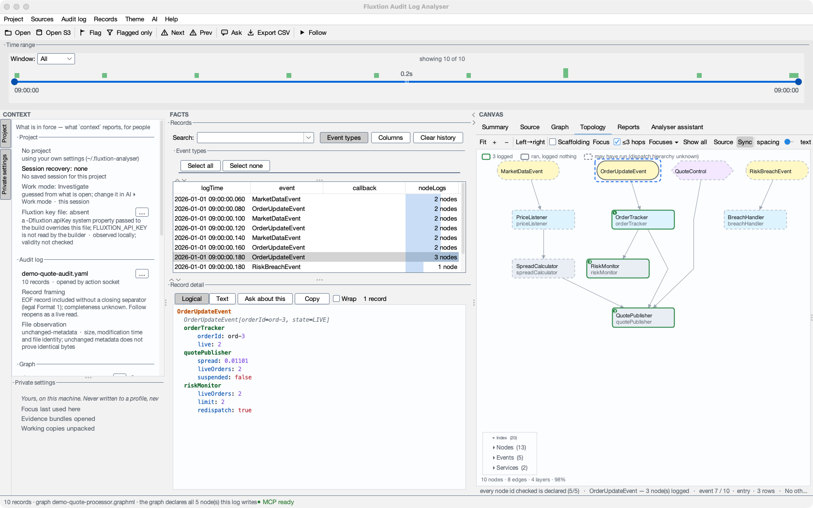

# Records, detail & filtering

These are the core surfaces — the ones you spend most time in. They're all **views over the same
Fluxtion audit log**: the log is the source of truth, and the table, detail viewer, search, filter,
summary, graphs and assistant are just different lenses on it. Narrow the view once and everything
follows.

The main window at a glance:

- **Time range** (top) — a histogram + slider that bounds the visible window.
- **Records** (centre) — one row per cycle, with the Search box, the **Event types** toggle and
  **Columns** above it. The toggle shows or hides the event-type checklist between the Search row and
  the table.
- **Record detail** (below the table) — the selected record's `nodeLogs`.
- **Right-hand tabs** — Summary, Source, Graph, Topology, Reports and the Analyser assistant.
- **Status bar** (bottom) — record count, time span and the open file.

## The records table

One row per **event cycle** (one propagation of the processor). Columns include the log time, the
event, the callback, the thread and a node-count. All times are shown in **UTC**.

- **Sort** by clicking a column header; **show/hide** columns from the **Columns** menu.
- **Select** a row to load it into the detail viewer; Shift/⌘-click to select several (the assistant
  sends all of them).
- **Anomaly tints** — rows with a parse-error, a breach or a `NaN` are highlighted; jump between them
  with **⚠ Next / ⚠ Prev** (**F3 / Shift+F3**).
- **Right-click** a row: *Diff selected two records*, the assistant's questions (*What happened here?*, *Compare these rows*, *Explain this finding* — see [Asking about what is on screen](../inapp/ask.md)), *Flag / unflag*.
- **Flag** rows with **F** to bookmark findings; *Records ▸ Show flagged only* focuses on them;
  *Records ▸ Copy selected as YAML* copies them to the clipboard.
- **Export** the records the filter shows with **Audit log ▸ Export records (CSV)…** or **Audit log ▸ Export records
  (YAML)…**, to a file you choose. A YAML export opens in the analyser again. A log read through the binary reader
  cannot be exported as YAML.

## Flagging & focus

Flagging turns the log into a working set of findings. Press **F** (or *Records ▸ Flag / unflag selected (F)*, or
right-click ▸ *Flag*) to bookmark the selected rows — flagged rows are **tinted** so they stand out in
context.

Toggle **Flagged only** (toolbar) to collapse the table to just the flagged records — a focused view of
everything you (or the assistant) marked as relevant, while the counts and time range still reflect it.
*Records ▸ Clear all flags* resets them.

Because flagging is also one of the assistant's [actions](../reference/verbs.md#actions-the-assistant-can-take), an agent's findings land here
as flags too — with a note attached — so its conclusions become a reviewable set in your own view, not
just text in a chat.

## The record detail viewer

Below the table, the selected record's **`nodeLogs`** in colourised YAML — the ordered list of every
node that ran in that cycle and the values it logged.

- **Click a nodeLog line** to open that node's source at the method that ran (needs
  [source roots](../admin/settings.md#source-roots-project)).
- **Click the event / `eventToString`** line to jump the Source view to the processor's handler for the
  cycle.
- **Right-click anywhere on a node line** to add any of its values to a graph — current, named, or new.
- **Copy** the shown record(s); toggle **Wrap** (off by default).

## Search

The search box above the table is a **full-text filter** over `eventToString`, `thread` **and** the
node-logs (case-insensitive). It combines with the other filters. Enter remembers a term (dropdown +
inline autocomplete); **Clear history** empties the saved terms. On a memory-mapped multi-GB log a text
search reads records from disk, so it's slower than the index-backed dimension/time filters — the
assistant's `aggregate`/`filter` echoes report `scan: index | raw` so you know which happened.

## The shared filter

One filter scopes **every** view at once — table, summary and graphs all honour it:

- **Time range** (top slider) — drag the two thumbs to bound `logTime`; drag the middle to pan the
  selection keeping its width; double-click to reset. Shrink the visible window with the **Window**
  control (All / week / day / hours / minutes) and pan it across the whole log.
- **Event types** (the toggle on the Records row, beside Search) — the checklist starts hidden, so the
  table keeps its rows, and stays as you last left it; tick the dimensions to keep (an
  **OR**). The list is split into **Event types** and **Callbacks**; use **Select all / Select none**,
  (beside the list) or right-click an entry for *Only this / Add / Remove*. **Select none** clears the view; leaving
  everything ticked means "all". Each entry counts its records **under the other filters**: `Tick (7)`
  when the search, the time range and *Flagged only* keep all seven, `Tick (3 / 7)` when they keep
  three, and a muted entry when they keep none — so you can see what ticking it would bring back. The
  entries stay in order of their totals.
- **Search** — the text filter above. A search set by the assistant (`filter {text: …}`), a walk step
  or the topology's node menu appears in the box too.
- **Flagged only** (toolbar) — the flagged records only.

## What is hidden, and why

A filter that hides records always says so, whether or not its control is on screen:

- The **Event types** toggle reads **▾ Event types** while the checklist shows and **▸ Event types**
  while it is hidden, and carries an accent badge — **1 of 7** — whenever a type filter is in force.
- The **Records** title gives the count: *Records: 3 of 21 shown · 18 hidden* (*Records: all 21 shown*
  when nothing is hidden), as does *showing 3 of 21* in the Time range header.
- A line under the title names **each filter that hides records**, with its own undo:
  *18 hidden by event types* **Show all** · *9 hidden by search "hedging"* **×**, and likewise
  *hidden by the time range* **Reset** and *hidden by flagged only* **Show all**. A record can fail
  more than one filter, so these counts can add up to more than the hidden total.
- When the filters hide **every** record, the empty table says which ones do and offers each undo:
  *No records: event types exclude all 21* **Select all** · *search "hedging" excludes 9* **Clear**.
  Record detail then says *the filter hides every record*.

The assistant sees the same: `context` reports each filter and what it hides (`context.hidden`, with
the excluded event types by name), and the in-app assistant's *About:* line says, for example,
*filtered: 1 event type hidden (RiskBreachEvent), 9 of 10 shown*.

These are plain components, so a screen reader reads them, and they follow the theme. So "why are
records missing?" is answered on the Records row itself: read the line under the title and press the
undo beside the filter you did not mean.

Because there's one filter and one log, the assistant can **drive these same controls** — filter to a
window, jump to a record, plot a series — and you see the result in the very views you're already
reading. See [Ask the assistant](../inapp/ask.md).

## Summary

The **Summary** tab rolls the *currently filtered* records up by event dimension with counts, first/last
times, span and rate. **Right-click** a summary row to filter the whole app by that dimension
(*Filter to / Add / Remove*) — a fast way to drill in.

## Diff

Select **two** records and *Diff selected two records* (Records menu or right-click) for a side-by-side
comparison of the two cycles.

Each record is flattened to `instanceId.key → value` (last occurrence within the record wins) and the
two are aligned key-by-key. Every row is classified and colour-coded:

- **changed** — the key exists in both records with different values (highlighted),
- **only A** / **only B** — the key appears in just one of the two records,
- unchanged rows are shown plain, so the differences stand out.

A header reports the total **difference count**, and you can **export** the whole diff as **CSV**,
**JSON** or **PDF** from the buttons along the bottom.

This is how you catch what moved between two cycles — e.g. a price, a quote id or an order state that
changed one propagation to the next — without eyeballing two raw blocks of `nodeLogs`.

Selecting a record also drives [Topology & step-through](topology.md): the nodes that fired in that
cycle light up on the processor graph, in dispatch order.

## Rolled log sets

A session that rolled across several files (`maker.log`, `maker.log.1`, … or date-stamped names) opens
as **one log**: opening any member offers the whole set. The load order comes from each file's
**content** — its first timed record — never from the name, because index suffixes are genuinely
ambiguous (logrotate's `.1` is the newest rolled file; an incrementing writer's `.1` is the oldest).

On load the analyser **validates time order** — within each file, and across the boundaries — and
checks it again whenever **Follow** appends records, so a record that arrives out of order is reported like one
that was there at load. It reports what it finds ("`maker.log.2` overlaps `maker.log.1` by 3.2s", "17 records out of order,
first at record 3,412"). Violations are **reported, never repaired**: a backwards timestamp is a
finding (a clock step, a mis-merge), and re-sorting records would destroy the evidence. While a
violation exists, time-anchored answers (`at`, rolling windows, buckets) carry a caveat note; record
anchors are unaffected. Agents open an explicit set with `open {logs: [...]}` and read the same
report from `context`.

### Confirming correct behavior

A finding can confirm expected behavior. Use `flag` with `kind: "confirmation"`, a `note` stating the
observation and an optional `fix` carrying your assessment. These appear as **Observation / Assessment**
in the table tooltip, topology callout and reports, including PDF. The record's context menu offers the
same category choice when writing a finding. Existing findings default to `fault`; omitting `kind` while
editing a finding preserves its category and any omitted text.

Flags and finding categories are included in the local session-recovery snapshot. Closing and reopening
a project offers restoration explicitly; findings are restored only against the verified unchanged log.
They are commentary about the records, not additional runtime evidence.
